# Map

<!-- Generated by node docs/tools/map.mjs docs. Do not edit: check-docs reports a stale map (WORKFLOW §5.7). -->

## Use cases by actor

### Administrator

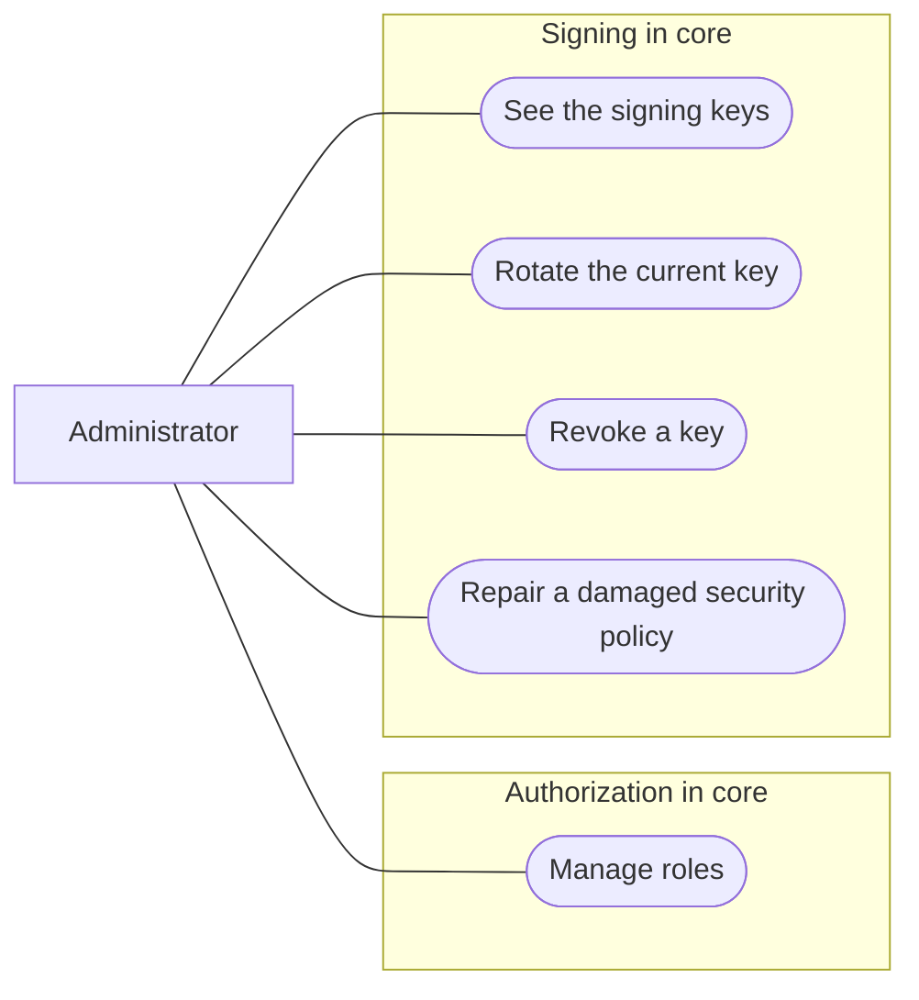

### AI agent

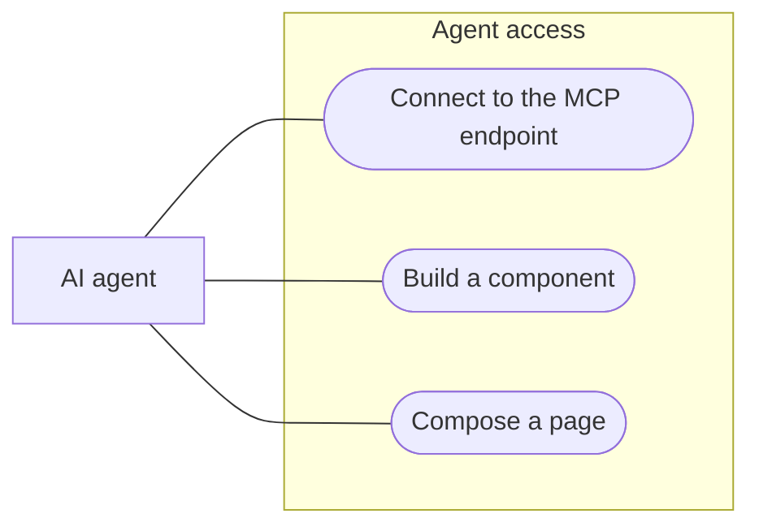

### Authentication provider

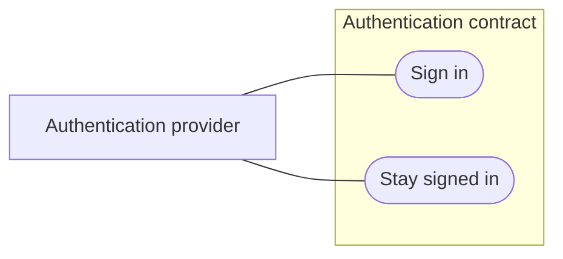

### Browser automation

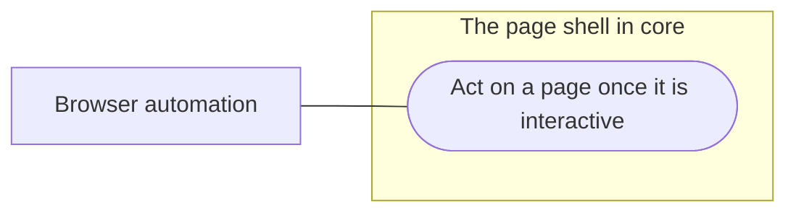

### Consuming site

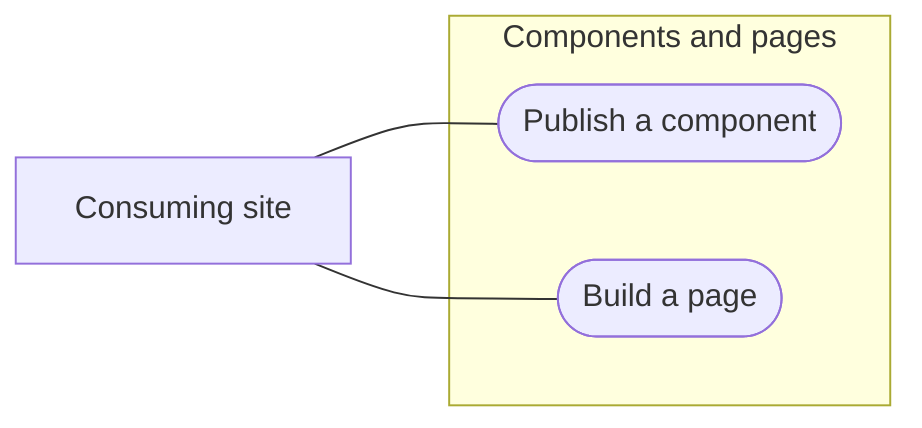

### Document editor

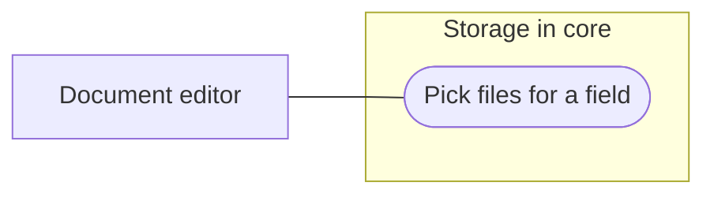

### Google Cloud

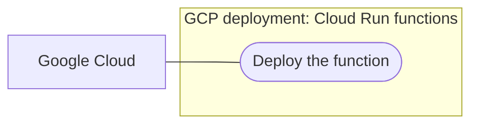

### Operator

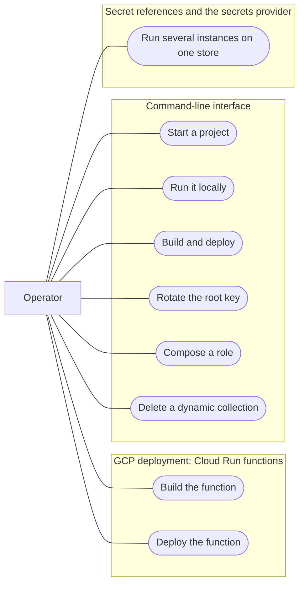

### Storage browser

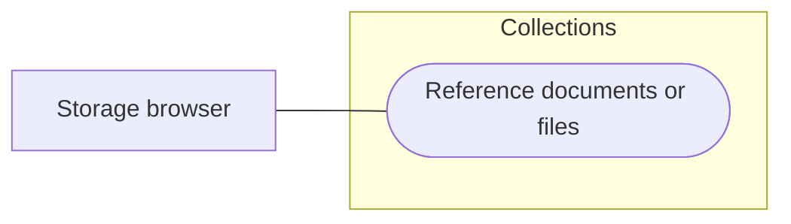

### User

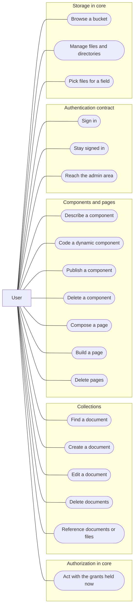

### Visitor

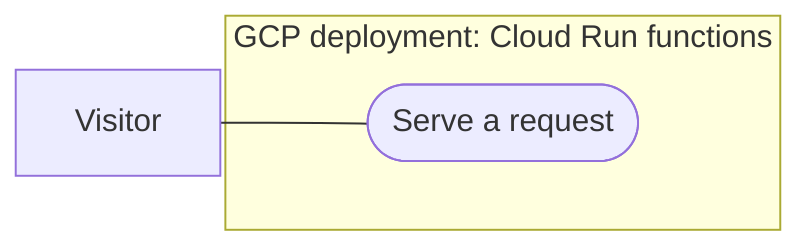

## Statements

| Statement | Levels | Named by | Document |
| :-- | :-- | :-- | :-- |
| ADM-1 · Administration reads strictly and writes conditionally | integration | — | [architecture/authorization.md](architecture/authorization.md) |
| ADM-2 · Changing roles | unit | — | [architecture/authorization.md](architecture/authorization.md) |
| ADM-3 · Changing accounts | unit | — | [architecture/authorization.md](architecture/authorization.md) |
| ADP-1 · Options | e2e | GJ1a | [architecture/adapter-gcp/deployment.md](architecture/adapter-gcp/deployment.md) |
| ADP-2 · Assets | e2e | GJ1a | [architecture/adapter-gcp/deployment.md](architecture/adapter-gcp/deployment.md) |
| ADP-3 · Server bundle | e2e | GJ1a | [architecture/adapter-gcp/deployment.md](architecture/adapter-gcp/deployment.md) |
| ADP-4 · Entry and initialization | e2e | GJ1a, GJ3a | [architecture/adapter-gcp/deployment.md](architecture/adapter-gcp/deployment.md) |
| ADP-5 · Middleware chain and request URL | unit, e2e | GJ3a | [architecture/adapter-gcp/deployment.md](architecture/adapter-gcp/deployment.md) |
| ADP-6 · Client address | unit, e2e | GJ3a | [architecture/adapter-gcp/deployment.md](architecture/adapter-gcp/deployment.md) |
| ADP-7 · Startup environment | unit, e2e | GJ3b | [architecture/adapter-gcp/deployment.md](architecture/adapter-gcp/deployment.md) |
| ADP-8 · A runtime origin is refused | unit, e2e | GJ3b | [architecture/adapter-gcp/deployment.md](architecture/adapter-gcp/deployment.md) |
| AGT-1 · Declaring agents in Tier 1 | unit | — | [architecture/agent-access.md](architecture/agent-access.md) |
| AGT-2 · Agents stored in Tier 2 | unit | — | [architecture/agent-access.md](architecture/agent-access.md) |
| AGT-3 · Administering agents | unit | — | [architecture/agent-access.md](architecture/agent-access.md) |
| AGT-4 · Agents and people stay apart | unit, e2e | TJ1b | [architecture/agent-access.md](architecture/agent-access.md) |
| AGT-5 · The ceiling | unit | — | [architecture/agent-access.md](architecture/agent-access.md) |
| AGT-6 · An agent's authority | unit | — | [architecture/agent-access.md](architecture/agent-access.md) |
| ART-1 · Where the artifact is | unit | — | [architecture/build.md](architecture/build.md) |
| ART-2 · Its dependencies | unit | — | [architecture/build.md](architecture/build.md) |
| ART-3 · Imports the scan cannot see | unit | — | [architecture/build.md](architecture/build.md) |
| ART-4 · Installed versions | unit | — | [architecture/build.md](architecture/build.md) |
| ASM-1 · Descriptor | unit | — | [architecture/adapter-aws/secrets.md](architecture/adapter-aws/secrets.md) |
| ASM-2 · Keys are secret names | unit, contract | — | [architecture/adapter-aws/secrets.md](architecture/adapter-aws/secrets.md) |
| ASM-3 · Reading | unit, contract | — | [architecture/adapter-aws/secrets.md](architecture/adapter-aws/secrets.md) |
| ASM-4 · Overwriting | unit, contract | — | [architecture/adapter-aws/secrets.md](architecture/adapter-aws/secrets.md) |
| ASM-5 · Atomic claim | unit, contract | — | [architecture/adapter-aws/secrets.md](architecture/adapter-aws/secrets.md) |
| ASM-6 · Deleting | unit, contract | — | [architecture/adapter-aws/secrets.md](architecture/adapter-aws/secrets.md) |
| AUTH-1 · Descriptor | unit | — | [architecture/adapter-gcp/authentication-identity-platform.md](architecture/adapter-gcp/authentication-identity-platform.md) |
| AUTH-2 · One sign-in call | unit, contract | — | [architecture/adapter-gcp/authentication-identity-platform.md](architecture/adapter-gcp/authentication-identity-platform.md) |
| AUTH-3 · Success | unit, contract | — | [architecture/adapter-gcp/authentication-identity-platform.md](architecture/adapter-gcp/authentication-identity-platform.md) |
| AUTH-4 · Second factor required | unit | — | [architecture/adapter-gcp/authentication-identity-platform.md](architecture/adapter-gcp/authentication-identity-platform.md) |
| AUTH-5 · Rejected credentials | unit, contract | — | [architecture/adapter-gcp/authentication-identity-platform.md](architecture/adapter-gcp/authentication-identity-platform.md) |
| AUTH-6 · Throttled | unit | — | [architecture/adapter-gcp/authentication-identity-platform.md](architecture/adapter-gcp/authentication-identity-platform.md) |
| AUTH-7 · Provider failure | unit, contract | — | [architecture/adapter-gcp/authentication-identity-platform.md](architecture/adapter-gcp/authentication-identity-platform.md) |
| AUTH-8 · Tokens are discarded | unit | — | [architecture/adapter-gcp/authentication-identity-platform.md](architecture/adapter-gcp/authentication-identity-platform.md) |
| AUTH-9 · No management capability | unit | — | [architecture/adapter-gcp/authentication-identity-platform.md](architecture/adapter-gcp/authentication-identity-platform.md) |
| AUTH-10 · getIdentity | unit, contract | — | [architecture/adapter-gcp/authentication-identity-platform.md](architecture/adapter-gcp/authentication-identity-platform.md) |
| AUTHN-1 · Identity | unit | — | [architecture/contracts/authentication.md](architecture/contracts/authentication.md) |
| AUTHN-2 · authenticate | unit, conformance | — | [architecture/contracts/authentication.md](architecture/contracts/authentication.md) |
| AUTHN-3 · Failures throw | unit | — | [architecture/contracts/authentication.md](architecture/contracts/authentication.md) |
| AUTHN-4 · getIdentity | unit, conformance | — | [architecture/contracts/authentication.md](architecture/contracts/authentication.md) |
| AUTHN-5 · Sign-in | unit, e2e | CJ1a, CJ1b, CJ1c | [architecture/contracts/authentication.md](architecture/contracts/authentication.md) |
| AUTHN-6 · A session records its provider | unit, e2e | CJ1a, CJ2a, CJ2c | [architecture/contracts/authentication.md](architecture/contracts/authentication.md) |
| AUTHN-7 · A refresh revalidates the session | unit, e2e | CJ2a, CJ2b, CJ2c | [architecture/contracts/authentication.md](architecture/contracts/authentication.md) |
| AUTHN-8 · Limits before any provider (new) | unit, e2e | — | [architecture/contracts/authentication.md](architecture/contracts/authentication.md) |
| AUTHN-9 · Recording failures (new) | unit, e2e | — | [architecture/contracts/authentication.md](architecture/contracts/authentication.md) |
| AUTHN-10 · The counter objects (new) | unit, integration | — | [architecture/contracts/authentication.md](architecture/contracts/authentication.md) |
| AUTHN-11 · The limits are security policy (new) | unit | — | [architecture/contracts/authentication.md](architecture/contracts/authentication.md) |
| AUTHN-12 · The admin area needs a session | e2e | CJ3a | [architecture/contracts/authentication.md](architecture/contracts/authentication.md) |
| AWS-1 · Credentials shape | unit | — | [architecture/adapter-aws/README.md](architecture/adapter-aws/README.md) |
| AWS-2 · Unknown options are refused | unit | — | [architecture/adapter-aws/README.md](architecture/adapter-aws/README.md) |
| AWS-3 · Required string options | unit | — | [architecture/adapter-aws/README.md](architecture/adapter-aws/README.md) |
| AWS-4 · One client per provider, the default chain by default | unit | — | [architecture/adapter-aws/README.md](architecture/adapter-aws/README.md) |
| BLD-1 · The facts Vite receives | unit | — | [architecture/build.md](architecture/build.md) |
| BLD-2 · The SvelteKit adapter and origin | unit | — | [architecture/build.md](architecture/build.md) |
| BLD-3 · No provider while SvelteKit analyses the build | unit | — | [architecture/build.md](architecture/build.md) |
| BRW-1 · Pages | e2e | BJ1a | [architecture/storage.md](architecture/storage.md) |
| BRW-2 · A directory in the path | e2e | BJ1a | [architecture/storage.md](architecture/storage.md) |
| BRW-3 · A directory | e2e | BJ1a | [architecture/storage.md](architecture/storage.md) |
| BRW-4 · The toolbar | e2e | BJ2a | [architecture/storage.md](architecture/storage.md) |
| BRW-5 · Selecting | unit, e2e | BJ2d | [architecture/storage.md](architecture/storage.md) |
| BRW-6 · Uploading | e2e | BJ2a | [architecture/storage.md](architecture/storage.md) |
| BRW-7 · Creating a directory | e2e | BJ2b | [architecture/storage.md](architecture/storage.md) |
| BRW-8 · Renaming | e2e | BJ2c | [architecture/storage.md](architecture/storage.md) |
| BRW-9 · Moving here | e2e | BJ2d | [architecture/storage.md](architecture/storage.md) |
| BRW-10 · Deleting | e2e | BJ2e | [architecture/storage.md](architecture/storage.md) |
| BRW-11 · Malformed submissions | unit | — | [architecture/storage.md](architecture/storage.md) |
| BRW-12 · The browser as a picker | e2e | BJ3a | [architecture/storage.md](architecture/storage.md) |
| BRW-13 · Names a user types | unit, e2e | BJ2a, BJ2b | [architecture/storage.md](architecture/storage.md) |
| BRW-14 · Acting on several items | unit, e2e | BJ2a, BJ2f | [architecture/storage.md](architecture/storage.md) |
| BRW-15 · Showing more | e2e | BJ1b | [architecture/storage.md](architecture/storage.md) |
| BRW-16 · Denials | unit, e2e | BJ2g, BJ2h | [architecture/storage.md](architecture/storage.md) |
| CFG-1 · Where the config is | unit | — | [architecture/configuration.md](architecture/configuration.md) |
| CFG-2 · Evaluating the config | unit | — | [architecture/configuration.md](architecture/configuration.md) |
| CFG-3 · The config's shape | unit | — | [architecture/configuration.md](architecture/configuration.md) |
| CFG-4 · Authoring helpers | unit | — | [architecture/configuration.md](architecture/configuration.md) |
| CLI-1 · Arguments | unit | — | [architecture/cli.md](architecture/cli.md) |
| CLI-2 · Commands and default modes | unit | — | [architecture/cli.md](architecture/cli.md) |
| CLI-3 · Project | unit | — | [architecture/cli.md](architecture/cli.md) |
| CLI-4 · Failure | integration | — | [architecture/cli.md](architecture/cli.md) |
| CLI-5 · Environment for Vite | unit | — | [architecture/cli.md](architecture/cli.md) |
| CLI-6 · dev | unit | LJ2 | [architecture/cli.md](architecture/cli.md) |
| CLI-7 · build | unit | LJ3a | [architecture/cli.md](architecture/cli.md) |
| CLI-8 · deploy | unit | LJ3a | [architecture/cli.md](architecture/cli.md) |
| CLI-9 · rotate-root | unit | LJ4 | [architecture/cli.md](architecture/cli.md) |
| CLI-10 · database | unit | LJ6 | [architecture/cli.md](architecture/cli.md) |
| CLI-11 · roles | unit | LJ5 | [architecture/cli.md](architecture/cli.md) |
| CLI-12 · init | unit | LJ1 | [architecture/cli.md](architecture/cli.md) |
| CLI-13 · init's templates | unit | LJ1 | [architecture/cli.md](architecture/cli.md) |
| CLI-14 · Usage | integration | — | [architecture/cli.md](architecture/cli.md) |
| CLI-15 · A command's usage | integration | — | [architecture/cli.md](architecture/cli.md) |
| CLI-16 · Version | integration | — | [architecture/cli.md](architecture/cli.md) |
| CLI-17 · Unknown command | integration | — | [architecture/cli.md](architecture/cli.md) |
| CLI-18 · No command | unit, integration | — | [architecture/cli.md](architecture/cli.md) |
| CLI-19 · Naming the production config | unit, integration | — | [architecture/cli.md](architecture/cli.md) |
| CLI-20 · The `genoa` command | integration | — | [architecture/cli.md](architecture/cli.md) |
| CLI-21 · Building from the published packages | e2e | LJ3a | [architecture/cli.md](architecture/cli.md) |
| CMP-1 · What is stored, and where | unit | NJ1a | [architecture/components.md](architecture/components.md) |
| CMP-2 · A component header | unit | — | [architecture/components.md](architecture/components.md) |
| CMP-3 · Attributes | unit, e2e | NJ1a | [architecture/components.md](architecture/components.md) |
| CMP-4 · A valid header | unit | — | [architecture/components.md](architecture/components.md) |
| CMP-5 · Attribute names | unit | — | [architecture/components.md](architecture/components.md) |
| CMP-6 · Registering a component | unit, e2e | NJ1a, TJ2a | [architecture/components.md](architecture/components.md) |
| CMP-7 · Reading the catalog | unit, e2e | NJ1a | [architecture/components.md](architecture/components.md) |
| CMP-8 · Saving a header | unit, e2e | NJ1a, NJ1b | [architecture/components.md](architecture/components.md) |
| CMP-9 · Deleting a component | unit, e2e | NJ4a, NJ4b, NJ4c | [architecture/components.md](architecture/components.md) |
| CMP-10 · The pages that pin a component | unit, e2e | NJ4b | [architecture/components.md](architecture/components.md) |
| CMP-11 · Component permissions | unit | — | [architecture/components.md](architecture/components.md) |
| COL-1 · Where collections come from | unit, e2e | OJ1a, OJ1c | [architecture/collections.md](architecture/collections.md) |
| COL-2 · Resolving a definition | unit, e2e | OJ1c, OJ1d | [architecture/collections.md](architecture/collections.md) |
| COL-3 · The catalog a principal sees | unit, e2e | OJ1a | [architecture/collections.md](architecture/collections.md) |
| COL-4 · A collection definition | unit | — | [architecture/collections.md](architecture/collections.md) |
| COL-5 · Schema helpers for references and files | unit | — | [architecture/collections.md](architecture/collections.md) |
| COL-6 · The database of a collection | unit, e2e | OJ1a, OJ1c | [architecture/collections.md](architecture/collections.md) |
| COL-7 · A signed dynamic definition | unit, e2e | OJ1c, OJ1d | [architecture/collections.md](architecture/collections.md) |
| COM-1 · Service-account shape | unit | — | [architecture/adapter-gcp/README.md](architecture/adapter-gcp/README.md) |
| COM-2 · Unknown options are refused | unit | — | [architecture/adapter-gcp/README.md](architecture/adapter-gcp/README.md) |
| COM-3 · Required string options | unit | — | [architecture/adapter-gcp/README.md](architecture/adapter-gcp/README.md) |
| COM-4 · One client per provider, ADC by default | unit | — | [architecture/adapter-gcp/README.md](architecture/adapter-gcp/README.md) |
| CONF-1 · Calling a suite registers it | conformance | — | [architecture/contracts/conformance.md](architecture/contracts/conformance.md) |
| CONF-2 · The storage suite | conformance | — | [architecture/contracts/conformance.md](architecture/contracts/conformance.md) |
| CONF-3 · The database suite | conformance | — | [architecture/contracts/conformance.md](architecture/contracts/conformance.md) |
| CONF-4 · The authentication suite | conformance | — | [architecture/contracts/conformance.md](architecture/contracts/conformance.md) |
| CONF-5 · The identity-store suite (new) | conformance | — | [architecture/contracts/conformance.md](architecture/contracts/conformance.md) |
| CONF-6 · Each assertion fails against a mutant (new) | conformance | — | [architecture/contracts/conformance.md](architecture/contracts/conformance.md) |
| DATA-1 · Collections, references and snapshots | unit | — | [architecture/contracts/database.md](architecture/contracts/database.md) |
| DATA-2 · Values | unit, conformance, contract | — | [architecture/contracts/database.md](architecture/contracts/database.md) |
| DATA-3 · The key | unit, conformance, contract | — | [architecture/contracts/database.md](architecture/contracts/database.md) |
| DATA-4 · Creating a document | unit, conformance, contract | — | [architecture/contracts/database.md](architecture/contracts/database.md) |
| DATA-5 · Reading a document | unit, conformance, contract | — | [architecture/contracts/database.md](architecture/contracts/database.md) |
| DATA-6 · Updating a document | unit, conformance, contract | — | [architecture/contracts/database.md](architecture/contracts/database.md) |
| DATA-7 · Deleting a document | unit, conformance, contract | — | [architecture/contracts/database.md](architecture/contracts/database.md) |
| DATA-8 · Query parameters | unit, conformance | — | [architecture/contracts/database.md](architecture/contracts/database.md) |
| DATA-9 · Which documents match | unit, conformance, contract | — | [architecture/contracts/database.md](architecture/contracts/database.md) |
| DATA-10 · Pages | unit, conformance, contract | — | [architecture/contracts/database.md](architecture/contracts/database.md) |
| DATA-11 · A query the store cannot serve | unit | — | [architecture/contracts/database.md](architecture/contracts/database.md) |
| DATA-12 · Errors | unit | — | [architecture/contracts/database.md](architecture/contracts/database.md) |
| DB-1 · Descriptor | unit | — | [architecture/adapter-gcp/database.md](architecture/adapter-gcp/database.md) |
| DB-2 · One client per provider | unit | — | [architecture/adapter-gcp/database.md](architecture/adapter-gcp/database.md) |
| DB-3 · Collections by name | unit, contract | — | [architecture/adapter-gcp/database.md](architecture/adapter-gcp/database.md) |
| DB-4 · Creating a document | unit, contract | — | [architecture/adapter-gcp/database.md](architecture/adapter-gcp/database.md) |
| DB-5 · Reading a collection | unit, contract | — | [architecture/adapter-gcp/database.md](architecture/adapter-gcp/database.md) |
| DB-6 · Reading a document | unit, contract | — | [architecture/adapter-gcp/database.md](architecture/adapter-gcp/database.md) |
| DB-7 · Updating and deleting | unit, contract | — | [architecture/adapter-gcp/database.md](architecture/adapter-gcp/database.md) |
| DDB-1 · Descriptor | unit | — | [architecture/adapter-aws/database.md](architecture/adapter-aws/database.md) |
| DDB-2 · Collections are tables | unit, contract | — | [architecture/adapter-aws/database.md](architecture/adapter-aws/database.md) |
| DDB-3 · Values | unit, contract | — | [architecture/adapter-aws/database.md](architecture/adapter-aws/database.md) |
| DDB-4 · Creating a document | unit, contract | — | [architecture/adapter-aws/database.md](architecture/adapter-aws/database.md) |
| DDB-5 · Reading a collection | unit, contract | — | [architecture/adapter-aws/database.md](architecture/adapter-aws/database.md) |
| DDB-6 · Reading a document | unit, contract | — | [architecture/adapter-aws/database.md](architecture/adapter-aws/database.md) |
| DDB-7 · Updating and deleting | unit, contract | — | [architecture/adapter-aws/database.md](architecture/adapter-aws/database.md) |
| DEP-1 · Descriptor | unit | — | [architecture/adapter-gcp/deployment.md](architecture/adapter-gcp/deployment.md) |
| DEP-2 · Options | unit | — | [architecture/adapter-gcp/deployment.md](architecture/adapter-gcp/deployment.md) |
| DEP-3 · Function settings | unit | — | [architecture/adapter-gcp/deployment.md](architecture/adapter-gcp/deployment.md) |
| DEP-4 · Setting validation | unit | — | [architecture/adapter-gcp/deployment.md](architecture/adapter-gcp/deployment.md) |
| DEP-5 · No working directory | unit | — | [architecture/adapter-gcp/deployment.md](architecture/adapter-gcp/deployment.md) |
| DEP-6 · Staging | integration | GJ2a | [architecture/adapter-gcp/deployment.md](architecture/adapter-gcp/deployment.md) |
| DEP-7 · Archive | integration | GJ2a | [architecture/adapter-gcp/deployment.md](architecture/adapter-gcp/deployment.md) |
| DEP-8 · Upload | unit, contract | GJ2a | [architecture/adapter-gcp/deployment.md](architecture/adapter-gcp/deployment.md) |
| DEP-9 · Lookup | unit, contract | GJ2a | [architecture/adapter-gcp/deployment.md](architecture/adapter-gcp/deployment.md) |
| DEP-10 · Create or update | unit, contract | GJ2a, GJ3a | [architecture/adapter-gcp/deployment.md](architecture/adapter-gcp/deployment.md) |
| DEP-11 · Completion | unit, contract | GJ2a | [architecture/adapter-gcp/deployment.md](architecture/adapter-gcp/deployment.md) |
| DEP-12 · Function URL | unit, contract | GJ2a | [architecture/adapter-gcp/deployment.md](architecture/adapter-gcp/deployment.md) |
| DEP-13 · Operator credentials | unit, contract | — | [architecture/adapter-gcp/deployment.md](architecture/adapter-gcp/deployment.md) |
| DEP-14 · Origin and client-address settings | unit | — | [architecture/adapter-gcp/deployment.md](architecture/adapter-gcp/deployment.md) |
| DOC-1 · Permission per operation | unit | OJ1a | [architecture/collections.md](architecture/collections.md) |
| DOC-2 · Reads return only readable fields | unit | OJ1a | [architecture/collections.md](architecture/collections.md) |
| DOC-3 · Updates keep what the writer may not write | unit | OJ3a | [architecture/collections.md](architecture/collections.md) |
| DOC-4 · Creation drops what the writer may not write | unit | OJ2a | [architecture/collections.md](architecture/collections.md) |
| DOC-5 · Creating and updating from the editor | unit, e2e | OJ2a, OJ3a | [architecture/collections.md](architecture/collections.md) |
| DOC-6 · Deleting one document | e2e | OJ4b | [architecture/collections.md](architecture/collections.md) |
| DOC-7 · Deleting several documents | unit, e2e | OJ4a | [architecture/collections.md](architecture/collections.md) |
| DOC-8 · Documents are validated against the schema | unit | OJ2a, OJ3a | [architecture/collections.md](architecture/collections.md) |
| DST-1 · Its descriptor | unit | — | [architecture/secrets.md](architecture/secrets.md) |
| DST-2 · It needs the project | unit | — | [architecture/secrets.md](architecture/secrets.md) |
| DST-3 · Its file | unit | — | [architecture/secrets.md](architecture/secrets.md) |
| DST-4 · What a read sees | unit | — | [architecture/secrets.md](architecture/secrets.md) |
| DST-5 · Writes and deletions | unit | — | [architecture/secrets.md](architecture/secrets.md) |
| DST-6 · Claims across processes | unit | — | [architecture/secrets.md](architecture/secrets.md) |
| DST-7 · The file's format | unit | — | [architecture/secrets.md](architecture/secrets.md) |
| DST-8 · Keys in every method | unit | — | [architecture/secrets.md](architecture/secrets.md) |
| EDT-1 · The document page | e2e | OJ3a, OJ4b, OJ4c | [architecture/collections.md](architecture/collections.md) |
| EDT-2 · Saving | e2e | OJ3a, OJ3d | [architecture/collections.md](architecture/collections.md) |
| EDT-3 · Leaving with unsaved changes | e2e | OJ3b, OJ4b | [architecture/collections.md](architecture/collections.md) |
| EDT-4 · The control for each field | unit, e2e | OJ3a | [architecture/collections.md](architecture/collections.md) |
| EDT-5 · Defaults on mount | unit | — | [architecture/collections.md](architecture/collections.md) |
| EDT-6 · Labels and hints | e2e | OJ3a | [architecture/collections.md](architecture/collections.md) |
| EDT-7 · Numbers | unit | — | [architecture/collections.md](architecture/collections.md) |
| EDT-8 · Choices | unit | — | [architecture/collections.md](architecture/collections.md) |
| EDT-9 · The editor's document | unit | — | [architecture/collections.md](architecture/collections.md) |
| EDT-10 · Markdown | e2e | OJ3a | [architecture/collections.md](architecture/collections.md) |
| EDT-11 · Lists | e2e | OJ3c | [architecture/collections.md](architecture/collections.md) |
| EDT-12 · Objects and variants | unit, e2e | OJ3c | [architecture/collections.md](architecture/collections.md) |
| ENF-1 · Every operation is checked first | unit | — | [architecture/authorization.md](architecture/authorization.md) |
| ENF-2 · No principal, no operation | integration | — | [architecture/authorization.md](architecture/authorization.md) |
| ENF-3 · Configuration permissions | unit | ZJ1a | [architecture/authorization.md](architecture/authorization.md) |
| ENF-4 · Interface gates | unit | — | [architecture/authorization.md](architecture/authorization.md) |
| ENV-1 · The envelope | unit | — | [architecture/signing.md](architecture/signing.md) |
| ENV-2 · What the signature covers | unit | — | [architecture/signing.md](architecture/signing.md) |
| ENV-3 · The algorithms | unit | — | [architecture/signing.md](architecture/signing.md) |
| ENV-4 · Key ids | unit | — | [architecture/signing.md](architecture/signing.md) |
| ENV-5 · Verifying an envelope | unit | — | [architecture/signing.md](architecture/signing.md) |
| ENV-6 · The registered algorithm | unit | — | [architecture/signing.md](architecture/signing.md) |
| FAUTH-1 · Descriptor (new) | unit | — | [architecture/adapter-gcp/authentication-firestore.md](architecture/adapter-gcp/authentication-firestore.md) |
| FAUTH-2 · Layout (new) | unit, contract | — | [architecture/adapter-gcp/authentication-firestore.md](architecture/adapter-gcp/authentication-firestore.md) |
| FAUTH-3 · Sign-in and lookup (new) | unit, contract | — | [architecture/adapter-gcp/authentication-firestore.md](architecture/adapter-gcp/authentication-firestore.md) |
| FAUTH-4 · Failures (new) | unit, contract | — | [architecture/adapter-gcp/authentication-firestore.md](architecture/adapter-gcp/authentication-firestore.md) |
| GRT-1 · The vocabulary | unit | — | [architecture/authorization.md](architecture/authorization.md) |
| GRT-2 · A grant | unit | — | [architecture/authorization.md](architecture/authorization.md) |
| GRT-3 · A grant meets a demand | unit | — | [architecture/authorization.md](architecture/authorization.md) |
| GRT-4 · A demand names its resource exactly when it must | unit | — | [architecture/authorization.md](architecture/authorization.md) |
| GRT-5 · A denial | unit | — | [architecture/authorization.md](architecture/authorization.md) |
| GRT-6 · Permitted fields | unit | — | [architecture/authorization.md](architecture/authorization.md) |
| GRT-7 · Roles | unit | — | [architecture/authorization.md](architecture/authorization.md) |
| HIS-1 · Undo and redo | unit, e2e | NJ1b, NJ2a, NJ5b, NJ5c | [architecture/components.md](architecture/components.md) |
| HIS-2 · Saves are conditional | unit, e2e | NJ1a, NJ2a, NJ2c, NJ5b | [architecture/components.md](architecture/components.md) |
| HST-1 · A host does no I/O when created | unit | — | [architecture/host.md](architecture/host.md) |
| HST-2 · One construction per provider | unit | — | [architecture/host.md](architecture/host.md) |
| HST-3 · What a construction does | unit | — | [architecture/host.md](architecture/host.md) |
| HST-4 · Routing | unit | — | [architecture/host.md](architecture/host.md) |
| HST-5 · Languages | unit | — | [architecture/host.md](architecture/host.md) |
| HST-6 · The config's data | unit | — | [architecture/host.md](architecture/host.md) |
| HST-7 · Closing | unit | — | [architecture/host.md](architecture/host.md) |
| HST-8 · The host ships inside the server bundle | unit | — | [architecture/host.md](architecture/host.md) |
| IDS-1 · Email normalization (new) | unit, conformance | — | [architecture/identities.md](architecture/identities.md) |
| IDS-2 · The identity record (new) | unit, conformance | — | [architecture/identities.md](architecture/identities.md) |
| IDS-3 · New subjects (new) | unit, conformance | — | [architecture/identities.md](architecture/identities.md) |
| IDS-4 · Sign-in (new) | unit, conformance | — | [architecture/identities.md](architecture/identities.md) |
| IDS-5 · Store failures (new) | unit, conformance | — | [architecture/identities.md](architecture/identities.md) |
| IDS-6 · getIdentity (new) | unit, conformance | — | [architecture/identities.md](architecture/identities.md) |
| KEY-1 · The screen | e2e | YJ1a, YJ1b | [architecture/signing.md](architecture/signing.md) |
| KEY-2 · What it shows | e2e | YJ1a | [architecture/signing.md](architecture/signing.md) |
| KEY-3 · Rotating | e2e | YJ2a, YJ3b | [architecture/signing.md](architecture/signing.md) |
| KEY-4 · Revoking | e2e | YJ3a, YJ3b | [architecture/signing.md](architecture/signing.md) |
| LDR-1 · Stanzas and provider entries | unit | — | [architecture/configuration.md](architecture/configuration.md) |
| LDR-2 · Data only | unit | — | [architecture/configuration.md](architecture/configuration.md) |
| LDR-3 · Each adapter under its own service | unit | — | [architecture/configuration.md](architecture/configuration.md) |
| LDR-4 · The descriptor's validation | unit | — | [architecture/configuration.md](architecture/configuration.md) |
| LDR-5 · Credential fields hold references | unit | — | [architecture/configuration.md](architecture/configuration.md) |
| LDR-6 · References only in credential fields | unit | — | [architecture/configuration.md](architecture/configuration.md) |
| LDR-7 · The bootstrap rule | unit | — | [architecture/configuration.md](architecture/configuration.md) |
| LDR-8 · Secret keys | unit | — | [architecture/configuration.md](architecture/configuration.md) |
| LDR-9 · One secrets store | unit | — | [architecture/configuration.md](architecture/configuration.md) |
| LDR-10 · Names that must exist | unit | — | [architecture/configuration.md](architecture/configuration.md) |
| LDR-11 · The default bucket | unit | — | [architecture/configuration.md](architecture/configuration.md) |
| LDR-12 · No integer-like keys | unit | — | [architecture/configuration.md](architecture/configuration.md) |
| LDR-13 · Development-only adapters | unit | — | [architecture/configuration.md](architecture/configuration.md) |
| LDR-14 · Inline values in production | unit | — | [architecture/configuration.md](architecture/configuration.md) |
| LDR-15 · Every issue at once | unit | — | [architecture/configuration.md](architecture/configuration.md) |
| LDR-16 · Descriptors load from the project | unit | — | [architecture/configuration.md](architecture/configuration.md) |
| LDR-17 · The manifest | unit | — | [architecture/configuration.md](architecture/configuration.md) |
| LDR-18 · One load per file, mode and inline rule | unit | — | [architecture/configuration.md](architecture/configuration.md) |
| LDR-19 · The runtime manifest | unit | — | [architecture/configuration.md](architecture/configuration.md) |
| LDR-20 · The manifest in Vite | unit | — | [architecture/configuration.md](architecture/configuration.md) |
| LDR-21 · Config edits restart the dev server | unit | — | [architecture/configuration.md](architecture/configuration.md) |
| LDR-22 · The secrets prefix | unit | — | [architecture/configuration.md](architecture/configuration.md) |
| LMB-1 · Descriptor | unit | — | [architecture/adapter-aws/deployment.md](architecture/adapter-aws/deployment.md) |
| LMB-2 · Options | unit | — | [architecture/adapter-aws/deployment.md](architecture/adapter-aws/deployment.md) |
| LMB-3 · Option validation | unit | — | [architecture/adapter-aws/deployment.md](architecture/adapter-aws/deployment.md) |
| LMB-4 · Staging | integration | — | [architecture/adapter-aws/deployment.md](architecture/adapter-aws/deployment.md) |
| LMB-5 · Installing dependencies | integration | — | [architecture/adapter-aws/deployment.md](architecture/adapter-aws/deployment.md) |
| LMB-6 · Archive | integration | — | [architecture/adapter-aws/deployment.md](architecture/adapter-aws/deployment.md) |
| LMB-7 · Upload | unit, contract | — | [architecture/adapter-aws/deployment.md](architecture/adapter-aws/deployment.md) |
| LMB-8 · Lookup | unit, contract | — | [architecture/adapter-aws/deployment.md](architecture/adapter-aws/deployment.md) |
| LMB-9 · Creating | unit, contract | — | [architecture/adapter-aws/deployment.md](architecture/adapter-aws/deployment.md) |
| LMB-10 · Environment | unit, contract | — | [architecture/adapter-aws/deployment.md](architecture/adapter-aws/deployment.md) |
| LMB-11 · Updating | unit, contract | — | [architecture/adapter-aws/deployment.md](architecture/adapter-aws/deployment.md) |
| LMB-12 · Completion | unit | — | [architecture/adapter-aws/deployment.md](architecture/adapter-aws/deployment.md) |
| LMB-13 · Function URL | unit, contract | — | [architecture/adapter-aws/deployment.md](architecture/adapter-aws/deployment.md) |
| LMB-14 · Operator credentials | unit, contract | — | [architecture/adapter-aws/deployment.md](architecture/adapter-aws/deployment.md) |
| LMB-15 · Entry and client address | integration, contract | — | [architecture/adapter-aws/deployment.md](architecture/adapter-aws/deployment.md) |
| LST-1 · The listing | unit, e2e | OJ1a | [architecture/collections.md](architecture/collections.md) |
| LST-2 · The toolbar | e2e | OJ2a, OJ4a | [architecture/collections.md](architecture/collections.md) |
| LST-3 · Selecting documents | e2e | OJ1b, OJ4a | [architecture/collections.md](architecture/collections.md) |
| LST-4 · Deleting the selection | e2e | OJ4a, OJ4c | [architecture/collections.md](architecture/collections.md) |
| LST-5 · The listing as a picker | e2e | OJ5a | [architecture/collections.md](architecture/collections.md) |
| LST-6 · Creating a document | e2e | OJ2a, OJ2b | [architecture/collections.md](architecture/collections.md) |
| LST-7 · Filtering the listing | unit, e2e | OJ1b | [architecture/collections.md](architecture/collections.md) |
| LST-8 · What a cell shows | unit, e2e | OJ1a | [architecture/collections.md](architecture/collections.md) |
| MAN-1 · Two signed manifests | unit | — | [architecture/authorization.md](architecture/authorization.md) |
| MAN-2 · An absent manifest is created signed | integration | — | [architecture/authorization.md](architecture/authorization.md) |
| MAN-3 · A rejected manifest is quarantined and replaced | unit, integration | — | [architecture/authorization.md](architecture/authorization.md) |
| MAN-4 · The manifests exist before the instance serves | integration | — | [architecture/authorization.md](architecture/authorization.md) |
| MCP-1 · The MCP endpoint | unit, e2e | TJ1a | [architecture/agent-access.md](architecture/agent-access.md) |
| MCP-2 · Authenticating a request | unit, e2e | TJ1a | [architecture/agent-access.md](architecture/agent-access.md) |
| MCP-3 · Failed tokens are limited per address (new) | unit | — | [architecture/agent-access.md](architecture/agent-access.md) |
| MCP-4 · Tool results | unit | — | [architecture/agent-access.md](architecture/agent-access.md) |
| MIO-1 · Descriptor | unit | — | [architecture/adapter-minio.md](architecture/adapter-minio.md) |
| MIO-2 · One client per provider | unit | — | [architecture/adapter-minio.md](architecture/adapter-minio.md) |
| MIO-3 · Only registered buckets | unit | — | [architecture/adapter-minio.md](architecture/adapter-minio.md) |
| MIO-4 · Reading an object | unit, conformance | — | [architecture/adapter-minio.md](architecture/adapter-minio.md) |
| MIO-5 · Public URL | unit | — | [architecture/adapter-minio.md](architecture/adapter-minio.md) |
| MIO-6 · Signed URL | unit | — | [architecture/adapter-minio.md](architecture/adapter-minio.md) |
| MIO-7 · Writing an object | unit, conformance | — | [architecture/adapter-minio.md](architecture/adapter-minio.md) |
| MIO-8 · Moving and deleting an object | unit, conformance | — | [architecture/adapter-minio.md](architecture/adapter-minio.md) |
| MIO-9 · Listing one level | unit, conformance | — | [architecture/adapter-minio.md](architecture/adapter-minio.md) |
| MIO-10 · Creating a directory | unit, conformance | — | [architecture/adapter-minio.md](architecture/adapter-minio.md) |
| MIO-11 · Deleting a directory | unit, conformance | — | [architecture/adapter-minio.md](architecture/adapter-minio.md) |
| MIO-12 · Moving a directory | unit, conformance | — | [architecture/adapter-minio.md](architecture/adapter-minio.md) |
| MIO-13 · Failures propagate | unit | — | [architecture/adapter-minio.md](architecture/adapter-minio.md) |
| MOD-1 · A service adapter | unit | — | [architecture/contracts/adapter-model.md](architecture/contracts/adapter-model.md) |
| MOD-2 · A deployment target | unit | — | [architecture/contracts/adapter-model.md](architecture/contracts/adapter-model.md) |
| MOD-3 · References and resolved options | unit | — | [architecture/contracts/adapter-model.md](architecture/contracts/adapter-model.md) |
| MOD-4 · Registries | unit | — | [architecture/contracts/adapter-model.md](architecture/contracts/adapter-model.md) |
| MOD-5 · Stamping the kind | unit | — | [architecture/contracts/adapter-model.md](architecture/contracts/adapter-model.md) |
| MOD-6 · The bootstrap rule in the types | unit | — | [architecture/contracts/adapter-model.md](architecture/contracts/adapter-model.md) |
| OBJ-1 · Descriptor | unit | — | [architecture/adapter-aws/storage.md](architecture/adapter-aws/storage.md) |
| OBJ-2 · Only registered buckets | unit | — | [architecture/adapter-aws/storage.md](architecture/adapter-aws/storage.md) |
| OBJ-3 · Reading an object | unit, contract | — | [architecture/adapter-aws/storage.md](architecture/adapter-aws/storage.md) |
| OBJ-4 · Public URL | unit | — | [architecture/adapter-aws/storage.md](architecture/adapter-aws/storage.md) |
| OBJ-5 · Signed URL | unit, contract | — | [architecture/adapter-aws/storage.md](architecture/adapter-aws/storage.md) |
| OBJ-6 · Conditional writes | unit, contract | — | [architecture/adapter-aws/storage.md](architecture/adapter-aws/storage.md) |
| OBJ-7 · Moving and deleting an object | unit, contract | — | [architecture/adapter-aws/storage.md](architecture/adapter-aws/storage.md) |
| OBJ-8 · Listing one level | unit, contract | — | [architecture/adapter-aws/storage.md](architecture/adapter-aws/storage.md) |
| OBJ-9 · Creating a directory | unit, contract | — | [architecture/adapter-aws/storage.md](architecture/adapter-aws/storage.md) |
| OBJ-10 · Deleting a directory | unit, contract | — | [architecture/adapter-aws/storage.md](architecture/adapter-aws/storage.md) |
| OBJ-11 · Moving a directory | unit, contract | — | [architecture/adapter-aws/storage.md](architecture/adapter-aws/storage.md) |
| PCK-1 · Opening a picker | e2e | OJ5a, OJ5b | [architecture/collections.md](architecture/collections.md) |
| PCK-2 · The picker protocol | e2e | BJ3a, OJ5a, OJ5b, OJ5c | [architecture/collections.md](architecture/collections.md) |
| PCK-3 · Applying a selection | unit | OJ5a | [architecture/collections.md](architecture/collections.md) |
| PCK-4 · Picked values | e2e | OJ5a, OJ5b | [architecture/collections.md](architecture/collections.md) |
| PGE-1 · A page entry | unit | — | [architecture/components.md](architecture/components.md) |
| PGE-2 · Creating a page | unit, e2e | NJ5a | [architecture/components.md](architecture/components.md) |
| PGE-3 · Opening a page | unit, e2e | NJ5a, NJ5b | [architecture/components.md](architecture/components.md) |
| PGE-4 · Editing a node | unit, e2e | NJ5b | [architecture/components.md](architecture/components.md) |
| PGE-5 · Adding a child node | unit, e2e | NJ5b | [architecture/components.md](architecture/components.md) |
| PGE-6 · The preview URL and files | unit, e2e | NJ5b | [architecture/components.md](architecture/components.md) |
| PGE-7 · Undoing and redoing a page | unit, e2e | NJ5c | [architecture/components.md](architecture/components.md) |
| PGE-8 · Deleting pages | unit, e2e | NJ7a | [architecture/components.md](architecture/components.md) |
| PGE-9 · Pages and the components they use | unit, e2e | NJ6a | [architecture/components.md](architecture/components.md) |
| PGE-10 · Page permissions | unit | — | [architecture/components.md](architecture/components.md) |
| PGE-11 · Page names | unit | — | [architecture/components.md](architecture/components.md) |
| PGE-12 · Editing a link | unit | — | [architecture/components.md](architecture/components.md) |
| POL-1 · The policy document | unit | — | [architecture/signing.md](architecture/signing.md) |
| POL-2 · The policy's sequence and mark | unit | YJ4, YJ4a, YJ4b | [architecture/signing.md](architecture/signing.md) |
| POL-3 · A damaged policy | unit, e2e | YJ4, YJ4a, YJ4b | [architecture/signing.md](architecture/signing.md) |
| POL-4 · What root rotation writes to the policy | unit | — | [architecture/signing.md](architecture/signing.md) |
| PUB-1 · Publishing | unit, e2e | NJ3a, NJ3c, TJ2a | [architecture/components.md](architecture/components.md) |
| PUB-2 · No change, no publication | unit | NJ3a | [architecture/components.md](architecture/components.md) |
| PUB-3 · Analysis and compilation | unit, e2e | NJ3a, NJ3b | [architecture/components.md](architecture/components.md) |
| PUB-4 · The publication | unit, e2e | NJ3a | [architecture/components.md](architecture/components.md) |
| PUB-5 · Writing a publication | unit, e2e | NJ3a, NJ3c | [architecture/components.md](architecture/components.md) |
| PUB-6 · What publishing answers | unit, e2e | NJ3a, NJ3b, NJ3c | [architecture/components.md](architecture/components.md) |
| PUB-7 · Composable components | unit, e2e | NJ5a | [architecture/components.md](architecture/components.md) |
| PWH-1 · Password bytes (new) | unit, conformance | — | [architecture/identities.md](architecture/identities.md) |
| PWH-2 · Hash string (new) | unit, conformance | — | [architecture/identities.md](architecture/identities.md) |
| PWH-3 · New hashes (new) | unit, conformance | — | [architecture/identities.md](architecture/identities.md) |
| PWH-4 · Verification (new) | unit, conformance | — | [architecture/identities.md](architecture/identities.md) |
| PWH-5 · Rehash on sign-in (new) | unit, conformance | — | [architecture/identities.md](architecture/identities.md) |
| PWH-6 · Test vectors (new) | unit, conformance | — | [architecture/identities.md](architecture/identities.md) |
| REF-1 · The three references | unit | — | [architecture/secrets.md](architecture/secrets.md) |
| REF-2 · Resolving a provider's options | unit | — | [architecture/secrets.md](architecture/secrets.md) |
| REF-3 · JSON credentials | unit | — | [architecture/secrets.md](architecture/secrets.md) |
| REF-4 · A bounded wait for the store | unit | — | [architecture/secrets.md](architecture/secrets.md) |
| REF-5 · One read per secret | unit | — | [architecture/secrets.md](architecture/secrets.md) |
| REF-6 · No value in an error | unit | — | [architecture/secrets.md](architecture/secrets.md) |
| REF-7 · The store is constructed from env() and inline() only | unit | — | [architecture/secrets.md](architecture/secrets.md) |
| REF-8 · The portable secret key | unit | — | [architecture/secrets.md](architecture/secrets.md) |
| REF-9 · An instance prefix | unit, e2e | SJ1a | [architecture/secrets.md](architecture/secrets.md) |
| REG-1 · The key manifest | unit | — | [architecture/signing.md](architecture/signing.md) |
| REG-2 · The key files | unit | — | [architecture/signing.md](architecture/signing.md) |
| REG-3 · Rotating and revoking | unit, e2e | YJ2a, YJ3b | [architecture/signing.md](architecture/signing.md) |
| REG-4 · The sequence and its mark | unit | — | [architecture/signing.md](architecture/signing.md) |
| REG-5 · What root rotation writes | unit | — | [architecture/signing.md](architecture/signing.md) |
| REG-6 · A manifest of the earlier type | unit | — | [architecture/signing.md](architecture/signing.md) |
| RES-1 · Resolving a subject | unit | — | [architecture/authorization.md](architecture/authorization.md) |
| RES-2 · Resolution reports what it worked around | unit | — | [architecture/authorization.md](architecture/authorization.md) |
| RES-3 · Every request is resolved | integration, e2e | ZJ2a | [architecture/authorization.md](architecture/authorization.md) |
| RES-4 · Resolutions are cached per subject | unit | — | [architecture/authorization.md](architecture/authorization.md) |
| ROL-1 · The roles screen | e2e | ZJ1a, ZJ1e | [architecture/authorization.md](architecture/authorization.md) |
| ROL-2 · A grant row | e2e | ZJ1a | [architecture/authorization.md](architecture/authorization.md) |
| ROL-3 · From rows to grants | e2e | ZJ1a | [architecture/authorization.md](architecture/authorization.md) |
| ROL-4 · Adding and removing rows | e2e | ZJ1a | [architecture/authorization.md](architecture/authorization.md) |
| ROL-5 · Creating, editing and deleting a role | e2e | ZJ1a, ZJ1b, ZJ1c, ZJ1d | [architecture/authorization.md](architecture/authorization.md) |
| SEC-1 · Descriptor | unit | — | [architecture/adapter-gcp/secrets.md](architecture/adapter-gcp/secrets.md) |
| SEC-2 · ADC without credentials | unit | — | [architecture/adapter-gcp/secrets.md](architecture/adapter-gcp/secrets.md) |
| SEC-3 · Reading the latest version | unit, contract | — | [architecture/adapter-gcp/secrets.md](architecture/adapter-gcp/secrets.md) |
| SEC-4 · Absence is only NOT_FOUND | unit, contract | — | [architecture/adapter-gcp/secrets.md](architecture/adapter-gcp/secrets.md) |
| SEC-5 · Overwriting | unit, contract | — | [architecture/adapter-gcp/secrets.md](architecture/adapter-gcp/secrets.md) |
| SEC-6 · Atomic claim | unit, contract | — | [architecture/adapter-gcp/secrets.md](architecture/adapter-gcp/secrets.md) |
| SEC-7 · Recovery window on create | unit, contract | — | [architecture/adapter-gcp/secrets.md](architecture/adapter-gcp/secrets.md) |
| SEC-8 · Destroying superseded versions | unit, contract | — | [architecture/adapter-gcp/secrets.md](architecture/adapter-gcp/secrets.md) |
| SEC-9 · Cleanup is best effort | unit | — | [architecture/adapter-gcp/secrets.md](architecture/adapter-gcp/secrets.md) |
| SEC-10 · Claims do not clean up | unit | — | [architecture/adapter-gcp/secrets.md](architecture/adapter-gcp/secrets.md) |
| SEC-11 · Deleting a secret | unit, contract | — | [architecture/adapter-gcp/secrets.md](architecture/adapter-gcp/secrets.md) |
| SHL-1 · The page marks when it is interactive | e2e | VJ1a | [architecture/shell.md](architecture/shell.md) |
| SRC-1 · A source definition | unit | — | [architecture/components.md](architecture/components.md) |
| SRC-2 · Opening a component's source | unit, e2e | NJ2a | [architecture/components.md](architecture/components.md) |
| SRC-3 · The signature preview | unit, e2e | NJ2a | [architecture/components.md](architecture/components.md) |
| SRC-4 · Saving a body | unit, e2e | NJ2a | [architecture/components.md](architecture/components.md) |
| SRC-5 · Leaving with unsaved changes | e2e | NJ2b | [architecture/components.md](architecture/components.md) |
| STO-1 · Descriptor | unit | — | [architecture/adapter-gcp/storage.md](architecture/adapter-gcp/storage.md) |
| STO-2 · ADC without credentials | unit | — | [architecture/adapter-gcp/storage.md](architecture/adapter-gcp/storage.md) |
| STO-3 · Only registered buckets | unit | — | [architecture/adapter-gcp/storage.md](architecture/adapter-gcp/storage.md) |
| STO-4 · Reads return the generation | unit, contract | — | [architecture/adapter-gcp/storage.md](architecture/adapter-gcp/storage.md) |
| STO-5 · Public URL | unit | — | [architecture/adapter-gcp/storage.md](architecture/adapter-gcp/storage.md) |
| STO-6 · Conditional writes | unit, contract | — | [architecture/adapter-gcp/storage.md](architecture/adapter-gcp/storage.md) |
| STO-7 · Moving and deleting an object | unit, contract | — | [architecture/adapter-gcp/storage.md](architecture/adapter-gcp/storage.md) |
| STO-8 · Signed URL | unit, contract | — | [architecture/adapter-gcp/storage.md](architecture/adapter-gcp/storage.md) |
| STO-9 · Listing one level | unit, contract | — | [architecture/adapter-gcp/storage.md](architecture/adapter-gcp/storage.md) |
| STO-10 · Creating a directory | unit, contract | — | [architecture/adapter-gcp/storage.md](architecture/adapter-gcp/storage.md) |
| STO-11 · Deleting a directory | unit, contract | — | [architecture/adapter-gcp/storage.md](architecture/adapter-gcp/storage.md) |
| STO-12 · Moving a directory | unit, contract | — | [architecture/adapter-gcp/storage.md](architecture/adapter-gcp/storage.md) |
| STOR-1 · The types that cross the contract | unit | — | [architecture/contracts/storage.md](architecture/contracts/storage.md) |
| STOR-2 · The adapter | unit, conformance | — | [architecture/contracts/storage.md](architecture/contracts/storage.md) |
| STOR-3 · Names are used as given | unit, conformance | — | [architecture/contracts/storage.md](architecture/contracts/storage.md) |
| STOR-4 · Only the provider's buckets | unit | — | [architecture/contracts/storage.md](architecture/contracts/storage.md) |
| STOR-5 · Reading an object | unit, conformance, contract | — | [architecture/contracts/storage.md](architecture/contracts/storage.md) |
| STOR-6 · Versions | conformance, contract | — | [architecture/contracts/storage.md](architecture/contracts/storage.md) |
| STOR-7 · Writing an object | unit, conformance, contract | — | [architecture/contracts/storage.md](architecture/contracts/storage.md) |
| STOR-8 · The precondition error | unit | — | [architecture/contracts/storage.md](architecture/contracts/storage.md) |
| STOR-9 · URLs | unit, contract | — | [architecture/contracts/storage.md](architecture/contracts/storage.md) |
| STOR-10 · Moving and deleting an object | unit, conformance, contract | — | [architecture/contracts/storage.md](architecture/contracts/storage.md) |
| STOR-11 · Listing one level | unit, conformance, contract | — | [architecture/contracts/storage.md](architecture/contracts/storage.md) |
| STOR-12 · Creating a directory | unit, conformance, contract | — | [architecture/contracts/storage.md](architecture/contracts/storage.md) |
| STOR-13 · Deleting a directory | unit, conformance, contract | — | [architecture/contracts/storage.md](architecture/contracts/storage.md) |
| STOR-14 · Moving a directory | unit, conformance, contract | — | [architecture/contracts/storage.md](architecture/contracts/storage.md) |
| STOR-15 · Failures propagate | unit | — | [architecture/contracts/storage.md](architecture/contracts/storage.md) |
| STOR-16 · A missing object | unit, conformance, contract | — | [architecture/contracts/storage.md](architecture/contracts/storage.md) |
| STS-1 · The buckets a principal sees | unit | BJ1a | [architecture/storage.md](architecture/storage.md) |
| STS-2 · A permission per operation | unit, e2e | BJ1a, BJ2a, BJ2e, BJ2g | [architecture/storage.md](architecture/storage.md) |
| STS-3 · Grants do not carry | unit | — | [architecture/storage.md](architecture/storage.md) |
| STS-4 · A listing carries signed URLs | unit | BJ1a | [architecture/storage.md](architecture/storage.md) |
| STS-5 · The CMS's state is read-only for users | unit, e2e | BJ2h | [architecture/storage.md](architecture/storage.md) |
| STS-6 · Objects read as text are decoded whole | unit | — | [architecture/storage.md](architecture/storage.md) |
| STS-7 · Signing one object's URL | unit | — | [architecture/storage.md](architecture/storage.md) |
| TGT-1 · Its descriptor | unit | — | [architecture/build.md](architecture/build.md) |
| TGT-2 · Its procedure | unit | — | [architecture/build.md](architecture/build.md) |
| TIR-1 · Declared roles and assignments | unit | — | [architecture/authorization.md](architecture/authorization.md) |
| TIR-2 · Declarations are merged when authorization is read | unit | — | [architecture/authorization.md](architecture/authorization.md) |
| TIR-3 · Declarations alone when the stored data is rejected | unit, integration | — | [architecture/authorization.md](architecture/authorization.md) |
| TIR-4 · The lock | unit | — | [architecture/authorization.md](architecture/authorization.md) |
| TOL-1 · Versions | e2e | TJ2b | [architecture/agent-access.md](architecture/agent-access.md) |
| TOL-2 · Reading components | unit | — | [architecture/agent-access.md](architecture/agent-access.md) |
| TOL-3 · Creating a component | unit, e2e | TJ2a | [architecture/agent-access.md](architecture/agent-access.md) |
| TOL-4 · Describing a component | unit, e2e | TJ2a | [architecture/agent-access.md](architecture/agent-access.md) |
| TOL-5 · A component's source | unit, e2e | TJ2a | [architecture/agent-access.md](architecture/agent-access.md) |
| TOL-6 · Publishing a component | unit, e2e | TJ2a | [architecture/agent-access.md](architecture/agent-access.md) |
| TOL-7 · Deleting a component | unit | — | [architecture/agent-access.md](architecture/agent-access.md) |
| TOL-8 · Reading pages | unit | — | [architecture/agent-access.md](architecture/agent-access.md) |
| TOL-9 · Creating a page | unit, e2e | TJ3a | [architecture/agent-access.md](architecture/agent-access.md) |
| TOL-10 · Adding a node | unit, e2e | TJ3a | [architecture/agent-access.md](architecture/agent-access.md) |
| TOL-11 · Setting values | unit, e2e | TJ3a | [architecture/agent-access.md](architecture/agent-access.md) |
| TOL-12 · Moving a node | unit | — | [architecture/agent-access.md](architecture/agent-access.md) |
| TOL-13 · Removing a node | unit | — | [architecture/agent-access.md](architecture/agent-access.md) |
| TOL-14 · The preview URL | unit | — | [architecture/agent-access.md](architecture/agent-access.md) |
| TOL-15 · Building and deleting a page | unit, e2e | TJ3a | [architecture/agent-access.md](architecture/agent-access.md) |
| TOL-16 · Edits are undoable | unit | — | [architecture/agent-access.md](architecture/agent-access.md) |
| TOL-17 · Tool permissions | unit | — | [architecture/agent-access.md](architecture/agent-access.md) |
| TOL-18 · Reading collections | unit | — | [architecture/agent-access.md](architecture/agent-access.md) |
| TOL-19 · Listing documents | unit | — | [architecture/agent-access.md](architecture/agent-access.md) |
| TOL-20 · Reading a document | unit | — | [architecture/agent-access.md](architecture/agent-access.md) |
| TOL-21 · Creating a document | unit | — | [architecture/agent-access.md](architecture/agent-access.md) |
| TOL-22 · Updating a document | unit | — | [architecture/agent-access.md](architecture/agent-access.md) |
| TOL-23 · Deleting a document | unit | — | [architecture/agent-access.md](architecture/agent-access.md) |
| TOL-24 · Reading buckets and directories | unit | — | [architecture/agent-access.md](architecture/agent-access.md) |
| TOL-25 · Reading an object | unit | — | [architecture/agent-access.md](architecture/agent-access.md) |
| TOL-26 · Uploading an object | unit | — | [architecture/agent-access.md](architecture/agent-access.md) |
| TOL-27 · Moving and deleting an object | unit | — | [architecture/agent-access.md](architecture/agent-access.md) |
| TOL-28 · Directories | unit | — | [architecture/agent-access.md](architecture/agent-access.md) |
| TOL-29 · Collection and storage tool permissions | unit | — | [architecture/agent-access.md](architecture/agent-access.md) |
| TRE-1 · Building a page | unit, e2e | NJ6a, TJ3a | [architecture/components.md](architecture/components.md) |
| TRE-2 · A node of the tree | unit, e2e | NJ6a | [architecture/components.md](architecture/components.md) |
| TRE-3 · Values in the tree | unit | — | [architecture/components.md](architecture/components.md) |
| VFY-1 · Resolving a key | unit | — | [architecture/signing.md](architecture/signing.md) |
| VFY-2 · The consumer's mark | unit | — | [architecture/signing.md](architecture/signing.md) |
| VFY-3 · The SDK reads the manifest by REG-1 | unit | — | [architecture/signing.md](architecture/signing.md) |
| VND-1 · What is packed | unit | — | [architecture/build.md](architecture/build.md) |
| VND-2 · How it is packed | unit | — | [architecture/build.md](architecture/build.md) |
| VND-3 · What is refused | unit | — | [architecture/build.md](architecture/build.md) |

## Levels

| Statement | unit | integration | e2e | contract | conformance | Document |
| :-- | :-- | :-- | :-- | :-- | :-- | :-- |
| ADM-1 · Administration reads strictly and writes conditionally |  | unverified |  |  |  | [architecture/authorization.md](architecture/authorization.md) |
| ADM-2 · Changing roles | unverified |  |  |  |  | [architecture/authorization.md](architecture/authorization.md) |
| BLD-3 · No provider while SvelteKit analyses the build | unverified |  |  |  |  | [architecture/build.md](architecture/build.md) |
| CFG-3 · The config's shape | unverified |  |  |  |  | [architecture/configuration.md](architecture/configuration.md) |
| DEP-10 · Create or update | required |  | wanted | required |  | [architecture/adapter-gcp/deployment.md](architecture/adapter-gcp/deployment.md) |
| ENF-1 · Every operation is checked first | unverified |  |  |  |  | [architecture/authorization.md](architecture/authorization.md) |
| ENF-2 · No principal, no operation |  | unverified |  |  |  | [architecture/authorization.md](architecture/authorization.md) |
| ENF-4 · Interface gates | unverified |  |  |  |  | [architecture/authorization.md](architecture/authorization.md) |
| GRT-1 · The vocabulary | unverified |  |  |  |  | [architecture/authorization.md](architecture/authorization.md) |
| GRT-2 · A grant | unverified |  |  |  |  | [architecture/authorization.md](architecture/authorization.md) |
| GRT-3 · A grant meets a demand | unverified |  |  |  |  | [architecture/authorization.md](architecture/authorization.md) |
| GRT-4 · A demand names its resource exactly when it must | unverified |  |  |  |  | [architecture/authorization.md](architecture/authorization.md) |
| GRT-5 · A denial | unverified |  |  |  |  | [architecture/authorization.md](architecture/authorization.md) |
| GRT-6 · Permitted fields | unverified |  |  |  |  | [architecture/authorization.md](architecture/authorization.md) |
| GRT-7 · Roles | unverified |  |  |  |  | [architecture/authorization.md](architecture/authorization.md) |
| MAN-1 · Two signed manifests | unverified |  |  |  |  | [architecture/authorization.md](architecture/authorization.md) |
| MAN-2 · An absent manifest is created signed |  | unverified |  |  |  | [architecture/authorization.md](architecture/authorization.md) |
| MAN-3 · A rejected manifest is quarantined and replaced | unverified | unverified |  |  |  | [architecture/authorization.md](architecture/authorization.md) |
| MAN-4 · The manifests exist before the instance serves |  | unverified |  |  |  | [architecture/authorization.md](architecture/authorization.md) |
| MOD-1 · A service adapter | unverified |  |  |  |  | [architecture/contracts/adapter-model.md](architecture/contracts/adapter-model.md) |
| MOD-2 · A deployment target | unverified |  |  |  |  | [architecture/contracts/adapter-model.md](architecture/contracts/adapter-model.md) |
| MOD-3 · References and resolved options | unverified |  |  |  |  | [architecture/contracts/adapter-model.md](architecture/contracts/adapter-model.md) |
| MOD-4 · Registries | unverified |  |  |  |  | [architecture/contracts/adapter-model.md](architecture/contracts/adapter-model.md) |
| MOD-6 · The bootstrap rule in the types | unverified |  |  |  |  | [architecture/contracts/adapter-model.md](architecture/contracts/adapter-model.md) |
| RES-3 · Every request is resolved |  | unverified | unverified |  |  | [architecture/authorization.md](architecture/authorization.md) |
| RES-4 · Resolutions are cached per subject | unverified |  |  |  |  | [architecture/authorization.md](architecture/authorization.md) |
| TIR-1 · Declared roles and assignments | unverified |  |  |  |  | [architecture/authorization.md](architecture/authorization.md) |
| TIR-2 · Declarations are merged when authorization is read | unverified |  |  |  |  | [architecture/authorization.md](architecture/authorization.md) |
| TIR-3 · Declarations alone when the stored data is rejected | unverified | unverified |  |  |  | [architecture/authorization.md](architecture/authorization.md) |
| TIR-4 · The lock | unverified |  |  |  |  | [architecture/authorization.md](architecture/authorization.md) |

## Collaboration

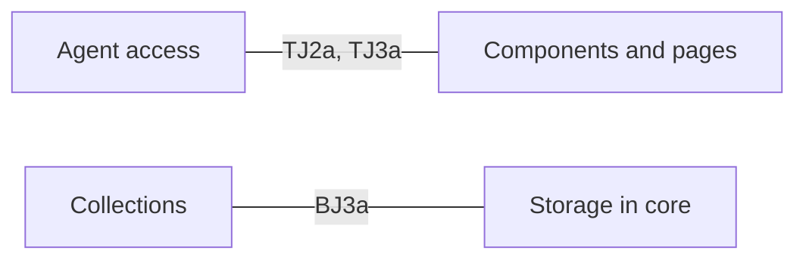
