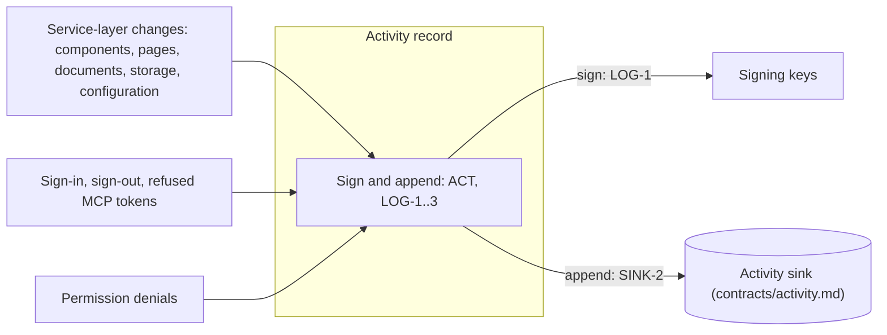
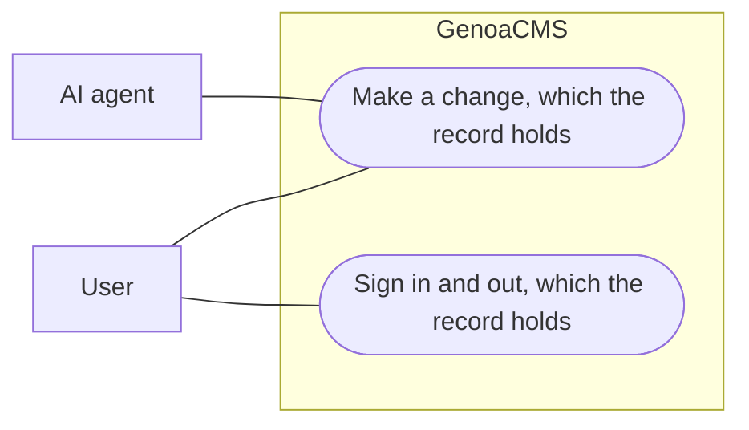
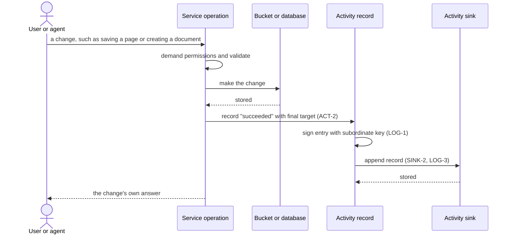
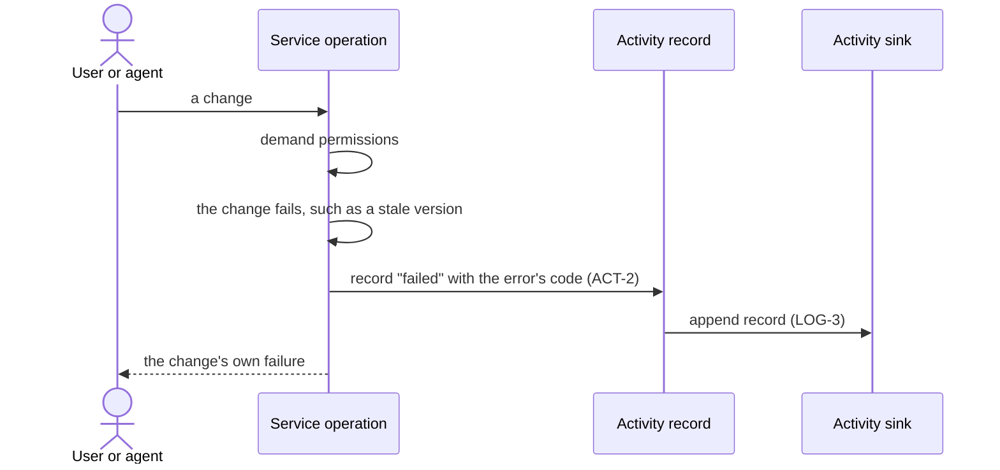
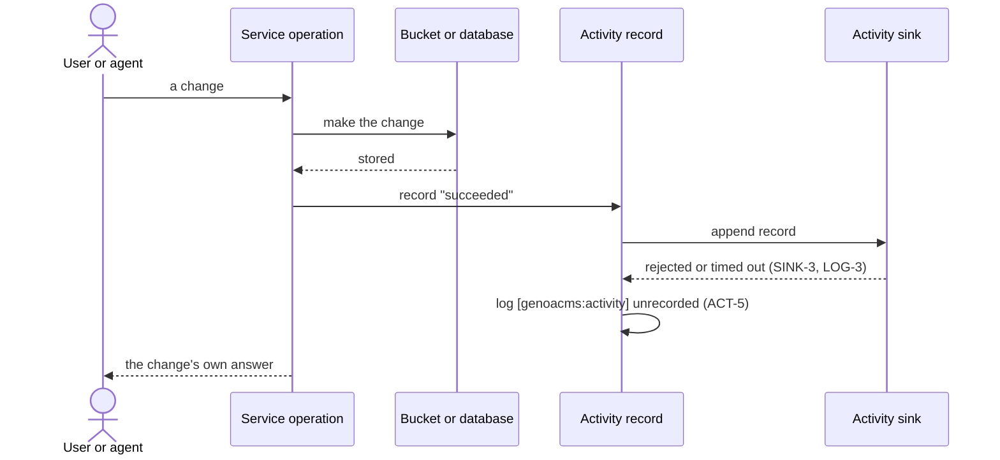
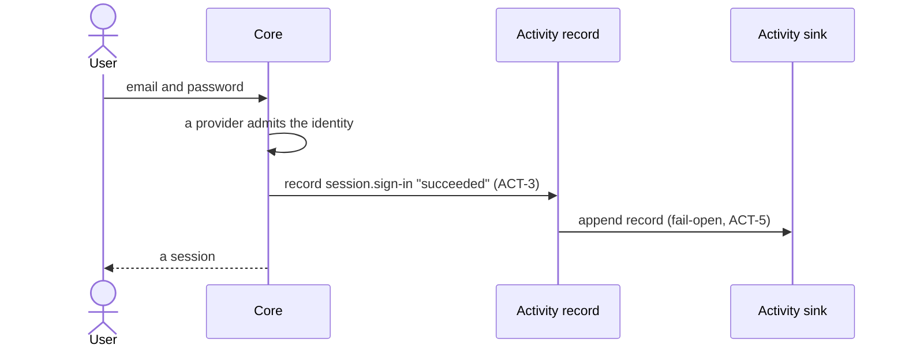

# The activity record

**Everything in this document is New.** No RFC yet.

## Design

### Role

The **activity record** is GenoaCMS's server-side forensic trail of who did what through GenoaCMS,
and when: every change a person or an agent makes to components, pages, documents, storage,
configuration, signing keys and access, every sign-in, failed sign-in, sign-out and refused MCP
token, and every permission denial. It exists as tamper-evident evidence of unauthorized or
malicious behavior by principals with less authority than the cloud operator: editors, content
managers and AI agents. Changes made outside GenoaCMS, directly in the operator's cloud, are out of
its reach, and so is what the operator does with the CLI.

After an operation finishes inside the service layer, core turns the event into an **entry**, signs
it individually with the current subordinate key ([`signing.md`](signing.md)), and hands it to the
**activity sink** the operator configures—an external adapter such as Google Cloud Logging or AWS
CloudWatch Logs ([`contracts/activity.md`](contracts/activity.md)). Core keeps no entries itself,
maintains no hash chains or queues, and does not read the record back: operators inspect and retain
entries in their logging service, and any exported entry verifies offline against the root public
key and key manifest (`signing.md` VFY-1). Without a sink nothing is recorded.



The dashboard's client-side "recent activity" list (the last ten items the browser opened, kept in
local storage) stays separate: it is a navigation shortcut, not an audit log (AU8). Only a
publication previously named its publisher (`components.md` PUB-4); nothing else was attributed on
the server (`components.md` NF13, NF22; `agent-access.md` TF1).

### Use cases



| # | Use case | Actors | Statements |
| :-- | :-- | :-- | :-- |
| AJ1 | Make a change, which the record holds | User, AI agent | |
| AJ2 | Sign in and out, which the record holds | User | |

### Scenarios

**AJ1a. A change succeeds and is recorded.** ACT-1, ACT-2, ACT-6, LOG-1, LOG-2, LOG-3.



**AJ1b. A change fails after authorization and is recorded.** ACT-2, LOG-1, LOG-3.



**AJ1c. The sink cannot store the entry.** ACT-5, LOG-3.



**AJ1d. A principal is denied.** ACT-4. One request and its response: no diagram.

**AJ2a. A user signs in.** ACT-3, ACT-5, LOG-3.



**AJ2b. A sign-in fails.** ACT-3, ACT-6. The entry carries the client address, and the submitted
email only when it fits basic email syntax and length (AU7). A sign-in refused by the limits before
any provider is not recorded.

**AJ2c. A user signs out.** ACT-3. The entry is appended if it can be; the user is signed out
either way.

### Decisions

| # | Decision | Where |
| :-- | :-- | :-- |
| AU1 | 2026-11-27: GenoaCMS records the changes made through it to pages and components, documents, storage, configuration, signing keys and access, so that an operator has forensic evidence of who did what and when (issue #32). Changes made directly in the operator's cloud are out of scope. This supersedes TU10 and fixes `components.md` NF13 and NF22 and `agent-access.md` TF1: a build's entry attributes the tree, and TRE-1 is unchanged. | ACT-1 |
| AU2 | 2026-11-27: the record is kept by an activity sink, an adapter of a kind of its own that the operator chooses: a managed logging service, a queue, or another external store. Core keeps no entries itself. | LOG-2, LOG-4, `contracts/activity.md` |
| AU3 | 2026-11-28: recording is post-write, awaited before responding, and fail-open. A change or sign-in is never blocked when the sink cannot be reached; failures are logged to stderr. Keeping operations available—and declared administrators able to sign in (`authorization.md` ZD9)—outweighs pre-write blocking. | ACT-2, ACT-5, LOG-3 |
| AU4 | 2026-11-28: each entry is signed individually with the current subordinate key, with no hash chain between entries. Entry authenticity comes from ML-DSA-65 signatures; deletion resistance is the provider's responsibility (locked log buckets and append-only IAM permissions). | LOG-1 |
| AU5 | 2026-11-27: besides changes, the record holds sign-ins, sign-outs, failed sign-ins, refused MCP tokens and permission denials; never reads. A sign-in or MCP token refused by rate limits before evaluation is not recorded. | ACT-3, ACT-4 |
| AU6 | 2026-11-27: an entry holds who, what, the target, when and the outcome, never the content or a diff of the change: the content is in the object and its history (`components.md` HIS-1). | LOG-1 |
| AU7 | 2026-11-28: a failed sign-in's entry carries the client address, and records the submitted email only when it is at most 254 characters and matches basic email syntax, so accidentally pasted passwords never enter the audit log. | ACT-6 |
| AU8 | 2026-11-28: core does not read the activity record back, and the dashboard's client-side recent-items list stays separate. Operators inspect entries in their external logging service; in-CMS reading can be added later as an optional sink capability (`contracts/README.md` CD1) without changing the write contract or envelope format. | `contracts/activity.md` CU19 |
| AU9 | 2026-11-27: how long entries are kept is the sink's. A sink adapter that can set its provider's retention takes it as an option; absent, the retention configured at the provider stands. Core prunes nothing. | `contracts/activity.md` SINK-4 |
| AU10 | 2026-11-27: `genoa rotate-root` and automatic subordinate key rotations are not recorded. The record is for principals of lesser authority. Those who deploy GenoaCMS are the developers who deploy the consuming apps and hold more authority in their organization; a root rotation makes them redeploy those apps, so it is already in their Git. An automatic rotation is the instance's own, and the request that triggered it has its own entry. Rotating and revoking on the key registry screen are recorded as changes of configuration. | ACT-1 |
| AU11 | 2026-11-27: the record is optional. Without a sink nothing is recorded and every operation behaves as it would without this document; NF13, NF22 and TF1 then stay open on that instance. | ACT-1, LOG-4 |
| AU12 | 2026-11-27: core signs every entry, whatever the sink, and a sink only stores what it receives. A managed logging service is trusted to keep entries, not to vouch for who wrote them: on Google Cloud any workload of the project allowed to write logs can write to any log name. | LOG-1, LOG-2 |
| AU13 | 2026-11-28: the first sinks are Google Cloud Logging, in `@genoacms/adapter-gcp`, AWS CloudWatch Logs, in `@genoacms/adapter-aws`. | `contracts/activity.md` |

**AD1. Recording happens post-write inside the service layer, awaited before responding.** ACT-2,
LOG-3.
*Why:* admin screens and `/mcp` call the same permission-checked services, so recording in the
service layer covers every caller in one place with no extra wrapper layer. Post-write recording
emits one entry per operation with its real outcome (`succeeded` or `failed`) and final target IDs
(such as `document.create`'s database-assigned ID), and lets `key.revoke` of the current key rotate
first so the revocation entry is signed by the newly minted key. Awaiting `append` before responding
is required on Cloud Run Functions and AWS Lambda, which freeze CPU as soon as the HTTP response
completes.
*Cost:* a process crash, OOM, or serverless timeout in the window between committing a write and
finishing `sink.append` leaves the change unrecorded. Writes pay one ML-DSA-65 sign plus one sink
round-trip; reads and page loads pay 0 ms.

**AD2. Stateless per-entry append with a short timeout; no chains and no batch queue.** LOG-1,
LOG-3.
*Why:* on serverless runtimes containers are short-lived and scale independently, and removing a
whole chain or tail was already undetectable from the log alone. Dropping chains eliminates
per-process mutable state, monotonic clock clamping, serialized flush queues, cross-page cursor
stitching, and partial-batch failure handling. Bounding `append` with a 3-second timeout ensures a
stalled sink degrades quickly to stderr instead of hanging CMS saves.
*Cost:* deleting a single entry at the provider cannot be detected from the remaining entries alone;
deletion protection relies on provider IAM (an append-only runtime identity) and locked log buckets.
Each recorded event makes one call to the sink.

**AD3. Array targets are bounded so every record fits under the 64 KiB contract ceiling.** LOG-1,
LOG-2.
*Why:* bulk operations (`storage.delete`, `storage.move`, `document.delete`, `page.delete`) may
operate on thousands of items, which would exceed provider per-entry size limits (256 KiB on Cloud
Logging and CloudWatch Logs). Capping array targets at 50 names of at most 512 bytes each, plus a count keeps every
serialized `ActivityRecord` well under 64 KiB (`contracts/activity.md` SINK-2).
*Cost:* bulk operations over more than 50 items record the first 50 names and the total count rather
than every name, and a name longer than 512 bytes is recorded cut.

**AD4. `AuthContext` carries optional `email` and `address` for actor attribution.** ACT-6.
*Why:* GenoaCMS threads `AuthContext` explicitly through every gated service and avoids ambient
request state (`authorization/context.ts`). Carrying optional `email` and `address` on `AuthContext`
gives every service the actor fields it needs without changing service signatures.
*Cost:* `AuthContext` carries two audit fields beyond pure authorization data; callers that omit
them (such as unit tests) default `address` to `unknown`.

**AD5. Signing activity entries avoids uncached per-call policy and secret reads.** LOG-1.
*Why:* `getCurrentSigningKey()` today re-reads `.genoacms/security/policy.json`, verifies its root
signature, reads `GENOACMS_SECURITY_POLICY_SEQUENCE`, fetches the subordinate seed from the secret
store, and re-derives the ML-DSA-65 keypair on every call: three cloud round trips per signature, estimated
at 200 to 500 ms, not measured. Caching immutable subordinate keys by `keyId` and throttling the due-rotation check keeps
signing overhead to ~5–15 ms CPU per write (and speeds up existing signed writes too).
*Cost:* automatic rotation triggers within the cache window after a key falls due rather than on the
exact millisecond; explicit rotation and revocation on `/configuration/keys` still invalidate caches
immediately. That changes what `signing.md` POL-1 says of `subordinateKeyRotationDays`, "when the
current key rotates as it is used", so the RFC changes POL-1 and states the cache window there.

**AD6. Revoking a key invalidates verification of entries it signed earlier.** LOG-1.
*Why:* GenoaCMS keeps one trust root and one key manifest (`signing.md` REG-1), where revocation is
retroactive so a leaked key cannot forge backdated documents. Reusing the same manifest avoids a
second key lifecycle. Because `key.revoke` records post-write after rotating the current key, the
revocation entry itself is signed by the new key and remains verifiable.
*Cost:* entries signed by a key before it was revoked fail standard `VFY-1` verification once that
key is revoked, though an offline verifier can still distinguish a revoked `keyId` listed in the
manifest from an unknown key or bad signature.

**AD7. Anonymous entries rely on the sign-in and token limits.** ACT-3.
*Why:* failed sign-ins and refused tokens are the evidence of an attempt to guess credentials, the
case a forensic trail exists for.
*Cost:* each costs a signature (5 to 15 ms of CPU) and a billed write at the provider, triggered by
anyone who can reach the instance. The limits bound it: `contracts/authentication.md` AUTHN-8 to
AUTHN-11 (RFC-0031) and `agent-access.md` MCP-3, all **New**. ACT-3's two anonymous rows are
therefore implemented only with those limits or after them.

### Findings

None.

### History

*History.* The first draft (2026-11-27) kept the record in the default bucket as one shared chain
across containers. Later the same day it moved to external activity sinks with per-instance chains,
an optional `ActivityReader`, an in-CMS `/activity` screen, dashboard integration, an MCP
`list_activity` tool, and pre-write `failClosed` (`attempted`/`failed`) recording. On 2026-11-28 it
was simplified to its current form: write-only external sinks, individually signed chainless
entries, post-write awaited fail-open recording in the service layer, and client-side dashboard
recent items kept separate (AU3, AU4, AU8, AD1, AD2).

### Verification

None.

## Specification

### Recording

#### ACT-1 · What is recorded

**New.** With a sink configured (LOG-4), each operation in this table appends an entry with its
action and target, whether a person reaches it in the admin interface or an agent through `/mcp`.
Names are as the operation receives them; a target member a table cell lists in brackets is an
array.

| Action | Target | Operations |
| :-- | :-- | :-- |
| `component.register` | `{ component, name }` | `components.md` CMP-6, `agent-access.md` TOL-3 |
| `component.header.save` | `{ component }` | CMP-8, TOL-4 |
| `component.source.save` | `{ component }` | SRC-4, TOL-5 |
| `component.undo`, `component.redo` | `{ component, part }`, `part` `header` or `source` | HIS-1 |
| `component.publish` | `{ component }` | PUB-1, TOL-6 |
| `component.delete` | `{ component }` | CMP-9, TOL-7 |
| `page.create` | `{ page }` | PGE-2, TOL-9 |
| `page.edit` | `{ page, node }` | PGE-4, PGE-5, PGE-12, TOL-10 to TOL-13 |
| `page.preview-url` | `{ page }` | PGE-6, TOL-14 |
| `page.undo`, `page.redo` | `{ page }` | PGE-7 |
| `page.build` | `{ page }` | TRE-1, TOL-15 |
| `page.delete` | `{ [pages] }` | PGE-8, TOL-15 |
| `document.create` | `{ collection, document }` on `succeeded`; `{ collection }` on `failed` | `collections.md` DOC-5, TOL-21 |
| `document.update` | `{ collection, document }` | DOC-5, TOL-22 |
| `document.delete` | `{ collection, [documents] }` | DOC-6, DOC-7, TOL-23 |
| `storage.upload` | `{ bucket, [items] }` | `storage.md` BRW-6, TOL-26 |
| `storage.create-directory` | `{ bucket, directory }` | BRW-7, TOL-28 |
| `storage.move` | `{ bucket, [items], destination }` | BRW-8, BRW-9, TOL-27, TOL-28 |
| `storage.delete` | `{ bucket, [items] }` | BRW-10, TOL-27, TOL-28 |
| `role.create`, `role.update`, `role.delete` | `{ role }` | `authorization.md` ROL-5, ADM-2 |
| `account.create`, `account.update`, `account.delete` | `{ account }` | ADM-3, ENF-3 |
| `agent.create`, `agent.update`, `agent.token`, `agent.revoke` | `{ agent }` | AGT-3 |
| `policy.update` | `{}` | `signing.md` POL-2, written from the security screen |
| `key.rotate` | `{}` | KEY-3 |
| `key.revoke` | `{ key }` | KEY-4 |
| `session.sign-in`, `session.sign-out`, `mcp.token-refused` | ACT-3 | |
| `permission.denied` | ACT-4 | |

`items` are object names, and directory names ending in `/`. `account` and `agent` are subjects,
`key` a key id. Nothing else appends an entry: not a read, a refresh of a session, an automatic
rotation or issuance of a key, root rotation (`signing.md` REG-5), the creation of absent manifests
or policy (`authorization.md` MAN-2, POL-1), or a quarantine (MAN-3). Without a sink, no operation
appends anything and every operation behaves as it would without this document.

- Test: none yet
- Level: unit, e2e
- State: new (no RFC yet)

#### ACT-2 · Post-write recording in the service layer

**New.** An operation of ACT-1 whose action is not `session.*`, `mcp.*` or `permission.denied` is a
**change**. The service function demands its permissions, runs the operation, and then appends one
entry and awaits it (LOG-3):

- when the operation succeeds: outcome `succeeded`, with its target (including server-assigned IDs
  such as `document.create`'s `document`);
- when the operation fails with any error other than `PermissionDeniedError`: outcome `failed`, with
  `error` set to the failure's code (LOG-1), before rethrowing the failure.

A `PermissionDeniedError` is recorded only as `permission.denied` (ACT-4), never as a failed change.
For `key.revoke` of the current key (`signing.md` KEY-4), recording runs after rotation and
revocation complete, so the entry is signed by the newly minted current key.

- Test: none yet
- Level: unit, e2e
- State: new (no RFC yet)

#### ACT-3 · Sessions and MCP authentication

**New.**

| Event | Entry | Recorded |
| :-- | :-- | :-- |
| a sign-in admits an identity (`contracts/authentication.md` AUTHN-5) | `session.sign-in`, outcome `succeeded`, target `{ provider }`, the provider's key | after the identity is admitted, awaited before returning the response; fail-open (ACT-5) |
| a sign-in fails with `invalid-credentials` | `session.sign-in`, outcome `failed`, target `{}` | awaited; fail-open |
| a sign-in fails with `too-many-attempts` or `sign-in-unavailable` | none | |
| a person signs out | `session.sign-out`, outcome `succeeded`, target `{}` | awaited; fail-open; the session ends either way |
| `/mcp` refuses a token that matches no agent (`agent-access.md` MCP-2) | `mcp.token-refused`, outcome `failed`, target `{}` | awaited; fail-open; a request without `Authorization` and a request answered 429 (MCP-3) append nothing |

- Test: none yet
- Level: unit, e2e
- State: new (no RFC yet)

#### ACT-4 · Denials

**New.** A `PermissionDeniedError` (`authorization.md` GRT-5) that ends a request or MCP tool call
appends `permission.denied`, outcome `denied`, target `{ permission, resource }`, `resource` omitted
for an instance-scoped permission. Denials are recorded once at the request or MCP boundary, so
denials on reads and changes are both captured without double-recording. A gate that hides an
element (ENF-4) is not a denial. The append is awaited and fail-open, and the request is answered as
it would be without the record.

- Test: none yet
- Level: unit, e2e
- State: new (no RFC yet)

#### ACT-5 · When the entry cannot be stored

**New.** Every append is fail-open (AU3). When signing fails, `sink.append` rejects, or the append
exceeds its timeout (LOG-3), core logs `[genoacms:activity] unrecorded: <action>: <reason>` and the
operation returns its own result or failure unchanged. No log line holds an email or a token.

- Test: none yet
- Level: unit, e2e
- State: new (no RFC yet)

#### ACT-6 · The actor

**New.** An entry names who acted:

```ts
type Actor =
  | { kind: 'person', subject: string, email: string, address: string }
  | { kind: 'agent', subject: string, address: string }
  | { kind: 'anonymous', email?: string, address: string }
```

`AuthContext` carries optional `email` and `address`, populated at request entry and on `/mcp`
(AD4). A person's subject and email are those of the session's access token. An agent's subject
starts with `agent:` (`agent-access.md` AGT-4). `anonymous` is the actor of a failed sign-in and of
a refused MCP token. On a failed sign-in, `email` is included only when the submitted string is at
most 254 characters and matches `^[^\s@]+@[^\s@]+\.[^\s@]+$`; otherwise `email` is omitted (AU7).
`mcp.token-refused` omits `email`. `address` is the client address as `contracts/authentication.md`
AUTHN-10 takes it, `unknown` when the hosting layer reports none.

- Test: none yet
- Level: unit
- State: new (no RFC yet)

### The log

#### LOG-1 · An entry

**New.** An entry is an envelope (`signing.md` ENV-1) of the type `genoacms.activityEntry.v1`,
signed by the current subordinate key, whose payload has exactly these members, an optional one
omitted when unset (ENV-2):

```ts
interface ActivityEntry {
  at: number                                              // milliseconds since the Unix epoch
  actor: Actor                                            // ACT-6
  action: string                                          // ACT-1
  target: Record<string, string | string[] | number>
  outcome: 'succeeded' | 'failed' | 'denied'
  error?: string                                          // with 'failed' (ACT-2)
}
```

`error` is the part of the failure's message before its first `:` when that part matches
`^[a-z][a-z-]*(/[a-z][a-z-]*)*$`, and `error` otherwise. An entry never holds the content or a diff
of what was changed.

Core bounds `target` before signing (AD3):

1. Every string in `target`, an array's elements included, whose UTF-8 encoding exceeds 512 bytes
   is cut to its longest prefix of whole code points of at most 509 bytes, followed by `…`.
2. Every array member `<name>` with more than 50 elements keeps its first 50, and the member
   `<name>Total` is added, the number of elements it had.
3. While the `ActivityRecord` (LOG-2), serialized as JSON in UTF-8, exceeds 65,536 bytes, the last
   element of the longest array member is removed; `<name>Total` is added when absent.

- Test: none yet
- Level: unit
- State: new (no RFC yet)

#### LOG-2 · The record a sink receives

**New.** Each entry reaches the sink as an `ActivityRecord` (`contracts/activity.md` SINK-1) whose
`at` is the payload's `at`, whose `action` is the payload's `action`, whose `subject` is the
payload's `actor.subject` (omitted for an `anonymous` actor), and whose `envelope` is the signed
entry. An offline verifier checks an exported entry's `envelope` against the root public key and key
manifest (`signing.md` VFY-1) and reads all authoritative fields from `envelope.payload`.

- Test: none yet
- Level: unit
- State: new (no RFC yet)

#### LOG-3 · Appending and timeout

**New.** Core signs each entry and calls `sink.append(record)` (`contracts/activity.md` SINK-2)
directly, with no in-process queue or chain state, awaiting the result before the operation finishes.
If signing or `sink.append` has not settled within 3,000 ms, core treats it as failed with
`activity/timeout` and handles it by ACT-5.

- Test: none yet
- Level: unit, integration
- State: new (no RFC yet)

#### LOG-4 · The config

**New.** `genoa.config` takes an optional stanza `activity?: { providers: Providers }`. When it is
absent, nothing is recorded (AU11). When it is present, `providers` has exactly one entry, whose
adapter is of the kind `activity`, or the issue `config/activity-provider-count` at
`activity.providers` reads `exactly one provider is allowed, found <n>`. The manifest carries the
stanza (`configuration.md` LDR-17).

- Test: none yet
- Level: unit
- State: new (no RFC yet)
