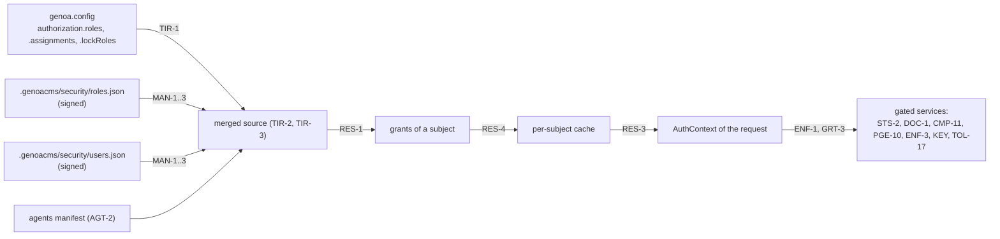

# Authorization in core

## Design

### Role

What a principal may do in GenoaCMS, and who decides it. Authentication (`contracts/authentication.md`)
answers who a user is; this document answers what that subject may do. Authorization is part of core:
it has no adapter, no contract and no provider (ZU2).

It covers:

- the permission model: the vocabulary, grants and how a grant meets a demand (GRT);
- the stored authorization data, two signed manifests in the primary bucket (MAN);
- Tier-1 declarations in `genoa.config` and how they combine with what is stored (TIR);
- resolving a subject to its grants, per request and cached (RES);
- administering roles and accounts (ADM) and the roles screen (ROL);
- the rules every gated service follows, and the configuration operations' permissions (ENF).



The permissions of each domain's operations live with the domain: `storage.md` STS-2,
`collections.md` DOC-1 to DOC-3, `components.md` CMP-11 and PGE-10, `signing.md` KEY-1 to KEY-4,
`agent-access.md` AGT-5, TOL-17 and TOL-29. This document holds the configuration operations (ENF-3).

Out of scope, and specified elsewhere or not yet: the session lifecycle (access and refresh tokens,
rotation, the single cookie), of which `contracts/authentication.md` AUTHN-5 to AUTHN-7 hold the
joins to the providers; the signed envelope and the key registry (`signing.md`); agents
(`agent-access.md`); and the security policy document, which supplies `grantCacheSeconds` (RES-4)
and is not yet specified anywhere.

The roles screen, and how its grant editor turns what an administrator switches on into the grants a
role stores:

```
/configuration (index card, gated) ─▶ /configuration/iam
                                        New role ─▶ dialog: name + grant editor ─▶ ?/createRole
                                        Edit     ─▶ dialog: grant editor ───────▶ ?/updateRole
                                        Delete   ─▶ confirmation ───────────────▶ ?/deleteRole
grant editor: rows ──(ROL-3)──▶ hidden field `grants` (JSON of Grant[])
```

### Decisions

| # | Decision | Where |
| :-- | :-- | :-- |
| ZU1 | 2026-11-01: this document starts with the roles screen only, so that the browser tests that check it carry statement IDs (RFC-0045). The rest of authorization is specified later, in its own RFCs. | ROL-1 to ROL-5 |
| ZU2 | 2026-08 (thesis, proposal §4.2.1a): authorization is a core module, not a service. The `authorization` service, its adapters and `@genoacms/authorization-adapter-array` were removed without deprecation. Cloud IAM cannot name collections or fields, would need a cloud identity per editor, and cannot evaluate a permission whose meaning only GenoaCMS defines. | this document |
| ZU3 | 2026-08 (§4.2.1b): the subject is the only value an authorization decision reads. An email is display data: an address reassigned to another person must not inherit authority. | MAN-1, RES-1, TIR-1 |
| ZU4 | 2026-08 (§4.2.1b): the access token carries identity only; grants are resolved on the server for each request and cached per subject. | RES-3, RES-4 |
| ZU5 | 2026-08-18 (change A): there is no seed administrator and no role is provisioned. The first administrator is a Tier-1 assignment of a declared role. A fresh instance grants nobody anything unless its configuration says so. | TIR-1 to TIR-3 |
| ZU6 | 2026-08-18 (change A): Tier-1 declarations are authority, not seeds. They are merged whenever authorization is read, never written to storage, refused when an administrator tries to change them, and revoked by deleting them from `genoa.config`. `authorization.lockRoles` refuses all runtime administration. | TIR-1, TIR-2, TIR-4, ADM-2, ADM-3 |
| ZU7 | 2026-08 (§4.2.2.4): `config:roles:manage` is full authority by another route, and no barrier is attempted: a holder can create a wildcard role and take it. | ENF-3 |
| ZU8 | 2026-08-19 (change C): `config:roles:manage` governs the catalog of buckets, collections and fields a grant can name, unfiltered, since ZU7 already lets its holder read them. | ENF-3 |
| ZU9 | 2026-08 (step 14): administration never leaves an account naming a role that does not exist; it refuses rather than cascades. There is no last-administrator rule, since declared principals do not depend on the manifests. | ADM-2, ADM-3 |
| ZU10 | 2026-08 (step 14): changing an account's roles needs both `config:users:manage` and `config:roles:manage`, so that managing accounts does not amount to granting any role. | ENF-3 |
| ZU11 | 2026-08-19 (changes C and D): `db:collection:schema` and `storage:bucket:list` are not permissions; a field list on `read` and `write` grants replaces the first, the filtered catalog the second. Declarations live in the `authorization` stanza, policy seeds in `security`. | GRT-1, TIR-1 |
| ZU12 | 2026-08-25: one set of four component permissions, `components:read`, `register`, `modify` and `code`, for prebuilt and dynamic components alike, replacing `components:prebuilt:*` and `components:dynamic:*`. | GRT-1, CMP-11 |
| ZU13 | 2026-11-20, RFC-0047. Setting the roles of an account or an agent needs both `config:users:manage` and `config:roles:manage` on every path. Creating or replacing an account, and creating or changing an agent, are no exception when the roles change, and neither is issuing a new token to an agent holding roles: account management alone covers the account, never the authority it holds (ZF5). | ENF-3, ADM-3, `agent-access.md` AGT-3 |

**ZD1. A grant row holds one permission over a set of resources (ROL-2, ROL-3).** A stored grant
carries one permission over one resource. The editor shows a row per permission, with a switch per
resource, and writes one grant per resource switched on.
*Why:* "this role may read these three buckets" is one decision. Three rows would repeat the
permission and have to be kept in step by hand.
*Cost:* a role opened for editing is regrouped into rows by permission and scope, so the order of
its stored grants is not kept.

**ZD2. A fresh row grants nothing until something is chosen (ROL-3).** It starts with no
permission, on named resources, with none switched on, and a collection switched on starts with no
fields.
*Why:* the wildcard and "every field" are the widest grants the editor can express. Defaulting to
them would make the widest grant the one reached by leaving a control alone.
*Cost:* an incomplete row is dropped silently from what is submitted.

**ZD3. A dialog's contents are mounted only while it is open (ROL-5).** The editor seeds its rows
from the role's stored grants each time its dialog opens.
*Why:* seeding once, at mount, kept showing the grants the editor was built with after a save had
reloaded the page data, so reopening looked unchanged until a refresh.
*Cost:* edits in a dialog closed without saving are lost.

**ZD4. Two wildcards, and a named resource carries its kind (GRT-2, GRT-3).** The permission and the
resource of a grant are each a wildcard independently, and a named resource is a scope and an id.
*Why:* one wildcard could express neither "read every bucket" nor "everything on the collection
`products`". The kind keeps a grant over the collection `products` away from a bucket of that name,
since a wildcard permission says nothing about the kind.
*Cost:* the widest grant is easy to write in a declaration; the editor only keeps it from being the
default (ROL-3).

**ZD5. A permission's scope is fixed by the permission (GRT-1, GRT-4).** Storage permissions are per
bucket, database permissions per collection, the rest per instance.
*Why:* a scope chosen per grant could contradict the permission; scoping by domain makes every check
of a permission name the same kind of resource.
*Cost:* no grant over a single page, component or file can be expressed.

**ZD6. No field list means every field (GRT-6).** A list names exactly its fields, and stays that
narrow when the collection gains fields.
*Why:* grants written before field lists existed must keep their meaning, and a restriction an
operator wrote must not widen by itself.
*Cost:* an unrestricted grant also covers fields added later, which may hold data nobody meant to
expose.

**ZD7. A manifest is never unsigned (MAN-2, MAN-4).** Absent manifests are created empty and signed
before the instance serves, and no setting accepts an unsigned one.
*Why:* a setting that tolerates unverified authorization data gets left on (`manifestTrust:
'accept-unsigned'` existed and was removed); creating them on first request would wait for a login
that the missing manifest makes fail.
*Cost:* an instance whose bootstrap failed has no manifests until a later start or request creates
them.

**ZD8. A bad manifest is quarantined and replaced; an outage is not a verdict (MAN-3).**
*Why:* an empty manifest grants nothing, so replacing it opens nothing that deleting it would not,
and declared principals can rebuild from the screen; the copy keeps the evidence. Replacing on an
unreachable store would destroy data merely because it could not be read.
*Cost:* every stored role and account is lost from service until rebuilt or restored by hand from
the quarantined copy.

**ZD9. Initialization never prevents startup (MAN-4).** *Why:* a declared administrator must be able
to sign in and repair a misconfigured store. *Cost:* an instance can serve while its keys or
manifests are missing; only the log says so.

**ZD10. Administration refuses an unverifiable manifest and writes conditionally (ADM-1).** *Why:*
editing over a manifest that failed verification would overwrite evidence, and quarantining from
the administration path would discard every role; two administrators editing at once would lose an
update. *Cost:* while a manifest is unverifiable, the roles screen cannot load until a request
replaces it (MAN-3).

**ZD11. A denial is not a fault (GRT-5).** A check throws an error of its own and returns nothing;
`hasPermission` answers a boolean for the interface only.
*Why:* a check whose result can be ignored will be; a denial reported as a server fault, or a fault
as a denial, misleads both the user and the operator.
*Cost:* every caller that turns errors into responses has to recognize the denial.

**ZD12. In an interface gate a list means all; `anyOf` is for an index (ENF-4).** *Why:* every
service demand is a conjunction, so a gate offering a control on the weaker of two would show a
button certain to be refused. An entry leading to independently gated destinations is worth showing
when any is. *Cost:* two forms of demand to read.

**ZD13. A dangling role reference resolves to the rest (RES-1).** *Why:* denying the account outright
would turn deleting a role into an outage for everyone who held it. *Cost:* the account holds less
than its record suggests, and only a warning says so.

### Findings

| # | Finding | State |
| :-- | :-- | :-- |
| ZF1 | *History.* **Every switch of the grant editor was inert.** Skeleton's `Switch` renders its visible parts as decoration and a visually hidden input as the control; without `Switch.HiddenInput` the switch renders, type-checks and passes every unit test, and cannot be clicked. Found by the Playwright suite in 2026-08. | fixed |
| ZF2 | *History.* **Reopening a role after a save showed the grants from before it (ZD3).** Found by the Playwright suite in 2026-08. | fixed |
| ZF3 | **Declared administrators cannot sign in during a storage outage, the case they exist for.** Breaks ZU5 and ZD9: the thesis (§4.2.4, §4.2.7.3) promises that a declared principal signs in while the manifests are unreadable. Cause: when the primary bucket, the secret store or the key registry cannot be reached, resolution throws instead of falling back to the declarations, so a sign-in with valid credentials, and every request carrying a session, is answered 500. Only a verdict (MAN-3) leaves the declarations in effect (TIR-3). Found 2026-11-20. TIR-3, RES-3. | open |
| ZF4 | **A momentary read error signs every stored account out of its permissions, silently, for the whole cache window.** Breaks ZD8 (an outage is not a verdict) and RES-2 (degraded operation is reported). Cause: any failure to read `roles.json` or `users.json` is taken for absence. The create that follows requires absence, fails its precondition because the object exists, and that failure is taken as a lost race, so the manifest resolves as empty, with no alert, and the result is cached (RES-4). Found 2026-11-20. MAN-2, RES-4. | open |
| ZF5 | *History.* **An account manager can give anyone any role, a wildcard role and themselves included, so `config:users:manage` alone is full authority.** Breaks ZU10, which requires both `config:users:manage` and `config:roles:manage` to change an account's roles. Cause: changing roles requires both, but creating or replacing an account also writes its roles, and requires only `config:users:manage` (ENF-3, ADM-3). The double check guards one door and leaves the other open. Agents have the same gap: `config:users:manage` alone creates an agent with roles or changes its roles (`agent-access.md` AGT-3), within the ceiling (AGT-5), and receives a new agent's token. The permission matrix allows `AccountAdministrator` to call `upsertUserAccount` without checking the roles it writes. Decided by ZU13. Found 2026-11-20. ENF-3, ADM-3. | fixed, RFC-0047 (`095cc7e6`) |
| ZF6 | **A user refused permission sees a server error, everywhere outside storage.** Breaks ZD11 and the thesis (§4.2.6): a denial and a fault must be reported differently. Cause: only the storage routes turn `PermissionDeniedError` into 403; in collections, pages, components, configuration, keys and the security policy it propagates and SvelteKit answers 500. Found 2026-11-20. GRT-5. | open |
| ZF7 | **A role can be deleted while an agent or a declared assignment still holds it, and a declared principal's authority can be changed at runtime.** Breaks ZU9 (no account names a missing role) and ZU6 (declarations are immutable at runtime). Cause: deleting a role looks for holders among stored accounts only, not stored agents (AGT-2) or declared assignments (TIR-1); and a declared assignment may name a stored role, which administration can edit. Found 2026-11-20. ADM-2, TIR-2. | open |
| ZF8 | **A role named `SuperAdmin` can be created but never changed or deleted.** Breaks ZU5: no role is special any more. Cause: update and delete refuse that name (`role/super-admin-immutable`), left from the provisioned role that change A removed, while create accepts it. Found 2026-11-20. ADM-2. | open |
| ZF9 | **Shortening the cache window in the security policy changes nothing until the instance restarts.** Breaks the thesis's §4.2.1b, which makes the window a security parameter administered at runtime. Cause: the window is read from the policy once per process (RES-4). Found 2026-11-20. RES-4. | open |
| ZF10 | **A role or account change waits out the cache window even on the instance that made it.** Contradicts the code's own documentation in `grants.server.ts`; the bound of RES-4 still holds. Cause: only agent administration drops a subject from the cache. Found 2026-11-20. RES-4. | open |
| ZF11 | **`config:adapters:manage` can be granted but allows nothing.** Breaks the reasoning behind ZU11: a permission that decides nothing is eventually granted as though it decided something. Cause: no operation demands it, since adapters are declared in Tier 1 only. Found 2026-11-20. GRT-1. | open |
| ZF12 | **An account manager can create and remove accounts but cannot see them.** Breaks no decision, but makes `config:users:manage` unusable on its own. Cause: listing accounts requires `config:roles:manage`, and the roles screen loads only for it. Found 2026-11-20. ENF-3. | open |
| ZF13 | **The code and its README describe a design that no longer exists, and an operator is told so in the log.** Breaks WORKFLOW §6.4 (the reason lives in the document, not in comments). Cause: comments in `roles.ts`, `context.ts`, `administration.ts`, `resolution.server.ts`, `bootstrap.server.ts`, `auth/auth.server.ts` and `configuration/user.server.ts` speak of a seed administrator, of `SuperAdmin` provisioned on first run, of grants carried in the token or resolved at login; the alert on a rejected manifest says permissions are "seed-administrator-only"; `authorization/README.md` says no request-time `AuthContext` exists and lists service-layer enforcement as not here yet. Found 2026-11-20. | open |
| ZF14 | **Users of two authentication providers who share a subject share its roles.** Breaks the reasoning behind ZU3: an identifier that another party can issue again carries authority it was not given. Cause: a subject is unique within its provider, not across providers (`identities.md` ID4), and resolution looks up the subject alone (RES-1), in stored accounts and declared assignments alike (TIR-1); the provider recorded with a session (`contracts/authentication.md` AUTHN-6) takes no part. A user whose provider issues, or whose administrator chooses, the subject of an administrator of another provider of the same instance signs in with that administrator's roles. Agents are not affected: their subjects carry the reserved prefix `agent:` (`agent-access.md` TU4). Found 2026-11-21. RES-1, TIR-1. | open |

### History

*History.* The roles screen and its grant editor date from 2026-08. Until 2026-11-01 only the code,
`authorization/README.md` and `packages/core/tests/grantEditor.spec.ts`, a Playwright suite that
ran nowhere (`build.md` F32), described them. RFC-0045 wrote ROL-1 to ROL-5 from the code and moved
that suite to `packages/core/e2e/`.

*History.* The rest of authorization was designed in the author's master's thesis (proposal §4.2,
2026-08) and built on the branches `feat/authorization-rework` and `feat/code-signing`, before the
project followed the Spec Workflow. The thesis's later changes A to E (2026-08-18 to 2026-08-20)
removed the seed administrator, added the role composer of `cli.md`, the resource picker and field
lists, the `authorization` stanza and the key registry screen. Its vocabulary differs from GRT-1:
the proposal lists `components:prebuilt:read`, `register`, `modify` and `components:dynamic:manage`,
`view_code`, `edit`, `commit`, which ZU12 replaced on 2026-08-25. GRT, MAN, TIR, RES, ADM and ENF
were written from the code at `77afa578` on 2026-11-20, and checked against the thesis; ZF3 to ZF13
record where they disagree.

### Verification

- **`unit`.** The conversion between rows and grants (ROL-3) in
  `packages/core/src/routes/(admin)/configuration/iam/grantRows.test.ts`, the categories (ROL-2) in
  `grantCategories.test.ts`.
- **`e2e`.** `packages/core/e2e/configuration.test.ts` serves core built with `genoa.config/e2e.ts` and
  drives the screen in Chromium as an administrator. Most tests read the hidden `grants` field and
  submit nothing. The ones that save create a role of their own, named with the run's suffix, in the
  run's instance, which the run removes. The e2e config declares one bucket, so the case of several
  named resources in one row is checked on collections.
- **Not yet carrying IDs.** No test carries a GRT, MAN, TIR, RES or ADM ID yet, nor an ENF ID but ENF-3's (RFC-0047). The suites that
  check them today are, in `packages/core/src/lib/script/authorization/`: `permissions.test.ts`
  and `packages/internal/src/authorization/permissions.test.js` (GRT-1), `enforce.test.ts` (GRT-3
  to GRT-5), `fields.test.ts` (GRT-6), `manifests.test.ts` and `signedManifests.test.ts` (MAN-1,
  MAN-3), `declared.test.ts` (TIR-1, TIR-2), `resolution.test.ts` (RES-1, TIR-3),
  `grantCache.test.ts` (RES-4), `administration.test.ts` (ADM-2, ADM-3) and `gate.test.ts` (ENF-4);
  `packages/core/evidence/permissionMatrix.test.ts` checks ENF-1 and ENF-3 role by role.
  `resolution.server.ts`, `administration.server.ts` and `bootstrap.server.ts` have no tests: MAN-2,
  MAN-4, ADM-1 and the declarations-only fallback through storage are checked by nothing.

## Specification

### The roles screen

#### ROL-1 · The roles screen

`/configuration/iam` is titled `Roles and access`. The configuration index, `/configuration`,
shows a card `Roles and access` linking to it only to a principal holding `config:roles:manage`.
The screen lists each role as a card headed by its name. A role that can be administered has `Edit`
and `Delete`; one declared in the config, or any role while administration is locked, has neither
and is marked as declared. `New role` is offered to a holder of `config:roles:manage`.

- Test: `packages/core/e2e/configuration.test.ts`
- Level: e2e

#### ROL-2 · A grant row

A row chooses its permission in two steps: a category, as tabs, then a permission of that category
in a combobox with the placeholder `Select permission...`. The categories, in order, are
`Storage` (permissions starting `storage:`), `Database` (`db:`), `Content` (`pages:` and
`components:`, in the groups `Pages` and `Components`) and `Configuration` (`config:`). An option's
value is the permission; its label drops the leading segments every option of its group shares, and
reads `_` as a space. A row opens on the category of its permission, or on `Storage` when it has none.

A resource-scoped permission shows `Applies to`: a switch `Any <scope>` and, while it is off, one
switch per declared resource of the permission's scope, named by its id: the buckets of the config
for a bucket scope, its collections for a collection scope. For `db:collection:read` and
`db:collection:write`, each collection switched on shows its fields: a switch `Every field`, and
while it is off one switch per field of the collection's schema. An instance-scoped permission shows
no resource.

The editor holds a hidden form field `grants`, whose value is the JSON of the grants its rows
describe (ROL-3), and changes as the rows are edited.

- Test: `packages/core/e2e/configuration.test.ts`
- Level: e2e

#### ROL-3 · From rows to grants

A new row has no permission, `Any <scope>` off, no resource switched on, and no fields. The grants
of a set of rows are those of each row, in order:

```pseudo
grants(row):
  if row has no permission: return []
  if permission is instance-scoped: return [{ permission, resource: '*' }]
  if Any <scope> is on: return [{ permission, resource: '*' }]
  if no resource is on: return []
  if permission selects fields and some resource on has no field on and Every field off: return []
  for each resource on, in the order switched on:
    grant = { permission, resource: { scope: scope of permission, id: resource } }
    if permission selects fields and Every field is off for it: grant.fields = the fields on
    yield grant
```

Switching a collection on starts it with no field on and `Every field` off; switching it off drops
its fields. `Every field` on is recorded by the absence of `fields`.

Opening a role for editing turns its stored grants back into rows: grants sharing a permission and a
scope form one row, a grant over `*` forms a row of its own with `Any <scope>` on, and a role without
grants opens with one new row.

- Test: `packages/core/e2e/configuration.test.ts`
- Level: e2e

#### ROL-4 · Adding and removing rows

`Add grant` appends a new row. Each row's `Remove grant` removes it and its grants.

- Test: `packages/core/e2e/configuration.test.ts`
- Level: e2e

#### ROL-5 · Creating, editing and deleting a role

`New role` opens the dialog `New role`, with a name field and the grant editor seeded with one new
row; `Create` submits the form action `createRole` with the fields `name` and `grants`. A role's
`Edit` opens the dialog `Grants of <name>`, with the editor seeded from the role's stored grants
(ROL-3) each time it opens; `Save` submits `updateRole`. The dialog closes on success, and the page
data reloads. A dialog closed without submitting keeps nothing: reopening `New role` shows one new
row again. `Delete` asks `Delete the role "<name>". Anyone holding it loses what it granted.`; `Yes` submits
`deleteRole` with `name` and shows `Role deleted`, or `Role not deleted` with the reason, and `No`
submits nothing.

`createRole` and `updateRole` fail with 400 `{ reason: 'role/name-required' }` for a missing or
empty `name`, and with 400 `{ reason: 'role/grants-malformed' }` for a `grants` that is not a JSON
array of grants; `updateRole` replaces the role's grants with those submitted. `deleteRole` fails
with 400 `{ reason: 'role/name-required' }` for a missing `name`. A refusal by the authorization
service fails with 409 `{ reason }`.

- Test: `packages/core/e2e/configuration.test.ts`
- Level: e2e

### The permission model

#### GRT-1 · The vocabulary

These twenty strings are the permissions, and nothing else is one. A string is a permission only if
it is one of them exactly; a name every object inherits, such as `constructor`, is not.

| Permission | Domain | Scope |
| :-- | :-- | :-- |
| `storage:bucket:read`, `storage:bucket:write`, `storage:bucket:delete` | storage | bucket |
| `db:collection:read`, `db:collection:write`, `db:collection:delete` | database | collection |
| `components:read`, `components:register`, `components:modify`, `components:code` | content | instance |
| `pages:read`, `pages:content_edit`, `pages:structure_edit`, `pages:publish`, `pages:delete` | content | instance |
| `config:users:manage`, `config:roles:manage`, `config:keys:manage`, `config:security:manage`, `config:adapters:manage` | configuration | instance |

A permission scoped to a bucket or a collection is resource-scoped; the others are instance-scoped.

- Test: unverified (no test carries the ID yet)
- Level: unit

#### GRT-2 · A grant

A grant is a permission, or `'*'` for every permission, over a named resource, or `'*'` for every
resource of every kind, with an optional list of fields:

```ts
type Grant = {
  permission: Permission | '*'
  resource: { scope: 'bucket' | 'collection', id: string } | '*'
  fields?: string[] | '*'
}
```

A named resource's `id` is not empty. `fields` refines `db:collection:read` and
`db:collection:write` only (GRT-6); on any other grant it has no effect.

- Test: unverified (no test carries the ID yet)
- Level: unit

#### GRT-3 · A grant meets a demand

A demand is a permission and, when the permission is resource-scoped, the id of one resource. A
grant satisfies it exactly when:

```pseudo
satisfies(grant, permission, resource):
  (grant.permission is '*' or grant.permission == permission)
  and (grant.resource is '*'
       or (resource is given
           and grant.resource.scope == scope(permission)
           and grant.resource.id == resource))
```

A principal holds a permission when one of its grants satisfies the demand. So a grant over a named
resource never satisfies an instance-scoped permission, a grant over the collection `x` never
satisfies a demand on the bucket `x`, and no permission implies another.

- Test: unverified (no test carries the ID yet)
- Level: unit

#### GRT-4 · A demand names its resource exactly when it must

A check of a resource-scoped permission without a resource, or with `'*'` or the empty string as
its resource, and a check of an instance-scoped permission with a resource, throw an error and
decide nothing. Their messages start with `permission-check-missing-resource`,
`permission-check-wildcard-resource`, `permission-check-empty-resource` and
`permission-check-unexpected-resource`. They are programming errors, not denials (GRT-5).

- Test: unverified (no test carries the ID yet)
- Level: unit

#### GRT-5 · A denial

A demand the principal does not hold throws `PermissionDeniedError`, which carries the subject, the
permission and the resource, with the message `permission-denied: '<subject>' lacks <permission>`,
followed by ` on '<resource>'` for a resource-scoped permission. A check that passes returns nothing
and changes nothing.

- Test: unverified (no test carries the ID yet)
- Level: unit

#### GRT-6 · Permitted fields

The fields a principal may read, or write, in a collection are, for `db:collection:read`, or
`db:collection:write`, over that collection:

- none, when no grant satisfies the demand;
- every field, including fields the collection gains later, when a satisfying grant has no `fields`
  or `fields: '*'`;
- otherwise the union of the `fields` of every satisfying grant.

The database service applies them (`collections.md` DOC-2, DOC-3).

- Test: unverified (no test carries the ID yet)
- Level: unit

#### GRT-7 · Roles

A role is a name and a list of grants. A principal holding several roles holds every grant of each.
No role is built in.

- Test: unverified (no test carries the ID yet)
- Level: unit

### The manifests

#### MAN-1 · Two signed manifests

The stored authorization data is two objects in the primary bucket, each a signed envelope
(`signing.md`):

| Object | Document type | Payload |
| :-- | :-- | :-- |
| `.genoacms/security/roles.json` | `genoacms.roles.v1` | `{ "roles": { "<role name>": [<Grant>, …] } }` |
| `.genoacms/security/users.json` | `genoacms.users.v1` | `{ "users": { "<subject>": { "email": "<string>", "roles": ["<role name>", …] } } }` |

A payload is valid only if every object in it has exactly the properties shown (a grant's `fields`
optional), every permission is a GRT-1 permission or `'*'`, a named resource's scope is `bucket` or
`collection` and its id is not empty, a field name or a role name in a list is not empty, and no
role name or subject is `__proto__`, `constructor` or `prototype`. An invalid payload yields no
roles and no accounts at all, never the valid part of them. The email is display data only (ZU3).

- Test: unverified (no test carries the ID yet)
- Level: unit

#### MAN-2 · An absent manifest is created signed

When a manifest is read and found absent, an empty one (`{ "roles": {} }`, `{ "users": {} }`) is
written signed, by a write that succeeds only if the object is still absent. A failed precondition
is another writer having created it first, and is not a failure. No reader ever acts on a manifest
without a signature.

- Test: unverified (no test carries the ID yet)
- Level: integration

#### MAN-3 · A rejected manifest is quarantined and replaced

When resolution (RES-1) reads a manifest that is not JSON, is not a signed envelope, names a signing
key the key registry does not list or has revoked, fails its signature or its document type, or has
an invalid payload (MAN-1):

1. its text is copied unchanged to `.genoacms/security/rejected/<name>-<milliseconds since the
   epoch>.json`, `<name>` being `roles` or `users`;
2. it is replaced with an empty signed manifest, by a write conditional on the version that was
   read, so that two instances replace it once;
3. an alert naming the manifest, the reason and the quarantined copy is logged (RES-2).

A key registry that cannot be read is not a verdict: the failure propagates and nothing is
quarantined or replaced.

- Test: unverified (no test carries the ID yet)
- Level: unit, integration

#### MAN-4 · The manifests exist before the instance serves

Once per process, before it serves a request and not while the application is being built, the
instance ensures, in order, the key registry with its root key, the security policy document, and
the two manifests (MAN-2). A failure is logged with the prefix `[genoacms:bootstrap]`, and the
instance serves anyway.

- Test: unverified (no test carries the ID yet)
- Level: integration

### Declarations

#### TIR-1 · Declared roles and assignments

`genoa.config` MAY declare, in its `authorization` stanza, `roles`, an object from role name to a
list of grants, and `assignments`, an object from subject to a list of role names. They are
validated by the rules of MAN-1. When they are not valid, every resolution and every administration
read fails with an error whose message starts with `security/invalid-declarations:`, and nothing is
resolved from them in part.

- Test: unverified (no test carries the ID yet)
- Level: unit

#### TIR-2 · Declarations are merged when authorization is read

Every time the authorization data is read, the declared roles and assignments are added to the
stored ones, and a stored role or account of a declared name or subject is ignored. Declarations are
never written to storage, so a declaration removed from `genoa.config` grants nothing from the next
read on.

- Test: unverified (no test carries the ID yet)
- Level: unit

#### TIR-3 · Declarations alone when the stored data is rejected

When `roles.json` or `users.json` is rejected (MAN-3), resolution uses the declarations alone: no
stored role, account or agent is known. It logs `stored-authorization-unavailable: <reason>. Only
Tier-1 declarations are in effect.` `users.json` is not read when `roles.json` was rejected.

- Test: unverified (no test carries the ID yet)
- Level: unit, integration

#### TIR-4 · The lock

When `authorization.lockRoles` is `true`, every operation that changes roles or accounts (ENF-3)
returns the refusal `administration/locked-by-configuration` after its permission check and changes
nothing, and the listing marks every role and account not editable.

- Test: unverified (no test carries the ID yet)
- Level: unit

### Resolution

#### RES-1 · Resolving a subject

A subject is known exactly when the merged authorization data (TIR-2, TIR-3) has an account, a
declared assignment or a stored agent (`agent-access.md` AGT-2) for it. A known subject holds the
grants of the roles its record names (GRT-7); a name that is no role contributes nothing, and the
others still apply. An unknown subject holds nothing. An agent whose roles exceed the ceiling holds
nothing (`agent-access.md` AGT-5). Only the subject is looked up; no email takes part.

Sign-in admits only a known subject (`contracts/authentication.md` AUTHN-5).

- Test: unverified (no test carries the ID yet)
- Level: unit

#### RES-2 · Resolution reports what it worked around

Each resolution logs, with the prefix `[genoacms:authorization]`, every role name that resolved to
nothing (`unknown-role: '<name>' referenced by subject '<subject>'`), a rejected manifest (MAN-3),
declarations used alone (TIR-3), and an agent refused for its ceiling.

- Test: unverified (no test carries the ID yet)
- Level: unit

#### RES-3 · Every request is resolved

A request outside `/mcp` carrying a valid access token is given the grants its subject holds now
(RES-1, RES-4), not grants recorded in the token. A request whose subject is not known is given no
grants (ENF-2).

- Test: unverified (no test carries the ID yet)
- Level: integration, e2e

#### RES-4 · Resolutions are cached per subject

A subject's resolution is reused for `grantCacheSeconds` of the security policy, as the policy stood
when the process first resolved a subject, and resolved again after that. Concurrent resolutions of
one subject run once. A resolution that throws is not reused. Administering an agent drops that agent's
resolution at once on the instance that administered it. A permission removed from a role is
therefore honored for at most the window, on every instance.

- Test: unverified (no test carries the ID yet)
- Level: unit

### Administration

#### ADM-1 · Administration reads strictly and writes conditionally

Administration reads both manifests and refuses, without quarantining or replacing anything, when
one cannot be read (`manifest/unreadable: <path>`), is not JSON (`manifest/not-json: <path>`), does
not verify (`manifest/unverified: <path>: <reason>`) or is invalid (`manifest/invalid: <path>:
<reason>`). It writes a changed manifest signed, conditional on the version it read; a write that
loses that condition changes nothing and returns `manifest/conflict`.

- Test: unverified (no test carries the ID yet)
- Level: integration

#### ADM-2 · Changing roles

Each change is checked against the stored roles, the stored accounts and the declarations, and is
refused, changing nothing, with the first reason that applies:

| Change | Refused with |
| :-- | :-- |
| creating a role | `role/name-empty`; `role/declared-in-configuration` for a declared name; `role/already-exists` |
| replacing a role's grants | `role/declared-in-configuration`; `role/super-admin-immutable` for the name `SuperAdmin`; `role/not-found`; the ceiling refusal (`agent-access.md` AGT-5) when a stored agent holds it |
| deleting a role | `role/declared-in-configuration`; `role/super-admin-immutable`; `role/not-found`; `role/in-use: held by <subjects>` while a stored account names it |

- Test: unverified (no test carries the ID yet)
- Level: unit

#### ADM-3 · Changing accounts

| Change | Refused with |
| :-- | :-- |
| creating or replacing an account, with its email and roles | `user/subject-empty`; `user/declared-in-configuration` for a declared subject; `user/duplicate-roles`; `user/unknown-roles: <names>` |
| changing an account's roles | `user/declared-in-configuration`; `user/not-found`; `user/duplicate-roles`; `user/unknown-roles: <names>`; the ceiling refusal for an agent's subject |
| removing an account | `user/declared-in-configuration`; `user/not-found` |

Nothing refuses removing the last account that can administer.

- Test: unverified (no test carries the ID yet)
- Level: unit

### Enforcement

#### ENF-1 · Every operation is checked first

Every operation a user reaches, in the admin interface or through `/mcp`, demands its permissions
(STS-2, DOC-1, CMP-11, PGE-10, KEY-1 to KEY-4, ENF-3, TOL-17, TOL-29) before it changes anything,
at the point its domain's statement names. A principal holding no grant is refused every one of
them before anything is read.

- Test: unverified (no test carries the ID yet)
- Level: unit

#### ENF-2 · No principal, no operation

Outside `/mcp`, a gated operation reached by a request that has no session, or whose subject is not
known (RES-1), is answered 401 with the message `unauthenticated` and runs nothing. A page of the
admin area requested without a session redirects before that (`contracts/authentication.md`
AUTHN-12).

- Test: unverified (no test carries the ID yet)
- Level: integration

#### ENF-3 · Configuration permissions

| Operation | Permission |
| :-- | :-- |
| listing roles and accounts, listing the buckets, collections and fields a grant can name | `config:roles:manage` |
| creating, replacing or deleting a role | `config:roles:manage` |
| creating an account with no roles, replacing an account with the same set of roles, removing an account | `config:users:manage` |
| creating an account with roles, replacing an account with another set of roles, changing an account's roles | `config:users:manage` and `config:roles:manage` |
| reading or changing the security policy | `config:security:manage` |

Whether creating or replacing an account changes its roles is decided against the stored account
the write replaces, none for a new account, comparing the roles as sets, so order does not count.
`config:users:manage` is demanded first, then the lock (TIR-4), then `config:roles:manage` when
the roles change; a denial writes nothing. A write that the decision no longer matches when it
lands fails with `manifest/conflict` (ADM-1). Agents follow the same rule (`agent-access.md`
AGT-3).

The catalog of grantable resources gives names only: every configured bucket, and every collection
with the names of its fields, a collection whose definition cannot be read with none.

- Test: `packages/core/src/lib/script/authorization/administration.test.ts`, `packages/core/src/lib/script/configuration/accounts.server.test.ts`
- Level: unit

#### ENF-4 · Interface gates

A control or entry of the interface is shown when the principal holds what its gate demands: one
permission; a list, meaning every permission in it; or `{ anyOf: [...] }`, meaning at least one, and
nothing when the list is empty. A gate on a resource-scoped permission names the resource the
service would check. A gate that cannot be decided (GRT-4) hides its element. A hidden element is a
courtesy only: the service behind it refuses on its own (ENF-1).

- Test: unverified (no test carries the ID yet)
- Level: unit
