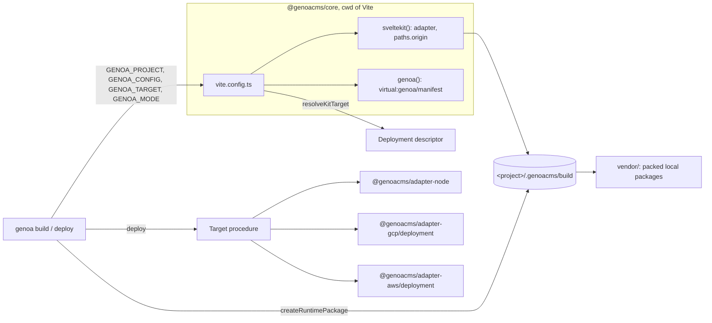

# Build, artifact and deployment

## Design

### Role

What `genoa build` and `genoa deploy` do between the CLI ([`cli.md`](cli.md)) and a running
instance: the facts that cross into core's Vite and SvelteKit, the choice of the SvelteKit adapter
and origin from the deployment target, the guard that keeps the build from reaching a live instance,
and the self-contained artifact with its generated `package.json` and vendored local packages. The
GCP and AWS targets are specified in [`adapter-gcp/deployment.md`](adapter-gcp/deployment.md) and
[`adapter-aws/deployment.md`](adapter-aws/deployment.md); the Node target is here (TGT-1, TGT-2).



The lifecycle, from development to a production cold start:

```
DEVELOPMENT   genoa dev            vite dev in core; genoa() loads the development manifest and watches it
                                   host.server.ts: createHost (no I/O); hooks: bootstrap through host.secrets()
BUILD         genoa build [t]      the CLI loads the config, spawns vite build in core with BLD-1's facts;
                                   vite.config.ts: resolveKitTarget (BLD-2); genoa() embeds the runtime manifest;
                                   the CLI writes .genoacms/build/package.json (ART-1) and vendor/ (VND-2)
DEPLOY        genoa deploy [t]     BUILD, then a host resolves the target's options and runs its procedure (CLI-8)
PRODUCTION    cold start           createHost over the embedded manifest; bootstrap; providers on first use
```

### Decisions

| # | Decision | Consequence |
| :-- | :-- | :-- |
| PU2 | GCP does not have to build remotely. **Build locally, ship the bundle**, still without uploading `node_modules`. | The artifact carries a generated `package.json`, and the platform installs it (PD6). |
| PU6 | Core's `dependencies` stay as they are: `vite` and the build tooling are needed where core is installed as a package and built by the user. | The artifact's `package.json` is derived from what the server bundle imports, not from core's `dependencies` (ART-2). |
| PU10 | The live GCP spike (KS4) is skipped until the production config exists. | The first real GCP deploy was the GCP deployment RFC's verification; it ran on 2026-09-28. |
| PU15 | 2026-10-30: GenoaCMS moves to SvelteKit 3, including `@genoacms/sveltekit-adapter-cloud-run-functions`. | The toolchain minimums of PF26 apply to every package that builds or tests with SvelteKit. PD10 and PD11, RFC-0043. |
| PU16 | 2026-10-30: the origin is fixed at build time, on every target. Each target turns its `origin` option into SvelteKit's `paths.origin`, and the Cloud Run adapter reads `paths.origin` instead of a runtime `ORIGIN` (PF23). | PD11. Changing the origin needs a rebuild, which `genoa deploy` always does. Breaking for the Cloud Run adapter's users outside GenoaCMS (`adapter-gcp/deployment.md` GD5). |
| PU17 | 2026-10-30: core imports its own modules through `#lib` subpath imports, not the deprecated `alias` that would keep `$lib` (PF22). | A mechanical migration of every `$lib` import and `vi.mock('$lib/…')` call in core, committed on its own. |
| PU18 | 2026-10-30: the Cloud Run adapter bundles the server in Vite's own build, as adapter-node 6 does, instead of a second Rollup pass (PF24). | `adapter-gcp/deployment.md` ADP-3 and ADP-4 change. Svelte libraries in core's `dependencies` are bundled, not external. |
| PU19 | 2026-10-30: the Cloud Run adapter supports SvelteKit 3 only, released as 2.0.0. | Its peer dependency is `@sveltejs/kit ^3`. SvelteKit 2 users stay on 1.x. |
| PU20 | 2026-10-30: the `@genoacms/adapter-node` target gets an optional `origin` option, fixed at build time like the `gcp` and `aws` targets' (PF30). | PD11 covers every target. A server reached over plain HTTP sets `origin`; without it the origin is `https://` plus the host. RFC-0043. |

**PD6. A build produces a self-contained, self-describing artifact.** It holds the SvelteKit output
and a generated `package.json` pinned to the installed versions, listing the packages the server
bundle imports and the adapter packages the manifest names (ART-2). It holds no project source, no
config file and no deployment option. Targets add their own entry glue and install the dependencies
their own way (KF24).
*Why:* core's `dependencies` keep build tooling such as `vite` (PU6); copying that list would install
the toolchain on every function. The bundle's imports are the exact set the running server needs.
*Cost:* the scan sees only ESM `import` syntax. A `require()` left dynamic, a `createRequire` call
or a non-literal `import()` inside a bundled dependency loads a package the scan cannot find, and
fails at runtime with `ERR_MODULE_NOT_FOUND`; the CLI warns about each (ART-3). There is no lockfile,
so transitive versions are resolved at install time and two deploys of one build can differ.

**PD7. Explicit facts cross the process boundary, as absolute paths or names.** The CLI spawns Vite
with core as its working directory (KF21) and passes `GENOA_PROJECT`, `GENOA_CONFIG`, `GENOA_TARGET`
and `GENOA_MODE` (BLD-1, CLI-5). There are no relative directory walks.
*Why `GENOA_MODE` is explicit:* Vite's `mode` is not reliable inside a SvelteKit build: one
`vite build --mode development` resolved the Vite config eight times, and some resolutions reported
`production` (KS2).
*Cost:* SvelteKit writes `.svelte-kit/` and Vite writes `node_modules/.vite-temp/` inside the
installed core package, in pnpm's virtual store too (KS3, KS5). A read-only `node_modules`, as in Nix
or a container image, fails the build.

**PD8. No provider is constructed while SvelteKit analyses the build (KF18).** Core reads `building`
from `$app/env`, which SvelteKit sets exactly while it runs the app during `vite build`. It is
enforced twice: each module-scope call skips its I/O while `building` (the bootstrap, and the
collection listing, COL-1), and core's runtime loader refuses to load any adapter runtime (BLD-3),
so a future module-scope call fails the build by name instead of reaching a live instance.
*Why:* any server code that runs at import time runs during the build, and the flag is the one
SvelteKit defines for this purpose.
*Cost:* each module-scope call must remember the flag. The collection listing reads as empty while
`building`, and `building` is also true while prerendering, so a prerendered page cannot reach a
provider. The loader check catches provider construction only, not a direct `fetch` or file read at
import time. A provider failure thrown outside the promise chain crashes the process instead of
degrading.

**PD9. Local packages travel inside the artifact (KF19).** The build packs with `npm pack` every
runtime adapter package the manifest names, however it was installed, and every local package the
server bundle imports or a packed package depends on (VND-1), and points the `package.json` at the
tarballs (VND-2). Everything else installs from the registry. The artifact is always installed with
npm 9 or later: Cloud Run buildpacks and the AWS procedure do, and the Node target says so.
*Why:* the artifact installs exactly the adapter code that was loaded and tested on the developer's
machine, published or not, and a version collision with the registry cannot occur. Adapters are
packed unconditionally because yarn v1 copies a `file:` directory into `node_modules`, where it
cannot be told from a registry install (KS8).
*Cost:* the build needs `npm` on `PATH`, about a second per packed package. Packed packages lose
registry provenance, and their own dependencies still resolve by range. pnpm or yarn inside the
artifact would also need their own override syntax. Not covered: a local helper library installed by
yarn v1's copy, which looks like a registry package and fails the install with `E404`; pnpm
`catalog:`, yarn `patch:` and `portal:` on a name that is not packed, which fail the build (VND-3); a
stale `dist/`, which is packed as it is; a credential under a name the deny list does not know;
Yarn Plug'n'Play, which has no `node_modules`; native binaries, packed as built on the build machine.

**PD10. SvelteKit's config is the argument of `sveltekit()` in core's `vite.config.ts` (PU15,
PF21).** Core has no `svelte.config.js`. `vite.config.ts` reads BLD-1's facts, calls
`resolveKitTarget()` (BLD-2), and passes its adapter and origin to `sveltekit()` with core's own
options (`vitePreprocess()`, `experimental.remoteFunctions`). RFC-0043.
*Why:* SvelteKit 3 reads no other file. The Vite config is where the `genoa()` plugin reads the
manifest, so both evaluate the config in one process.
*Cost:* the Vite config awaits the loader at the top level, so every Vite start, `vitest` included,
pays one evaluation of the config. An error in the config reads as a failed Vite config.

**PD11. A deployment target fixes the origin at build time (PU16, PF23).** A deployment descriptor
MAY declare `origin(options)`, and its result is SvelteKit's `paths.origin` (BLD-2), which every
SvelteKit adapter reads and SvelteKit's CSRF check trusts. RFC-0043.
*Why:* SvelteKit 3 and adapter-node 6 no longer read `ORIGIN` at runtime. One mechanism serves every
target.
*Cost:* an artifact serves one origin; moving an instance to another domain needs a rebuild. The
descriptor receives unresolved options, so the origin cannot be a `secret()` or `env()` reference:
the descriptor's validation refuses one. An operator who still sets `ORIGIN` on a function gets an
error at startup on GCP (`adapter-gcp/deployment.md` ADP-8); on AWS and Node it is ignored.

**PD12. Core builds from what it publishes (`cli.md` LF19, CLI-21).** RFC-0043 amendment. What `genoa
build`, `genoa deploy`, `genoa dev` and `genoa rotate-root` load from core imports only packages core
lists in `dependencies` or `peerDependencies`. Vitest's configuration lives in core's
`vitest.config.ts`, which Vitest prefers and Vite never loads. Core lists `@sveltejs/kit` in
`peerDependencies` too, so SvelteKit treats core's `*.remote.ts` modules as remote functions when
core is installed (PF31).
*Why:* the repository builds core in place, with every devDependency installed and outside
`node_modules`, the one setting no user has. Only a build of the packed packages sees what users see.
*Cost:* core keeps two configs, and a test option written into `vite.config.ts` does nothing under
Vitest. The peer makes pnpm and npm install `@sveltejs/kit` for the project as well. The packed build
is the slowest end-to-end test.

### Rejected alternatives

| Alternative | Why rejected |
| :-- | :-- |
| **Remote build on GCP** | It uploads the project source, including the config directory and credentials (KF9), and needs the config and a build script at the remote end. Building locally also lets CI verify exactly what ships. |
| **Runtime `package.json` = core's `dependencies`** | Would install `vite`, `vitest` and the tailwind toolchain on every function; moving them to `devDependencies` breaks users, who build core from their own install (PU6). |
| **Fully self-contained bundle, no install** | Would bundle `typescript`, `ts-morph`, `jsdom` and gRPC SDKs, which is the most fragile option. |

### Findings

PF21 to PF31 are facts about SvelteKit 3.1.1, `@sveltejs/adapter-node` 6.0.1, Vite 8.0.12 and Vitest
4.1, read from their published packages on 2026-10-30.

| # | Finding | State |
| :-- | :-- | :-- |
| PF21 | `svelte.config.js` is no longer read. SvelteKit's config is the flat argument of the asynchronous `sveltekit()` Vite plugin (`@sveltejs/kit/src/exports/vite/index.js`). | holds; met by PD10 |
| PF22 | `$lib` is removed; the replacement is a `#lib` subpath import. `$app/environment` is deprecated in favor of `$app/env`, which exports the same `building`. | holds; met by PU17, PD8 |
| PF23 | adapter-node 6 reads no `ORIGIN`: the origin is `builder.config.paths.origin`, or else comes from `PROTOCOL_HEADER` and `HOST_HEADER` (`@sveltejs/adapter-node/src/handler.js`). Behind CloudFront the AWS target's `origin` would silently stop applying. | holds; met by PD11 |
| PF24 | adapter-node 6 no longer bundles the server a second time: the `dependencies` of `package.json` in the working directory stay external, except Svelte libraries, which are bundled. KF22 no longer holds. | holds; met by PU18, ART-2 |
| PF25 | The adapter API changed: `builder.generateManifest` and `createEntries` throw, `builder.config` has no `kit` key, `rimraf` and `mkdirp` are deprecated. The Cloud Run adapter 1.x fails on SvelteKit 3. | holds; met by PU19 |
| PF26 | The toolchain minimums rise: Node ≥ 22.17, TypeScript ^6, Vite ^8.0.12, `@sveltejs/vite-plugin-svelte` ^7, Svelte ^5.57.1, Vitest ≥ 4 wherever a SvelteKit Vite config is loaded; `@genoacms/config` follows core to Vite 8. | holds; RFC-0043 |
| PF27 | `runnerImport` survives in Vite 8, still `@experimental` (KF25). | holds |
| PF28 | SvelteKit 3 writes its generated `tsconfig.json` to `node_modules/$app/tsconfig.json`, which the app extends as `$app/tsconfig`; several types moved (`$app/forms`, `@sveltejs/kit/hooks`); `@sveltejs/kit/node/polyfills` is removed. | holds; RFC-0043 |
| PF29 | `$env/dynamic/private` is an alias of `$app/env/private`, which exposes only variables declared with `defineEnvVars`; core reads no `$env` module. | holds |
| PF30 | adapter-node 6 assumes `https` without `PROTOCOL_HEADER`, so a server reached over plain HTTP fails SvelteKit's CSRF check on every form post. | holds; met by PU20, TGT-1 |
| PF31 | A `*.remote.*` module inside `node_modules` counts as remote only when its package lists `@sveltejs/kit` in `peerDependencies`; otherwise its server-only imports reach the client build (`@sveltejs/kit/src/exports/vite/utils.js`). | holds; met by PD12 |
| PF32 | *History.* **Core's Playwright Test suite gated nothing.** It built with `genoa.config/development.ts`, which imports gitignored credential files, ran at no level and carried no statement IDs; on 2026-11-01 a SvelteKit 3.1 regression broke saving and publishing components unseen (`components.md` NF20). | fixed, RFC-0045: the suite moved into `e2e/` |
| PF33 | **An adapter whose runtime lives in another package than its descriptor deploys without its runtime** (ART-2). The artifact lists the package that owns each descriptor, at the version installed for the project, not the package of its runtime specifier, which the host then cannot import. Every adapter of the repository keeps both in one package. Found by LS3 (D19). | open |
| PF34 | **No test runs core's runtime loader or hooks while `building`** (BLD-3). Only the collection listing's guard is tested (COL-1); removing the loader's refusal or the hooks' check passes every test. Found writing BLD-3, 2026-11-26. | open |

### History

*History.* Before the 2026-09 redesign the GCP deploy uploaded the project source and assumed a
remote build (KF9, KF15). RFC-0005, RFC-0015 and RFC-0020 implemented the local build, the CLI and
vendoring; RFC-0043 moved to SvelteKit 3. On 2026-09-27, measured on real core (KS6), the server
imported 12 of core's 45 `dependencies`, and the generated `package.json` installed 126 packages
(67 MB). This text was split out of `configuration.md` on 2026-10-02 and restructured under the Spec
Workflow on 2026-11-26 (PS1); its IDs gained the prefix `P`, so D9 is PD9.

### Verification

- **PS1, drift audit and Specification from the code, at `f18f6205`, 2026-11-26.** The Specification was written from `packages/config/src/environment.ts`, `src/load/kit.ts`, `src/artifact/`, core's `host.server.ts` and `hooks.server.ts`, and `packages/adapter-node/src/`. LS3 (`cli.md`) had audited the earlier text at `9f43931`: D17, D18 and D21 are corrected here, D20 is stated in VND-1, and D19 is PF33. No falsification audit of these statements has run.

## Specification

### The build

#### BLD-1 · The facts Vite receives

`readGenoaEnvironment(fallbackMode, environment)` reads the facts of a build or a dev server: the
project root from `GENOA_PROJECT`, else the working directory; the config file from `GENOA_CONFIG`,
absent when unset; the target from `GENOA_TARGET`, absent when unset; and the mode from `GENOA_MODE`,
else `fallbackMode`. An empty variable counts as unset. A relative `GENOA_PROJECT` or `GENOA_CONFIG`
fails with `genoa/relative-path: <variable> must be absolute`, and a mode other than `development`
or `production` with `genoa/invalid-mode: GENOA_MODE must be development or production, not
<mode>`. Vite's own `mode` is never read: the `genoa()` plugin falls back to `development` for `vite
dev` and `production` for `vite build`, and core's `vite.config.ts` to `development`.

- Test: unverified (no test carries its ID yet)
- Level: unit

#### BLD-2 · The SvelteKit adapter and origin

`resolveKitTarget({ root, file?, mode, target? })` loads the config (LDR-18). When it declares no
deployment target, it returns neither an adapter nor an origin, or fails with
`config/no-deployment-target` when a target was requested. Otherwise the target is the requested
one, else `deployment.default`, else the first key of `deployment.targets`; an undeclared one fails
as CLI-7 states. It loads the target's descriptor from the project (LDR-16) and returns the
SvelteKit adapter its `svelteKitAdapter()` loader's factory makes from
`svelteKitOptions(options, { outDir: <root>/.genoacms/build })`, or from `{}` without
`svelteKitOptions`, and the origin `origin(options)` returns, or none. Both receive the target's
options unresolved. Core's `vite.config.ts` passes the origin to SvelteKit as `paths.origin`.

- Test: unverified (no test carries its ID yet)
- Level: unit

#### BLD-3 · No provider while SvelteKit analyses the build

While SvelteKit's `building` is true, core loads no adapter runtime: its loader fails with
`host/building: <specifier> was requested while SvelteKit analyses the build; module-scope provider
I/O must check building`. The instance bootstrap does not run.

- Test: unverified (PF34)
- Level: unit

### The artifact

#### ART-1 · Where the artifact is

The artifact is `<project>/.genoacms/build`, the SvelteKit adapter's output. After `vite build` the
build writes its `package.json`: `{ "name": "genoacms-runtime", "private": true, "type": "module",
"dependencies": {…}, "overrides": {…} }`, with `overrides` present only when a package was packed
(VND-2), two-space indented and ending in a newline.

- Test: unverified (no test carries its ID yet)
- Level: unit

#### ART-2 · Its dependencies

`dependencies` lists, sorted by name: every package the server output imports by a bare specifier,
at the version installed where core resolves it (ART-4); and the package of every adapter record of
the manifest that is not a deployment, at the record's version (LDR-17). The server output is every
`.js` and `.mjs` file of the artifact outside `client/`; a bare specifier is the source of a static
import, an `export … from` or an `import()` with a string literal, that does not start with `.`,
`/`, `node:`, `data:` or `file:` and does not name a Node builtin; it is reduced to its package name.
A package both imported and an adapter's, at two versions, fails the build with
`build/version-conflict: <package>`. Nothing else is listed: no devDependency and no workspace
protocol.

- Test: unverified (no test carries its ID yet)
- Level: unit

#### ART-3 · Imports the scan cannot see

The build reports, as `<file relative to the artifact>: <construct>`, every `import()` whose
argument is not a string literal, as `import(<node type>)`, and every call of `require` or
`createRequire`, with its argument as JSON or `<node type>`.

- Test: unverified (no test carries its ID yet)
- Level: unit

#### ART-4 · Installed versions

A package's installed version, from a directory, is the `version` of the first
`node_modules/<package>/package.json` found walking up from that directory, a directory itself named
`node_modules` being searched directly, as pnpm places a package's dependencies beside it. Symbolic
links are not followed for the walk. A package found nowhere fails with `build/not-installed:
<package> (from <directory>)`.

- Test: unverified (no test carries its ID yet)
- Level: unit

### Vendoring

#### VND-1 · What is packed

A package is **local** when no segment of its directory's real path is `node_modules`. The build
packs: every package of ART-2's adapters, as resolved from the project root, local or not; every
local package the server output imports, as resolved from core; and, transitively, every local
package that a packed package lists in `dependencies`, `optionalDependencies` or
`peerDependencies`, never `devDependencies`. A missing optional or peer dependency is skipped; a
missing regular one fails with ART-4's error. One name at two real paths fails with
`build/vendor-conflict: <name> is installed from <path> and from <path>`.

- Test: unverified (no test carries its ID yet)
- Level: unit

#### VND-2 · How it is packed

`<artifact>/vendor/` is emptied, then each package is packed into it with `npm pack --ignore-scripts`,
in name order. A pack that fails fails the build with `build/vendor-pack-failed: <directory>:
<first line of npm's error>`. In the artifact's `package.json`, each packed package that is a
direct dependency is `file:vendor/<tarball>`, and `overrides` maps every packed name to its
tarball.

- Test: unverified (no test carries its ID yet)
- Level: unit

#### VND-3 · What is refused

A packed package fails the build when its tarball lacks a target of its `exports` or its `main`,
type declarations and patterns aside: `build/vendor-incomplete: <name> lacks <target>; build the
package before deploying`; when its tarball holds a file named `serviceAccount.json`,
`credentials.json`, `authCredentials.js`, `secrets.env`, `.env` or `.env.<anything>` other than one
ending in `.example`: `build/vendor-secret: <name> would ship <file>`; and when it depends, by
`workspace:`, `catalog:`, `link:`, `portal:` or `patch:`, on a package that is not packed:
`build/vendor-protocol: <name> depends on <dependency>@<spec>, which npm cannot install; vendor or
publish <dependency>`.

- Test: unverified (no test carries its ID yet)
- Level: unit

### The Node target

#### TGT-1 · Its descriptor

`@genoacms/adapter-node` is a deployment target whose SvelteKit adapter is `@sveltejs/adapter-node`,
loaded from its own package, writing into the artifact directory. Its options are `outDir`, a
non-empty directory given relative to the project root, inside it and not the root itself, and
`origin`, an absolute `http` or `https` origin without a path, which is the build's origin (BLD-2).
Its validation gives `unknown option '<key>'` for any other key, `origin must be an absolute http(s)
origin such as 'https://cms.example.com'`, `outDir must be a non-empty string`, and `outDir must be
a directory inside the project, given relative to its root`.

- Test: unverified (no test carries its ID yet)
- Level: unit

#### TGT-2 · Its procedure

The procedure copies the artifact, its `package.json` included, into `<project>/<outDir>`, default
`build`, over what is there, deleting nothing, and prints `GenoaCMS copied to <directory>. Install
its runtime dependencies there with: npm install --omit=dev`. A directory that is the project root
or outside it is refused with `deploy/out-dir-outside-project`, whatever the validation let through.

- Test: unverified (no test carries its ID yet)
- Level: unit
