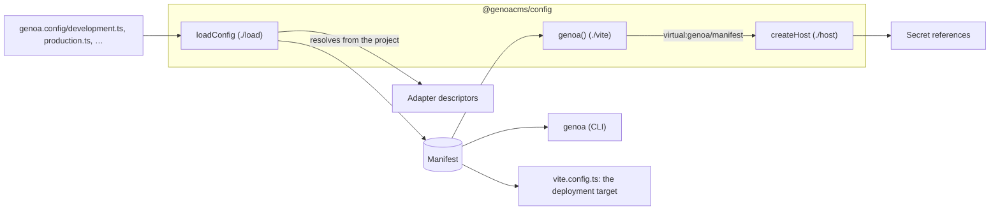

# Configuration

## Design

### Role

A project describes its instance in `genoa.config`: which adapters provide each service, the
buckets and databases they serve, the collections, the authorization it declares and the security
defaults it seeds. `@genoacms/config` turns that file into a **manifest**, which every later phase
reads instead of the file: the CLI, core's Vite config, the `genoa()` Vite plugin and, inside the
build, the host. This document covers the config file, the loader's rules and the manifest. How
the host constructs providers from the manifest is in [`host.md`](host.md), how credentials reach
them in [`secrets.md`](secrets.md), what an adapter is in
[`contracts/adapter-model.md`](contracts/adapter-model.md), the build and the artifact in
[`build.md`](build.md), and the commands in [`cli.md`](cli.md).



### Decisions

| # | Decision | Consequence |
| :-- | :-- | :-- |
| KU1 | Development and production use **separate config files**, selected explicitly. | No profile or overlay mechanism inside one file. |
| KU5 | `database.defaultDatabase` is history. | Dropped: every example config wrote it and nothing read it. |
| KU7 | Core's development config keeps its providers and its gitignored credential files, imported and wrapped in `inline()`. | Core's CI cannot load `genoa.config/development.ts`; the unit tests use `genoa.config/test.ts`, whose credentials are `env()` references no test resolves. A config that uses `secret()` or `env()` loads with no credential present. |
| KU8 | GCP deployment of core uses a separate production config. | `packages/core/genoa.config/production.ts`. |
| KU9 | `--config` is optional on every command, `genoa deploy` included. | Without it the default lookup applies (CFG-1). A development config chosen by mistake for a production build fails LDR-13, and the CLI names the production config (CLI-19). |
| KU12 | A project's configuration lives in **one place**: a single root file `genoa.config.ts`, or one directory `genoa.config/` holding every config file, the modules they share and local credential files. In the directory form the files are named after their environment: `development.ts` and `production.ts`. | The default lookup (CFG-1) never finds a production config, which is always named with `--config genoa.config/production.ts`. Core and `genoa init` use the directory form. *Cost:* `genoa.config/index.ts` is not a config; two layouts stay supported; the symmetric names suggest a mode-based default that does not exist; when both forms exist the root file wins silently; the KU9 guard works only when the development config holds a `developmentOnly` adapter. Core's `.npmignore` covers `/genoa.config`, so anything moved out of it must be listed again. |

**KD1. The config is data.** A config file is a module that evaluates to a plain, JSON-serializable
object. It may import helpers, shared modules and collection files. It does not import adapters, and
it holds a credential value only through `inline()`. The loader evaluates it on a developer machine
or a CI runner and produces the manifest. Every later phase reads the manifest, never the module.
*Why:* it removed the import cycle between the config and the adapters (KF2), the bundle of the
config (KF6) and SDK loading at build time (KF7).
*Cost:* the config cannot compute anything at runtime; nothing needs to. One build evaluates it in
three places (the CLI, core's Vite config, the Vite plugin), each memoized in its process (LDR-18).
`runnerImport` is experimental in Vite (KF25), so a breaking change there hits the loader; it is
isolated in one module, and a fallback such as `jiti` is a one-module swap.

### Core's own configs

`packages/core/genoa.config/` holds one config per use, sharing `collections.js`,
`authorization.ts`, `security.ts` and `languages.ts`. `development.ts` is the default (CFG-1): the
development store, GCP storage and Firestore with the gitignored service account wrapped in
`inline()` (KU7), the array adapter, and a Node target. `production.ts` deploys to GCP: every
Google provider authenticates as the function's service account, users live in Identity Platform,
and the deploy credential is the target's `inline()`, which never enters the build (LDR-19).
`test.ts` is the unit tests' config and `e2e.ts` the end-to-end tests'. `gcp.ts`, `aws.ts` and
`self-hosted.ts` are examples the documentation site checks.

### Rejected alternatives

| Alternative | Why rejected |
| :-- | :-- |
| **Environment overlays in one config file** | The author chose separate files (KU1). Composition across files is plain TypeScript imports. |
| **Config as JSON or YAML** | Collection definitions use schema helpers, and configs share modules. A module that evaluates to data keeps composition and gets every property of a static format through the manifest. |

### Findings

KF1 to KF19 are the system as it was before the 2026-09 redesign (KS1 to KS8, RFC-0001 to
RFC-0020), kept short. KF21 to KF28 are facts about the tools that the design relies on.

| # | Finding | State |
| :-- | :-- | :-- |
| KF1 | *History.* Where the config lived was inferred from `cwd`, a `../../..` walk gated on `GENOA_BUILD`, and `GENOA_CONFIG_PATH`. | fixed, redesign: the facts of BLD-1 |
| KF2 | *History.* Importing `@genoacms/cloudabstraction` evaluated the user's config and every adapter it named, SDKs included, through an import cycle that worked only because the config did not await its adapter imports. | fixed, redesign (KD1) |
| KF3 | *History.* Each adapter hardcoded its own published specifier, which had to match `adapterPath` in the config. | fixed, redesign (DD3) |
| KF4 | *History.* `getProvider` returned the first entry not yet marked initialized and mutated the shared config: the result depended on call order. | fixed, redesign (DD3) |
| KF5 | *History.* Adapters were module-level singletons, so two providers naming one adapter shared one client. | fixed, redesign (DD3, HST-2) |
| KF6 | *History.* A rollup bundle of the config was read only by the Node deployment; GCP loaded the raw config from uploaded source. | fixed, redesign (KD1) |
| KF7 | *History.* `svelte.config.js` imported the whole config, and so every SDK, to read which SvelteKit adapter to use, so `vite build` needed real credentials. | fixed, redesign (CD16, BLD-2) |
| KF8 | *History.* The config's types drifted from the loader: a one-parameter `Config` given three arguments, a type that did not exist, the old singular `adapter:` shape. | fixed, redesign (CFG-3, CD16) |
| KF9 | *History.* **The GCP deploy uploaded the service-account key**: it archived the project root, `genoa.config/gcp/serviceAccount.json` included. | fixed, redesign: only the artifact leaves the machine (PU2) |
| KF10 | *History.* The default deployment provider was decided twice, in `svelte.config.js` and in the CLI; deployment providers were looked up by name, every other service by `adapterPath`. | fixed, redesign (BLD-2, CLI-7) |
| KF11 | *History.* `adapter-secrets-env` resolved `.env` against `cwd`, which under `genoa run` was the installed core, and core had to set `envDir: false`. | fixed, RFC-0006 (DST-3) |
| KF12 | *History.* The config was evaluated by two processes with two working directories, reconciled by `../../..`. | fixed, redesign (BLD-1) |
| KF13 | *History.* `@genoacms/cloudabstraction` mixed the service contracts, a config loader and a rollup build tool, so every adapter inherited rollup. | fixed, RFC-0001 and RFC-0016 (CU18) |
| KF14 | *History.* `adapter-aws` was written against a config shape that no longer existed and could not run. | fixed, RFC-0013 |
| KF15 | *History.* The GCP deploy injected a snippet that did not exist and assumed a remote build of uploaded source. | fixed, RFC-0015 (PU2) |
| KF16 | *History.* `SecretReference` and `isSecretReference` were declared and never called: no resolution existed. | fixed, RFC-0004 (REF-2) |
| KF17 | *History.* The Cloud Run SvelteKit adapter needed a gitignored `files/` directory built before use. | fixed, RFC-0043 (PU18) |
| KF18 | *History.* **Every build ran the instance's startup I/O**: SvelteKit runs the built server to analyse it, which ran the bootstrap and the collection listing against the configured storage, and crashed without credentials. | fixed, RFC-0019 (PD8, BLD-3) |
| KF19 | *History.* The artifact's `package.json` named versions the registry did not have, or had with other code. | fixed, RFC-0020 (PD9) |
| KF21 | SvelteKit loads its config from `process.cwd()`; from SvelteKit 3 it is the argument of `sveltekit()` in the Vite config, which Vite also loads from `process.cwd()` (`@sveltejs/kit/src/core/config/index.js`, PF21). | holds; met by BLD-1 |
| KF22 | *History.* Both SvelteKit adapters re-bundled the server with rollup and left external exactly the `dependencies` of `package.json` in `process.cwd()`. | changed by SvelteKit 3: PF24 |
| KF23 | With Vite running in core, only packages in core's `dependencies` stay external, so a literal `import('@genoacms/adapter-…')` in core would be bundled with its SDK. | holds; met by CD17 |
| KF24 | Cloud Run functions build a container with buildpacks, which run `npm install` on the uploaded `package.json`; uploading `node_modules` is never needed (GCP platform behavior). | holds; met by PD6 |
| KF25 | Vite exports `runnerImport(moduleId, inlineConfig)`, which evaluates a TypeScript module and its imports without a dev server, marked `@experimental` in Vite 7 and 8 (`vite/dist/node/index.d.ts`, PF27). | holds; used by CFG-2 |
| KF26 | `@genoacms/adapter-secrets-env` is development only (`adapter-secrets-env/README.md`). | holds; DST-1 |
| KF27 | The `authorization` stanza is authority, re-read on every resolution, and `security` seeds the signed policy; the stanzas' doc comments say so and are kept verbatim. | holds; CFG-3, HST-6 |
| KF28 | Core's `build` script builds `language-adapter-ts` through pnpm and works only in the monorepo, so the CLI does not run core's npm scripts. | holds; CLI-5 |
| KF29 | **A config without a secrets store, or without authentication or language providers, loads** (LDR-1, LDR-9). `secrets: {}`, `authentication: {}` and `languages: {}` pass every rule. The missing store surfaces only at the first request, as `secrets/provider-count` from REF-7, which the bootstrap logs and swallows. Found by LS3 (D13). | open |
| KF30 | **`-0` and symbol-keyed properties pass the data rule** (LDR-2). The rule walks the values rather than comparing a JSON round trip: `-0` becomes `0` in the build, and a symbol-keyed property is dropped without an issue. Found by LS3 (D14). | open |
| KF31 | **`genoa build` prints each inline warning twice** (LDR-14). The CLI loads the config, then Vite's plugin loads it again in its own process with the default warning sink. The plugin never receives `--no-inline`, so a bare `vite build` warns where the CLI refuses. Found by LS3 (D16). | open |

### History

*History.* Until 2026-09 the config was a module that imported its adapters, which read the whole
config back through `@genoacms/cloudabstraction` (KF1 to KF19). The redesign of 2026-09-26 replaced
the external proposal `genoacms-config-architecture.md` (2026-09-10): it kept the proposal's core
decisions and corrected the parts that did not match the repository or did not type-check, among
them a claim that the config bundle was dead, a GCP deploy described as uploading the build, types
that left optional secrets unresolved, and dev loading through `ssrLoadModule` before a dev server
exists. Its goals were any platform through an adapter, several providers per service including two
of one adapter, credentials kept in a secret manager and resolved at runtime, a build that
constructs no client, and every existing capability preserved. A table of preserved functionality
mapped each capability before to its form after; the ones still visible are the stanzas of CFG-3,
the host's routing and data (HST-4, HST-6), lazy construction per provider (HST-2), the CLI's
commands (`cli.md`) and the conformance suites run against a factory (`contracts/conformance.md`).
RFC-0001 to RFC-0020 implemented it, RFC-0018 the one directory of KU12, and nothing was released
before, so no migration existed.

*History.* On 2026-10-02 this document was split by subject, without changing the content that
moved: the adapter model and the service contracts to [`contracts/`](contracts/README.md) (U4, D2,
D4, U14, F20, Q5 and Q6), the host to [`host.md`](host.md) (D3), secrets to
[`secrets.md`](secrets.md) (U3, U11, D5), the build to [`build.md`](build.md) (U2, U6, U10, D6 to
D9), the CLI to [`cli.md`](cli.md), and authentication on GCP and self-owned stores (U13) to
[`adapter-gcp/authentication-identity-platform.md`](adapter-gcp/authentication-identity-platform.md)
GU1 and [`identities.md`](identities.md) IU1.

*History.* On 2026-11-26 the five documents of the split were restructured under the Spec Workflow
(KS9). Their IDs had been unprefixed and shared; each keeps its number under its document's prefix:
`K` here, `D` in `host.md`, `S` in `secrets.md` and `P` in `build.md`, so D1 is KD1 and S-1 is KS1.
The adapter model's three IDs clashed with the contracts register and were renumbered: U4 is CU18,
D2 CD16 and D4 CD17. The constraints R1 to R8 are KF21 to KF28. Frozen RFCs keep the old IDs.

### Verification

KS1 to KS8 were run on 2026-09-26 and 2026-09-27, before any RFC of the redesign, with Node 24.21,
Vite 7.3.6, SvelteKit 2.70.2, `@sveltejs/adapter-node` 5.5.7, the repository's Cloud Run SvelteKit
adapter, pnpm 10.6 and npm 11.19. KS1 to KS5 used a fake installed core in a separate project with a
fake adapter whose runtime imported a fake SDK carrying a marker string, configured as two
providers; KS6 used a real build of core at `9592593`. No repository file was changed.

| # | Assumption | Result |
| :-- | :-- | :-- |
| KS1 | An opaque runtime `import()` in core survives `vite build` and both SvelteKit adapters, and resolves from the artifact's `node_modules` after install. | **Pass.** The SDK marker was absent from both outputs; after `npm install` of the generated `package.json`, both artifacts served, and two providers on one adapter were two instances. |
| KS2 | `runnerImport` loads a TypeScript config with imports from a script, from a SvelteKit config and from a Vite plugin. | **Pass, with two corrections.** TypeScript, JSON, `.js` credential modules and nested imports load in 66–80 ms, and a type-only adapter import loads nothing. Its import graph excludes the config file itself. The plugin's `configResolved` fired eight times per build with inconsistent `mode`, which led to `GENOA_MODE` (PD7) and memoization (LDR-18). |
| KS3 | An absolute `out` outside core works for both SvelteKit adapters. | **Pass.** SvelteKit still writes `.svelte-kit/` inside core, and Vite `node_modules/.vite-temp/`, both new files inside the installed package. |
| KS4 | A Cloud Run function runs from the build plus a generated `package.json` with `"main": "function.js"`. | **Local pass.** The live deploy was skipped until the production config existed (PU10); the author deployed core to GCP on 2026-09-28, and it serves. |
| KS5 | In a pnpm project, core resolves the project's adapter packages in Vite dev and in the build. | **Pass**, with default hoisting and `hoist: false`. Importing `@sveltejs/adapter-node` by name from core failed under `hoist: false`, which led to the deployment descriptor's loader functions (CD16). |
| KS6 | A bare-specifier scan of the server output finds every external. | **Pass** on real core: 12 externals, no `require` or `createRequire`, and only known non-literal imports; the generated `package.json` installed 126 packages (67 MB). Core was not booted from the installed artifact. |
| KS7 | Descriptors and deploy-time modules load from the project root even when the loading code lives in another package. | **Pass with `import-meta-resolve`** under strict pnpm. `runnerImport` was rejected for this: it closes its module runner, and a descriptor's lazy `import()` then fails. |
| KS8 | A packed local package installs from the artifact with npm, without the registry (PD9). | **Pass** for `npm pack --ignore-scripts` with `overrides`, with npm 11.19, 10.9.2 and 9.9.4; without `overrides`, `workspace:^` and nested ranges fail. yarn v1 copies a `file:` directory into `node_modules`, indistinguishable from a registry install, which is why adapters are vendored unconditionally. Run on 2026-09-27 at `15bcbd5`. |
| KS9 | 2026-11-26: the Specification below was written from the code at `f18f6205`, rule by rule, from `packages/config/src/load/` and `src/vite/`. LS3 (`cli.md`) had audited the earlier text against the code at `9f43931`; its items D13, D14 and D16 are KF29 to KF31, and D15 is stated in LDR-17 and LDR-18. No falsification audit of these statements has run. | stated as found |

## Specification

### The config file

#### CFG-1 · Where the config is

A config file named explicitly (`--config`, `GENOA_CONFIG`) is used as given. Otherwise the loader
takes the first file that exists under the project root, in this order: `genoa.config.ts`,
`genoa.config.mts`, `genoa.config.js`, `genoa.config.mjs`, `genoa.config/development.ts`,
`genoa.config/development.mts`, `genoa.config/development.js`, `genoa.config/development.mjs`. No
other file is found by default, `genoa.config/index.*` and `genoa.config/production.*` included.
When none exists, the load fails with the `ConfigError` `config/not-found`, whose one issue reads
`no config file under <root>; looked for: <the eight paths, comma-separated>`.

- Test: `packages/config/src/load/loader.test.ts`
- Level: unit

#### CFG-2 · Evaluating the config

The file is evaluated with Vite's module runner, rooted at the project, with no Vite config file:
TypeScript, JSON imports and plain `.js` modules load, and a type-only import loads nothing. A file
that throws while evaluating fails the load with `config/evaluation-failed`: `<file> failed to
evaluate: <first line of the error>`. A file whose default export is not a plain object fails with
`config/not-an-object`: `<file> must default-export a plain object`. The import graph is recorded:
the file itself first, then every file it imported.

- Test: `packages/config/src/load/loader.test.ts`
- Level: unit

#### CFG-3 · The config's shape

`@genoacms/config` exports these types. `authorization` and `security` are typed as
`AuthorizationConfig` and `SecurityConfig`, also exported; what they mean is specified where they are used
([`authorization.md`](authorization.md), [`signing.md`](signing.md)).

```ts
interface ProviderEntry<S extends string = string, O = unknown> { readonly adapter: S, readonly options: O }
type Providers = Record<string, ProviderEntry>

interface Config<AP extends Providers, DP extends Providers, SP extends Providers,
  XP extends Providers, LP extends Providers, TP extends Providers> {
  authentication: {
    providers: AP                     // tried in key order; the first Identity wins
    cookieName: string
    agents?: Record<string, { label: string, token: Secret<string> }>   // keyed by agent:<name>
  }
  database: { providers: DP, databases: Record<string, { provider: keyof DP & string, collections: CollectionReference[] }> }
  storage: {
    providers: SP
    buckets: Record<string, { provider: keyof SP & string }>
    defaultBucket: string
    pathDelimiter?: string            // segment separator in storage browser URLs; default '|->'
  }
  secrets: { providers: XP }          // exactly one provider
  languages: { providers: LP }        // keyed by the language name a component records
  deployment?: { targets: TP, default?: keyof TP & string }   // a build requires a target
  authorization: AuthorizationConfig
  security: SecurityConfig
}
```

Under `tsc --strict`, a bucket or database naming a provider that is not a key of its `providers`
is an error, and so is a `deployment.default` naming no target.

- Test: unverified (the types are checked by `tsc` in `packages/config/test/types/config.test.ts`, which writes no report)
- Level: unit

#### CFG-4 · Authoring helpers

`defineConfig(config)` returns its argument. `storageProvider`, `databaseProvider`,
`authenticationProvider`, `secretsProvider`, `languageProvider` and `deploymentTarget` each take an
adapter specifier and its options and return `{ adapter, options }`. Each types the options by its
service's registry (CD16): a registered specifier takes its registered option type, a bare object
in a `Secret` field is a type error, and `secretsProvider` refuses `secret()` in any field (REF-7).
The helpers evaluate inside a config file.

- Test: `packages/config/src/load/loader.test.ts` (unverified: the type errors, which `tsc` checks in `packages/config/test/types/config.test.ts` without a report)
- Level: unit

### The loader's rules

`loadConfig({ root, file?, mode, forbidInline?, onWarning? })` evaluates the config (CFG-2), loads
its descriptors (LDR-16) and applies LDR-1 to LDR-14, LDR-22 and the agent rules of
[`agent-access.md`](agent-access.md) (AGT-1, AGT-5), then builds the manifest (LDR-17). A provider
entry is each value of `authentication.providers`, `database.providers`, `storage.providers`,
`secrets.providers`, `languages.providers` and `deployment.targets`; its path is
`<stanza>.<providers or targets>.<key>`.

#### LDR-1 · Stanzas and provider entries

`authentication`, `database`, `storage`, `secrets`, `languages`, `authorization` and `security`
are plain objects, or the issue `config/missing-stanza` at the stanza's name reads `is required and
must be an object`. A provider entry is `{ adapter: <non-empty string>, options: <plain object> }`,
or the issue `config/invalid-provider-entry` at its path reads `must be { adapter: '<descriptor
specifier>', options: { … } }`.

- Test: `packages/config/src/load/loader.test.ts`
- Level: unit

#### LDR-2 · Data only

Every value of the config, at any depth, is `null`, a boolean, a string, a finite number, an array
or a plain object. Any other value gives the issue `config/not-serializable` at its path, reading
`is undefined: remove the key or give it a value`, `is <value>, which JSON cannot represent` for a
non-finite number, `is a function: the config must evaluate to data`, `is a <bigint or symbol>,
which JSON cannot represent`, or `is an instance of <class name>, which does not survive JSON`.

- Test: `packages/config/src/load/loader.test.ts`
- Level: unit

#### LDR-3 · Each adapter under its own service

A provider entry whose descriptor's `kind` is not the kind of the place it is configured in
(`authentication`, `database`, `storage`, `secrets`, `language` under `languages`, `deployment`
under `deployment.targets`) gives `config/kind-mismatch` at `<path>.adapter`: `<specifier> is a
<kind> adapter, configured under <stanza>`.

- Test: `packages/config/src/load/loader.test.ts`
- Level: unit

#### LDR-4 · The descriptor's validation

Each entry's unresolved options are passed to its descriptor's `validate`, when it has one, and
each reason it returns is an issue `config/invalid-options` at `<path>.options`. A `validate` that
throws gives the one reason `validate threw: <its message>`.

- Test: `packages/config/src/load/loader.test.ts`
- Level: unit

#### LDR-5 · Credential fields hold references

Each option the descriptor lists in `secretOptions` that is present holds a `secret()`, `env()` or
`inline()` reference (REF-1), or the issue `config/bare-secret` at `<path>.options.<option>` reads
`is a credential field: use secret(), env() or inline(), not a bare value`. An absent credential
option is allowed.

- Test: `packages/config/src/load/loader.test.ts`
- Level: unit

#### LDR-6 · References only in credential fields

A reference anywhere other than a listed credential option of an entry whose descriptor loaded, or
an agent's `token` (AGT-1), gives `config/misplaced-reference` at its path: `a secret(), env() or
inline() reference is only allowed in a credential field the adapter declares`. The values under an
entry whose descriptor did not load are not checked by this rule.

- Test: `packages/config/src/load/loader.test.ts`, `packages/config/src/load/agents.test.ts`
- Level: unit

#### LDR-7 · The bootstrap rule

A `secret()` reference at any depth of the secrets provider's options gives
`config/bootstrap-secret` at its path: `the secrets provider cannot be configured with secret():
nothing exists yet to resolve it; use env() or inline()`.

- Test: `packages/config/src/load/loader.test.ts`
- Level: unit

#### LDR-8 · Secret keys

Every `secret()` key in the config matches the portable key rule (REF-8), or the issue
`config/invalid-secret-key` at its path reads `secret key must match ^[A-Za-z_][A-Za-z0-9_]*$`.

- Test: `packages/config/src/load/loader.test.ts`
- Level: unit

#### LDR-9 · One secrets store

When `secrets.providers` is a plain object, it has exactly one key, or the issue
`config/secrets-provider-count` at `secrets.providers` reads `exactly one provider is allowed,
found <n>` (KF29).

- Test: `packages/config/src/load/loader.test.ts`
- Level: unit

#### LDR-22 · The secrets prefix

**New.** `secrets.prefix` is absent, or a string of at most 64 characters matching
`^[A-Za-z][A-Za-z0-9]*(_[A-Za-z0-9]+)*$`: it starts with a letter, holds no `__`, and does not end
in `_`. Any other value gives the issue `config/invalid-secrets-prefix` at `secrets.prefix`,
reading `must match ^[A-Za-z][A-Za-z0-9]*(_[A-Za-z0-9]+)*$ and be at most 64 characters`. The
manifest carries it in `config.secrets.prefix` (LDR-17), and the host applies it (`secrets.md`
REF-9).

- Test: none yet
- Level: unit
- State: new (RFC-0050)

#### LDR-10 · Names that must exist

Each bucket's `provider` is a key of `storage.providers`, and each database's `provider` a key of
`database.providers`, or the issue `config/unknown-provider` at
`storage.buckets.<bucket>.provider` or `database.databases.<database>.provider` reads `must name a
key of storage.providers` or `must name a key of database.providers`. A `deployment.default` that
is present is a key of `deployment.targets`, or the same code at `deployment.default` reads `must
name a key of deployment.targets`.

- Test: `packages/config/src/load/loader.test.ts`
- Level: unit

#### LDR-11 · The default bucket

`storage.defaultBucket` is a key of `storage.buckets`, or the issue `config/unknown-bucket` at
`storage.defaultBucket` reads `must name a key of storage.buckets`.

- Test: `packages/config/src/load/loader.test.ts`
- Level: unit

#### LDR-12 · No integer-like keys

A provider key, bucket name or database name matching `^(0|[1-9][0-9]*)$` gives `config/integer-key`
at its path: `integer-like keys are reordered by JavaScript, which would change the order providers
are tried in; use a name`.

- Test: `packages/config/src/load/loader.test.ts`
- Level: unit

#### LDR-13 · Development-only adapters

In `production` mode, an entry whose descriptor is `developmentOnly` gives `config/development-only`
at `<path>.adapter`: `<specifier> is for development only; a production build cannot use it`. In
`development` mode it is allowed.

- Test: `packages/config/src/load/loader.test.ts`
- Level: unit

#### LDR-14 · Inline values in production

In `production` mode, each `inline()` reference outside the `deployment` stanza is reported at its
path as `is inline: this value is written into the build`: as the warning `config/inline`, or, with
`forbidInline`, as the error `config/inline-forbidden`. In `development` mode, and under
`deployment`, an `inline()` reference is neither (KF31).

- Test: `packages/config/src/load/loader.test.ts`
- Level: unit

### Issues and the manifest

#### LDR-15 · Every issue at once

A load that finds any error rejects with one `ConfigError` whose `code` is `config/invalid` and
whose `issues` list every error found: rules in the order LDR-1 to LDR-14 and then the agent rules,
paths in document order, each `{ code, path, message }`. Its message is `config/invalid:` followed
by one line per issue, `  - <path>: <message>`, the path and colon left out for an issue without
one. Warnings are not errors: each is passed to `onWarning`, or printed to standard error as
`[genoacms] <path> <message>`, and the load succeeds when only warnings were found. No message of
the loader holds an option's value.

- Test: `packages/config/src/load/loader.test.ts`
- Level: unit

#### LDR-16 · Descriptors load from the project

Each distinct `adapter` specifier of a well-formed entry is resolved with Node's ESM algorithm as if
imported from `<root>/package.json`, and imported natively, wherever `@genoacms/config` is installed;
no runtime module is loaded. A specifier that does not resolve or import gives
`config/descriptor-not-found` at the first entry's `<path>.adapter`: `cannot load <specifier>: <first
line of the error>`. A module whose default export is not a descriptor gives `config/descriptor-invalid`:
`<specifier>: <reasons>`, a reason being `its default export is not a descriptor object`, `kind
<kind as JSON> is not a service kind`, `a deployment descriptor needs svelteKitAdapter and procedure
functions`, or `runtime must be a non-empty bare specifier`. The descriptor's package is the
specifier's first segment, or first two for a scoped name, and its version is that of the nearest
`package.json` above the resolved file that carries that name.

- Test: `packages/config/src/load/loader.test.ts`
- Level: unit

#### LDR-17 · The manifest

A load that finds no error resolves to a manifest:

```ts
interface Manifest {
  readonly version: 1
  readonly mode: 'development' | 'production'
  readonly config: SerializedConfig          // the evaluated config, references as their $… objects
  readonly adapters: Readonly<Record<string, {        // one record per distinct descriptor specifier
    readonly kind: 'storage' | 'database' | 'authentication' | 'secrets' | 'language' | 'deployment'
    readonly runtime?: string                          // absent for deployment descriptors
    readonly secretOptions: Readonly<Record<string, 'string' | 'json'>>   // {} when none
    readonly developmentOnly: boolean
    readonly package: string                           // the descriptor's package (LDR-16)
    readonly version: string
  }>>
  readonly source?: { readonly root: string, readonly file: string, readonly dependencies: readonly string[] }
}
```

`source` is present in `development` mode only, and its `dependencies` is CFG-2's import graph, the
config file first.

- Test: `packages/config/src/load/loader.test.ts`
- Level: unit

#### LDR-18 · One load per file, mode and inline rule

Within one process, calls to `loadConfig` with the same config file, mode and `forbidInline` return
the very same promise, so the config is evaluated and its warnings reported once. A load that
rejects is forgotten, and the next call loads again. `clearLoadCache()` forgets every load.

- Test: `packages/config/src/load/loader.test.ts`, `packages/config/src/vite/plugin.test.ts`
- Level: unit

#### LDR-19 · The runtime manifest

`toRuntimeManifest(manifest)` returns a new object, leaving its argument unchanged: the manifest
without `config.deployment`, without the adapter records of kind `deployment`, and with `source`
reduced to `{ root, file }`, absent when the manifest has none. It is what the build embeds, so no
deployment option, inline or not, enters the build.

- Test: `packages/config/src/manifest.test.ts`
- Level: unit

#### LDR-20 · The manifest in Vite

The `genoa()` Vite plugin loads the config once per Vite config resolution, with the project, file
and mode of BLD-1 (the mode falling back to `development` for `vite dev` and `production` for `vite
build`), and serves `virtual:genoa/manifest`, a module exporting `manifest`, the runtime manifest
(LDR-19). It resolves no other id.

- Test: `packages/config/src/vite/plugin.test.ts`
- Level: unit

#### LDR-21 · Config edits restart the dev server

In the dev server, the plugin watches the files of `source.dependencies`. A change to one of them
forgets every load (LDR-18) and restarts the server, which then loads the edited config. A change to
any other file does neither.

- Test: `packages/config/src/vite/plugin.test.ts`
- Level: unit
