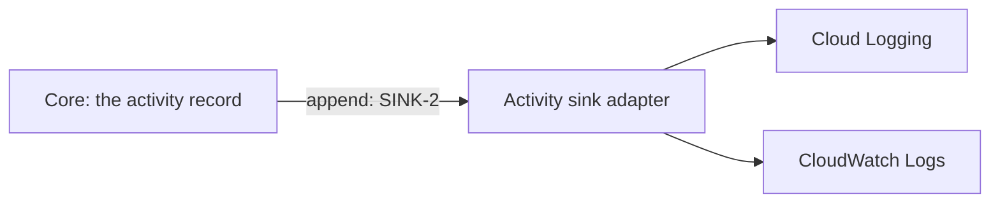

# Activity sink contract

Part of the [service contracts](README.md). Markers, IDs and test references as defined there.

**Everything in this document is New.** No RFC yet.

## Design

### Role

An **activity sink** stores the signed entries of the activity record ([`activity.md`](../activity.md)):
core signs each entry and hands it to the sink one record at a time. A sink is an adapter of the
kind `activity`. It stores what it receives and never signs, verifies, reads back or alters an
entry: core signs every entry before it reaches a sink (`activity.md` AU12), so a sink is trusted to
keep entries durably, never to vouch for them.



Each adapter specifies its own mapping onto the contract. Not part of the contract: reading entries
back (operators inspect logs in their provider's console or SIEM, and an optional reader capability
per CD1 may be added later without changing `append`), where the provider keeps entries, who may
delete them, and how its retention is set beyond `retentionDays` (SINK-4); these belong to the
provider, and its adapter's document says how to configure them.

### Decisions

| # | Decision | Where |
| :-- | :-- | :-- |
| CU19 | 2026-11-28: the activity sink contract is write-only (`append` only); reading entries back is not part of the contract (`activity.md` AU8). An optional reader capability (CD1) can be added later without breaking `append`. | SINK-1, SINK-2 |
| CU20 | 2026-11-27: a sink adapter that can set its provider's retention takes it as an option; absent, the retention configured at the provider stands untouched (`activity.md` AU9). | SINK-4 |

**CD18. A record carries `at`, `action` and optional `subject` beside the envelope, unsigned.**
SINK-1.
*Why:* providers index, label and route entries on fields of their own (a log entry's timestamp and
labels); they cannot inspect core's opaque `SignedEnvelope` payload without coupling every adapter
to core's payload schema version. Copying these three fields out of the payload lets every sink
populate native metadata while treating `envelope` as an opaque signed blob.
*Cost:* the copies are not covered by the signature. Any verifier checking an exported entry
verifies `envelope` first and reads all authoritative fields from its signed payload.

**CD19. Records are appended one at a time, bounded to 64 KiB.** SINK-2.
*Why:* without chains there is no shared head to batch around, and enforcing a hard 64 KiB
serialized record ceiling in core guarantees every provider (including Cloud Logging and CloudWatch
Logs, both capped at 256 KiB per entry) can accept every record in a single call without splitting.
*Cost:* one provider call per recorded event.

### Findings

None.

### History

*History.* The first draft (2026-11-27) accepted batches of up to 100 records and defined an
optional `ActivityReader` capability for newest-first paginated listing. On 2026-11-28 the contract
was simplified to single-record, write-only `append` (CU19, CD19) because managed logging services
such as CloudWatch Logs cannot cleanly serve synchronous descending paginated queries, and in-CMS
reading was dropped from core (`activity.md` AU8).

### Verification

None.

## Specification

### Types

#### SINK-1 · The types that cross the contract

**New.** `@genoacms/contracts/activity` exports:

```ts
interface ActivityRecord {
  readonly at: number                 // the payload's at (activity.md LOG-1)
  readonly action: string             // the payload's action (activity.md ACT-1)
  readonly subject?: string           // the payload's actor.subject, when the actor has one
  readonly envelope: SignedEnvelope   // signing.md ENV-1
}

interface ActivitySink {
  readonly append: (record: ActivityRecord) => Promise<void>
}
```

An adapter of the kind `activity` is an `AdapterDescriptor<'activity', O>` whose runtime creates an
`ActivitySink` (`adapter-model.md` MOD-1).

- Test: none yet
- Level: unit
- State: new (no RFC yet)

### Appending

#### SINK-2 · Appending

**New.** `append` stores the record it receives, whose UTF-8 JSON encoding is at most 65,536 bytes
(64 KiB). It resolves only once the provider has acknowledged the record durably; buffering a record
past the call, or acknowledging before the provider has, is a breach of the contract. The record's
`envelope` is stored intact without modifying its fields or canonical values so it verifies offline
against the root key and key manifest (`signing.md` VFY-1).

- Test: none yet
- Level: unit, contract, conformance
- State: new (no RFC yet)

#### SINK-3 · A failed append

**New.** When the provider refuses or fails to store the record, `append` rejects with the
provider's error, its message unchanged (`storage.md` STOR-15 is the same rule for storage).

- Test: none yet
- Level: unit, conformance
- State: new (no RFC yet)

### Options

#### SINK-4 · Retention

**New.** A sink adapter whose provider's retention can be set takes the option
`retentionDays?: number`, an integer from 1 to 36,500, and its descriptor's `validate` refuses any
other value with `retentionDays must be an integer from 1 to 36500`. Set, the adapter applies it to
where it stores records, as its own document specifies; absent, the adapter never changes the
retention configured at the provider. An adapter whose provider has no settable retention has no such
option.

- Test: none yet
- Level: unit, contract
- State: new (no RFC yet)
