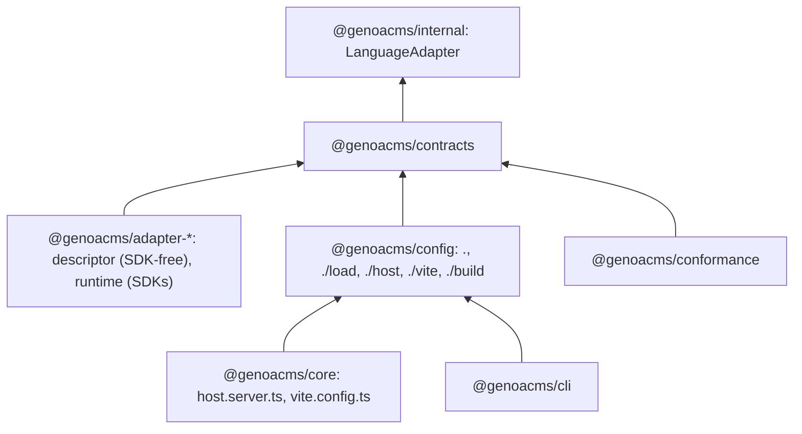

# The adapter model

## Design

### Role

What an adapter is, as `@genoacms/contracts` types it: a descriptor and a runtime per service, the
references that fill credential options, the registries that type each provider entry, and the
packages and their dependency direction. What each service's instance must do is in the service's
own contract document ([`README.md`](README.md)); how the loader checks a descriptor is in
[`configuration.md`](../configuration.md), and how the host calls a runtime in
[`host.md`](../host.md).



An adapter imports only `@genoacms/contracts` and its own SDKs. Nothing imports a config file except
the loader, and nothing imports an adapter runtime except the host's loader, after the manifest
exists. `@genoacms/config/host` does not import Vite, because it ships inside the server bundle
(HST-8). The conformance suites have their own package, so `contracts` stays free of test tooling.
`LanguageAdapter` stays in `@genoacms/internal/languageAdapter`, whose types it is built from;
`@genoacms/contracts` depends on `internal` for it.

### Decisions

| # | Decision | Where |
| :-- | :-- | :-- |
| CU18 | Package names: `@genoacms/contracts` and `@genoacms/config`. `@genoacms/cloudabstraction` is deleted. | RFC-0001, RFC-0016 |

**CD16. Adapters are two modules: a descriptor and a runtime.** The *descriptor* is SDK-free. It
declares the service kind, which options are secrets, whether the adapter is development-only, an
option validator, and the bare specifier of its runtime module (MOD-1). The *runtime* exports a
factory `create(resolvedOptions, ctx)`. The config names the descriptor.
*Why:* the loader and the build can validate every provider, and choose a SvelteKit adapter, without
loading a single SDK: KD1 applied to adapters. The external proposal ran validators inside the
adapter module, which brought KF7 back.
*Cost:* an adapter ships two entry points per service, plus a registry augmentation.

**CD17. Adapter runtimes are loaded by bare specifier at runtime, not bundled.** The host's loader is
a dynamic `import()` whose argument the bundler cannot analyze, so adapter packages stay external in
every SvelteKit adapter's output (KF23), and the build lists them in the artifact's `package.json`
(ART-2).
*Why:* bundling cloud SDKs is fragile (gRPC clients load proto files by path) and outside our
control for third-party SvelteKit adapters.
*Cost:* the deployment must install dependencies, which every target already does for core's own
externals. Resolution relies on Node's walk-up from the installed core: KS5 showed it holds under
npm, pnpm's default hoisting and `hoist: false` for packages the project depends on directly, not
for transitive ones, which is why the SvelteKit adapter is loaded through the descriptor (MOD-2).
Yarn PnP is untested, and a SvelteKit adapter that traces dependencies (such as Vercel's nft) may
treat a non-analyzable `import()` differently.

**One JSON rule, stated once.** `secret()` and `env()` always yield strings. When the descriptor
declares an option as `'json'`, the host parses the string before calling `create` (REF-3).
`inline()` passes its value through unchanged. There is no content sniffing, so a string secret that
begins with `{` is never misread.

### Rejected alternatives

| Alternative | Why rejected |
| :-- | :-- |
| **A generated table of literal `import()`s** (the external proposal) | A literal import is bundled by the SvelteKit adapter with its cloud SDK (KF23). |
| **Adapter `validate` inside the runtime module** (the external proposal) | Loads SDKs at build time and brings KF7 back. Solved by CD16. |
| **Generic `Config<Extension>` typing** | One type parameter cannot type heterogeneous provider collections (KF8). Module augmentation keyed by specifier scales without coupling. |
| **Three packages (contracts, loader, host)** | No consumer wants the loader without the host's types, or the reverse. Subpath exports keep Vite out of `./host`. |
| **Linking `@genoacms/core` from outside the project** | Adapter resolution relies on the walk-up from the installed core (CD17); a `link:` or `file:` core elsewhere is not supported. |

### Findings

| # | Finding | State |
| :-- | :-- | :-- |
| CF67 | **No release proves the adapter model's types** (MOD-1 to MOD-4, MOD-6). They are checked by `tsc` over `test/types/`, which writes no JUnit report, so `check-results.mjs` cannot see them, and they stay `unverified`. `packages/contracts` already runs `.test-d.ts` type tests under Vitest, which do report. Found converting this document, 2026-11-26. | open |

### History

*History.* The descriptor and runtime split, the references and the registries came with the
2026-09 redesign (RFC-0001), which replaced `@genoacms/cloudabstraction`'s `Extension` generic
(KF8). This text was split out of `configuration.md` on 2026-10-02 and restructured under the Spec
Workflow on 2026-11-26 (CS9). Its IDs clashed with the contracts register: U4 is CU18, D2 CD16 and
D4 CD17.

### Verification

- **CS9, Specification from the types, at `f18f6205`, 2026-11-26.** Written from `packages/contracts/src/adapter.d.ts`, `references.d.ts`, `registry.d.ts` and `index.js`, and checked against `test/types/contracts.test.ts`. No falsification audit of these statements has run.

## Specification

### Descriptors and runtimes

#### MOD-1 · A service adapter

```ts
interface AdapterDescriptor<Kind extends string, O extends object> {
  readonly kind: Kind
  readonly runtime: string            // bare specifier of the runtime module, never relative
  readonly secretOptions?: { readonly [K in keyof O]?: SecretEncoding }   // top-level credential options
  readonly developmentOnly?: boolean  // refused by a production build (LDR-13)
  readonly validate?: (options: unknown) => string[]   // reasons the unresolved options are invalid
}

interface AdapterContext {
  readonly name: string               // the provider's key; for messages, never for lookup
  readonly resources: readonly string[]   // HST-3
  readonly projectRoot?: string       // absent in a production artifact
}

interface AdapterRuntime<O extends object, Instance> {   // the runtime module's default export
  readonly create: (options: Resolved<O>, ctx: AdapterContext) => Instance | Promise<Instance>
}
```

A `secretOptions` key that is not an option name is a type error.

- Test: unverified (CF67)
- Level: unit

#### MOD-2 · A deployment target

```ts
type SvelteKitAdapterFactory = (options?: Record<string, unknown>) => { name: string, adapt: (builder: never) => unknown }

interface DeploymentDescriptor<O extends object> {
  readonly kind: 'deployment'
  readonly svelteKitAdapter: () => Promise<{ default: SvelteKitAdapterFactory }>
  readonly svelteKitOptions?: (options: O, ctx: { outDir: string }) => Record<string, unknown>
  readonly origin?: (options: O) => string | undefined
  readonly procedure: () => Promise<{ default: DeployProcedure<O> }>
  readonly secretOptions?: { readonly [K in keyof O]?: SecretEncoding }
  readonly validate?: (options: unknown) => string[]
}

interface DeployContext {
  readonly projectRoot: string
  readonly buildDir: string           // the artifact (ART-1)
  readonly workDir: string            // exists and is empty when the procedure starts
  readonly target: string             // the target's key in deployment.targets
}

type DeployProcedure<O extends object> = (options: Resolved<O>, ctx: DeployContext) => Promise<void>
```

`svelteKitOptions` and `origin` receive the options unresolved (BLD-2); the procedure receives them
resolved (CLI-8). A SvelteKit adapter whose `adapt` takes SvelteKit's `Builder` is a
`SvelteKitAdapterFactory`.

- Test: unverified (CF67)
- Level: unit

### References and registries

#### MOD-3 · References and resolved options

```ts
interface SecretRef { readonly $secret: string }
interface EnvRef { readonly $env: string }
interface InlineRef<T> { readonly $inline: T }
type Secret<T = string> = SecretRef | EnvRef | InlineRef<T>   // a credential option; T is its resolved type
type BootstrapSecret<T = string> = EnvRef | InlineRef<T>       // a credential of the secrets provider itself
type SecretEncoding = 'string' | 'json'

type ResolvedValue<V> =
  [V] extends [SecretRef | EnvRef | InlineRef<infer T>] ? T :
  V extends ReadonlyArray<infer E> ? Array<ResolvedValue<E>> :
  V extends object ? Resolved<V> : V
type Resolved<O> = {
  [K in keyof O]: ResolvedValue<NonNullable<O[K]>> | (undefined extends O[K] ? undefined : never)
}
```

An optional credential resolves to its type and stays optional.

- Test: unverified (CF67)
- Level: unit

#### MOD-4 · Registries

`StorageAdapters`, `DatabaseAdapters`, `AuthenticationAdapters`, `SecretsAdapters`,
`LanguageAdapters` and `DeploymentTargets` are interfaces an adapter augments, mapping its descriptor
specifier to its option type. `OptionsOf<R, S>` is `R[S]` for a registered specifier and
`Record<string, unknown>` for any other, so an unregistered adapter configures unchecked.

- Test: unverified (CF67)
- Level: unit

### Helpers

#### MOD-5 · Stamping the kind

`defineStorageAdapter`, `defineDatabaseAdapter`, `defineAuthenticationAdapter`,
`defineSecretsAdapter`, `defineLanguageAdapter` and `defineDeploymentTarget` return a frozen copy of
the descriptor they are given with `kind` set to `storage`, `database`, `authentication`, `secrets`,
`language` or `deployment`, replacing any `kind` it had, every other property kept. `defineRuntime`
and `defineDeployProcedure` return their argument.

- Test: `packages/contracts/src/define.test.js`
- Level: unit

#### MOD-6 · The bootstrap rule in the types

`defineSecretsAdapter<O>` does not compile when any option of `O`, at any depth, accepts a
`SecretRef`; options of `BootstrapSecret` compile.

- Test: unverified (CF67)
- Level: unit
