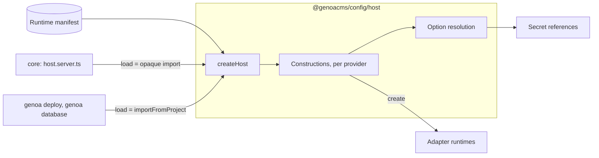

# The host

## Design

### Role

The host is the per-process object that holds a manifest ([`configuration.md`](configuration.md)
LDR-17) and constructs providers on first use. Core creates one over the runtime manifest the build
embeds, and the CLI one over the manifest it loaded, for `genoa deploy` and `genoa database`.
Adapters never see it: a runtime receives its resolved options and a context (CD16). How it resolves
the references in those options, and constructs the secrets store, is in [`secrets.md`](secrets.md).

### Decisions

**DD3. The host constructs providers; adapters never see the config.** For each provider entry the
host resolves the secret references, loads the runtime by specifier and calls `create`. It caches
the **promise** of each construction per provider, and drops a promise that rejects.
*Why:* two entries naming one adapter become two `create` calls (KF5). No adapter identifies itself
by a string (KF3), and no state is shared and mutated (KF4).
*Cost:* the first use of a provider is asynchronous and can fail. The host is one more object to
hand to tests.

### Rejected alternatives

| Alternative | Why rejected |
| :-- | :-- |
| **Eager resolution of every provider at cold start** | Pays for providers a request never uses, and makes readiness depend on every key existing. |

### Findings

None.

### History

*History.* Designed in the 2026-09 redesign and implemented by RFC-0004. Split out of
`configuration.md` on 2026-10-02, and restructured under the Spec Workflow on 2026-11-26 from the
code (DS1). D3 became DD3.

### Verification

- **DS1, drift audit and Specification from the code, at `f18f6205`, 2026-11-26.** The Specification was written from `packages/config/src/host/` and core's `host.server.ts`. LS3 (`cli.md`) had found the earlier text missing members, errors and loaders (D22); they are stated here. No falsification audit of these statements has run.

## Specification

### Construction

#### HST-1 · A host does no I/O when created

`createHost({ manifest, load, projectRoot?, secretTimeoutMs?, environment? })` returns a host without
loading a runtime, constructing a provider or reading a secret. `load(specifier)` resolves to the
runtime module, `projectRoot` defaults to the manifest's `source.root`, `secretTimeoutMs` to 10 000
and `environment` to `process.env`. A manifest whose `version` is not 1 is refused with the
`HostError` `host/unsupported-manifest: manifest version <version> is not supported`.

- Test: `packages/config/src/host/host.test.ts`
- Level: unit

#### HST-2 · One construction per provider

`storage(name)`, `database(name)`, `authentication(name)` and `language(name)` construct the provider
`name` of their service once per host: every call, concurrent first calls included, gets the same
promise. A construction that rejects is forgotten, so the next call constructs again. Two providers
naming one adapter are two constructions, each with its own options and resources.

- Test: `packages/config/src/host/host.test.ts`
- Level: unit

#### HST-3 · What a construction does

A construction of the provider `name` of `<service>` fails with `provider/not-found:
<service>.providers.<name>` when the service has no such provider, and with
`provider/unknown-adapter: <service>.providers.<name>.adapter: <specifier> is not in the manifest`
when the manifest has no runtime for its adapter. Otherwise it resolves the entry's options (REF-2),
loads the adapter's runtime with `load`, and returns what `create(resolvedOptions, { name, resources,
projectRoot })` returns. `resources` are, in key order, the buckets bound to the provider for
storage, the databases bound to it for a database, and empty otherwise. Every failure is a
`HostError` whose `code` is the message's prefix.

- Test: `packages/config/src/host/host.test.ts`
- Level: unit

#### HST-4 · Routing

`storageForBucket(bucket)` constructs the storage provider of `storage.buckets.<bucket>`, or fails
with `bucket/not-found: <bucket>`. `databaseForCollection(collection)` constructs the provider of
the first database, in key order, whose `collections` holds a reference with that `name`, or fails
with `database/not-found: <collection>`. `databaseNamed(database)` constructs the provider of
`database.databases.<database>`, or fails with `database/not-found: <database>`.

- Test: `packages/config/src/host/host.test.ts`
- Level: unit

#### HST-5 · Languages

`language(name)` fails before constructing anything, when `languages.providers` has no key `name`,
with `language/not-configured: No language adapter is configured for '<name>'. Configured
languages: <keys, comma-separated>.`, or `… No language adapters are configured at all.` when there
are none. When the constructed adapter's `language` is not `name`, it fails with `language/mismatch:
languages.providers.<name> constructs an adapter for '<language>'`.

- Test: `packages/config/src/host/host.test.ts`
- Level: unit

#### HST-6 · The config's data

These members are read from the manifest on every access, never copied: `authorization`, `security`,
`cookieName` (`authentication.cookieName`), `agents` (`authentication.agents`, unresolved, `{}` when
absent), `defaultBucket`, `pathDelimiter` (`storage.pathDelimiter`, `'|->'` when absent), `buckets`
and `databases` (their names in key order), `collections` (every collection of every database,
databases in key order, collections in array order), and `authenticationProviderKeys` (in key order).
Reading them constructs nothing.

- Test: `packages/config/src/host/host.test.ts`
- Level: unit

#### HST-7 · Closing

`close()` waits until every pending construction has settled, then forgets every construction and
every cached secret, so a later call constructs again.

- Test: `packages/config/src/host/host.test.ts`
- Level: unit

#### HST-8 · The host ships inside the server bundle

`@genoacms/config/host` imports neither Vite, nor `import-meta-resolve`, nor the loader, nor the
file system or path modules of Node: it runs in a production artifact, where none of them is
installed or has a project to read.

- Test: `packages/config/src/host/host.test.ts`
- Level: unit
