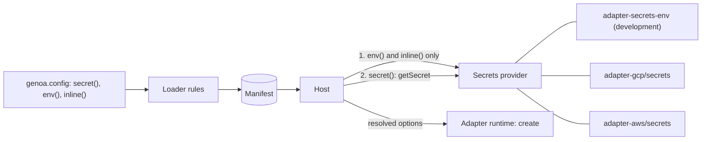

# Secret references and the secrets provider

## Design

### Role

How a credential reaches an adapter. A config writes a credential option as a reference:
`secret('KEY')` reads the configured secrets store, `env('VAR')` the process environment, and
`inline(value)` carries the value in the config itself. The loader checks where references stand
([`configuration.md`](configuration.md) LDR-5 to LDR-8, LDR-14), and the host resolves them just
before it constructs a provider ([`host.md`](host.md) HST-3). This document covers the references,
their resolution, the one secrets provider, and `@genoacms/adapter-secrets-env`, the development
store. The Secret Manager store is in [`adapter-gcp/secrets.md`](adapter-gcp/secrets.md), and the
AWS one in [`adapter-aws/secrets.md`](adapter-aws/secrets.md).

### Decisions

| # | Decision | Consequence |
| :-- | :-- | :-- |
| SU3 | Inline credentials stay allowed, but only when written explicitly. | `inline()` exists, and a production build warns once per inline field (LDR-14). |
| SU11 | `packages/core/.env` held the dev instance's signing seeds. The author moved it once, by hand, to `packages/core/.genoacms/secrets.env` when core switched stores. | No path override and no fallback in code. Agents never read or move secret files. |

**SD5. Secrets are typed references, resolved by the host just before construction.**
`secret('KEY')`, `env('VAR')` and `inline(value)` are the only ways to fill a credential option.
Each adapter's option types say which fields are credentials, and its descriptor says the same at
runtime (`secretOptions`). The secrets provider's own options admit `env()` and `inline()` only:
the bootstrap rule, stated by the type (CD16), by the loader (LDR-7) and by the host (REF-7).
*Why:* a credential then exists in one form the loader can check and the host can resolve, never as
a bare value someone has to recognize.
*Cost:* the first use of each provider costs a secret round trip at cold start, unless `env()` or
the platform's own identity is used. A secret several providers use is fetched once, but its
timeout fails every provider waiting on it at the same moment, which reads as correlated failures
in the logs.

**SD6. Resolved values are held in three places only.** The adapter's closure after `create`, the
host's per-process cache, keyed by secret name, and the options object passed to `create`. A value
is never held in the manifest (except `inline()`), in the Vite module graph, or in an error message
(REF-6). The signing seeds and the registry sequence, which core reads through `host.secrets()`
directly ([`signing.md`](signing.md)), bypass the cache.
*Why:* every other place a credential lands is a place it can leak from: a build, a log, a
terminal.
*Cost:* an error names the path and the reference, which is less than an operator debugging a
malformed credential would like to see.

**SD7. Rotation takes effect on restart.** Resolved values are cached for the life of the process.
A constructed client holds its credential whatever the cache does, so rotation means
reconstructing the provider, and the honest unit of that is the process. On serverless platforms the
next cold start reads the new version; a long-running Node server applies it on restart, which every
deploy does.
*Why:* reconstructing live clients under load is a source of bugs, and a reload endpoint is an
attack surface.
*Cost:* no live rotation, and a key missing at the first read stays missing until restart (SF1).

**Recommended production form.** The cloud's secrets adapter with `credentials` omitted, which uses
the platform's own identity (on Cloud Run, the function's service account). Every other credential
is then a `secret()`, and no credential exists in the config or the environment. Operators who want
no round trip can mount secrets as environment variables and write `env()`. `env()` is not a second
store: it is read-only, and the single store is about where writes go.

### Rejected alternatives

| Alternative | Why rejected |
| :-- | :-- |
| **`secret.json()` or sniffing a value's first character** | Ambiguous. JSON decoding is declared per option in the descriptor (REF-3). |
| **Several secrets providers** | A write would have no defensible target. `env()` covers read-only platform secrets. |
| **Baking resolved secrets into the build** | The artifact would be a credential. `inline()` is the explicit, warned version of this, for operators who accept the trade. |
| **TTL-based live rotation, a reload socket** | SD7. |

### Findings

| # | Finding | State |
| :-- | :-- | :-- |
| SF1 | **A secret set after the first failed read is not seen until the process restarts** (REF-5). A missing key is cached: the construction that failed is retried on the next call, but the retry reads the cached absence and fails with `secrets/missing` again without asking the store. The text before 2026-11-26 said the rejection was not cached, so the next call retried; the code's comment calls caching the absence deliberate (SD7). A timeout or an error is retried against the store. Found by LS3 (D23). | open |
| SF2 | **A slow store construction counts against the first secret's timeout** (REF-4). The deadline covers constructing the secrets store as well as `getSecret`, so a store slow to construct fails the first provider with `provider/secret-unavailable`, naming a secret the store was never asked for. Found by LS3 (D24). | open |
| SF3 | **A lock file left by a crashed process blocks every later claim** (DST-6). The lock is never broken: each `setSecretIfAbsent` fails after 5 s with `secrets-env/lock-timeout` until someone removes the file. Found by LS3 (D25). | open |
| SF4 | **A key written twice in the development file keeps its old value after a restart** (DST-7). A write replaces the first line holding the key, and a read takes the last, so in a file edited by hand to hold `KEY=` twice, `setSecret` and a rotation take effect only in the writing instance. Found reading the code, 2026-11-26. | open |
| SF5 | **An existing development file keeps its permissions** (DST-3). Mode `0600` applies only when the file is created; a file created by hand with wider permissions stays readable by others. Found by LS3 (D25). | open |

### History

*History.* Before the 2026-09 redesign, `SecretReference` was declared and never resolved (KF16),
and the development store resolved `.env` against `cwd` (KF11). RFC-0004 added resolution in the
host and RFC-0006 ported the development store to `.genoacms/secrets.env`. This text was split out
of `configuration.md` on 2026-10-02 and restructured under the Spec Workflow on 2026-11-26 (SS1);
D5 became SD5, and U3 and U11 SU3 and SU11.

### Verification

- **SS1, drift audit and Specification from the code, at `f18f6205`, 2026-11-26.** The Specification was written from `packages/config/src/references.ts`, `src/host/` and `packages/adapter-secrets-env/src/`. LS3 (`cli.md`) had audited the earlier text at `9f43931`; its D23 to D25 are SF1 to SF3 and SF5. No falsification audit of these statements has run.

## Specification

### References

#### REF-1 · The three references

`secret(key)` returns `{ $secret: key }`, and throws the error of REF-8 for a key outside the
portable rule. `env(variable)` returns `{ $env: variable }`, and throws
`config/invalid-env-reference: env() needs a variable name` for an empty name. `inline(value)`
returns `{ $inline: value }`. A value is a reference only when it is a plain object with exactly one
own key: `$secret` holding a string, `$env` holding a string, or `$inline` holding anything.

- Test: `packages/config/src/references.test.ts`
- Level: unit

#### REF-2 · Resolving a provider's options

When the host constructs a provider, it resolves each option the descriptor lists in
`secretOptions`, and copies every other option unchanged. An `inline()` option resolves to its value,
never decoded. An `env()` option resolves to the variable of the host's environment, or fails with
`secrets/env-missing: <path> reads <variable>, which is not set`. A `secret()` option resolves to the
store's `getSecret(key)`, or fails, when that is `undefined`, with `secrets/missing: <path> points
at '<key>', which the configured secret store does not hold. Set it before starting GenoaCMS.` A
listed option present without a reference fails with `config/bare-secret: <path> is a credential
field and holds no reference`. `<path>` is `<service>.providers.<name>.options.<option>`. The options
of one provider are resolved concurrently.

- Test: `packages/config/src/host/host.test.ts`
- Level: unit

#### REF-3 · JSON credentials

An option listed as `'json'` is parsed as JSON after a `secret()` or `env()` reference is read; one
listed as `'string'` is passed as read. A value that does not parse fails with
`secrets/invalid-json: <path> is declared JSON and is not valid JSON`, which holds neither the value
nor the parser's message.

- Test: `packages/config/src/host/host.test.ts`
- Level: unit

#### REF-4 · A bounded wait for the store

Each read of a `secret()` reference, the construction of the store included, is bounded by the
host's `secretTimeoutMs`. When the bound passes first, the construction fails with
`provider/secret-unavailable: <path> → <key>: no answer within <ms> ms` (SF2).

- Test: `packages/config/src/host/host.test.ts`
- Level: unit

#### REF-5 · One read per secret

Within one host, each secret key is read from the store once: concurrent and later resolutions of
that key, by any provider, share the first read. A read that resolved, to a value or to `undefined`,
is kept until `close()` (HST-7). A read that rejected or timed out is forgotten, and the next
resolution reads again (SF1).

- Test: `packages/config/src/host/host.test.ts`
- Level: unit

#### REF-6 · No value in an error

No error of the loader or the host holds a resolved value or an option's value. They name config
paths, provider names, variable names and secret keys.

- Test: `packages/config/src/host/host.test.ts` (unverified: the loader's messages, which LDR-15 states and no test checks against a credential)
- Level: unit

### The secrets provider

#### REF-7 · The store is constructed from env() and inline() only

`host.secrets()` constructs the one provider of `secrets.providers`, once per host as HST-2 states,
with no resources. It fails with `secrets/provider-count: exactly one secrets provider is allowed,
found <n>` when there is not exactly one, and with `config/bootstrap-secret: the secrets provider
cannot be configured with secret()` when one of its listed options is a `secret()` reference,
without asking any store.

- Test: `packages/config/src/host/host.test.ts`
- Level: unit

#### REF-8 · The portable secret key

A secret key matches `^[A-Za-z_][A-Za-z0-9_]*$`: the names every supported store and an environment
variable accept. `@genoacms/contracts/secrets` exports the pattern as `SECRET_KEY_PATTERN`,
`isValidSecretKey(key)`, and `assertValidSecretKey(key)`, which throws `invalid-secret-key: '<key>'
must match ^[A-Za-z_][A-Za-z0-9_]*$` and never normalizes a key.

- Test: `packages/contracts/src/secrets.test.js`
- Level: unit

### The development store

#### DST-1 · Its descriptor

`@genoacms/adapter-secrets-env` is a secrets adapter whose runtime is
`@genoacms/adapter-secrets-env/runtime`. It is `developmentOnly`, so a production build refuses it
(LDR-13). Its one option is `path`, a non-empty string; its validation gives `unknown option
'<key>'` for any other key and `path must be a non-empty string` for another `path`.

- Test: `packages/adapter-secrets-env/src/descriptor.test.js`
- Level: unit

#### DST-2 · It needs the project

Its runtime fails to construct without `projectRoot` in the context, which a production artifact
lacks, with `secrets-env/no-project-root: this adapter is for development only; configure a secret
manager for deployment`.

- Test: `packages/adapter-secrets-env/src/runtime.test.js`
- Level: unit

#### DST-3 · Its file

The store is the file at `path`, default `.genoacms/secrets.env`, resolved against the project root.
A read of a missing file reads as empty. A write creates the file with mode `0600`, and its
directory with mode `0700`, when they do not exist (SF5).

- Test: `packages/adapter-secrets-env/src/runtime.test.js`
- Level: unit

#### DST-4 · What a read sees

`getSecret(key)` answers from the store's own writes first: the value it last wrote, or `undefined`
after it deleted the key. For a key it has not written or deleted, it answers the process
environment's variable when one is set, and otherwise reads the file afresh, so another process's
write is seen. The store never writes the process environment.

- Test: `packages/adapter-secrets-env/src/runtime.test.js`
- Level: unit

#### DST-5 · Writes and deletions

`setSecret(key, value)` writes the key to the file and resolves to `true`. `deleteSecret(key)` removes
every line of the key from the file and resolves to `true` when the key was in the file, in the
store's own writes or in the environment, and to `false` otherwise; the key then reads as absent in
this store. Writes of one store run one at a time, so concurrent writes lose none.

- Test: `packages/adapter-secrets-env/src/runtime.test.js`
- Level: unit

#### DST-6 · Claims across processes

`setSecretIfAbsent(key, value)` writes the key and resolves to `true` only when the key is in
neither the file, nor the store's own writes, nor the environment; otherwise it resolves to `false`
and writes nothing. It holds the lock file `<path>.lock`, created exclusively, from the read to the
write, so of racing claims from several stores or processes exactly one wins. A lock it cannot take
within 5 s fails the claim with `secrets-env/lock-timeout: <lock path> is held; remove it if no
process owns it` (SF3).

- Test: `packages/adapter-secrets-env/src/runtime.test.js`
- Level: unit

#### DST-7 · The file's format

The file holds `KEY=value` lines, optionally prefixed with `export `, with keys of the portable rule
(REF-8). It is read with a leading byte-order mark dropped and CRLF or lone CR line ends read as LF;
a key written several times reads as its last line (SF4). A double-quoted value has `\n` read as a
newline and any other backslash escape as the character it escapes; a single-quoted value is taken
as written; an unquoted value is trimmed and ends at a `#` preceded by whitespace. A write replaces
the first line of its key in place, or appends one, keeps every other line, comment and blank line,
and writes LF line ends. It writes a value unquoted unless it is empty, has leading or trailing
whitespace, or holds `"`, `'`, `#`, a newline or a backslash; then it writes it double-quoted, with
backslash, `"` and newline escaped, so that every value reads back as written.

- Test: `packages/adapter-secrets-env/src/envFile.test.js`
- Level: unit

#### DST-8 · Keys in every method

Every method of the store refuses a key outside the portable rule with the error of REF-8, before
reading or writing anything.

- Test: `packages/adapter-secrets-env/src/runtime.test.js`
- Level: unit
