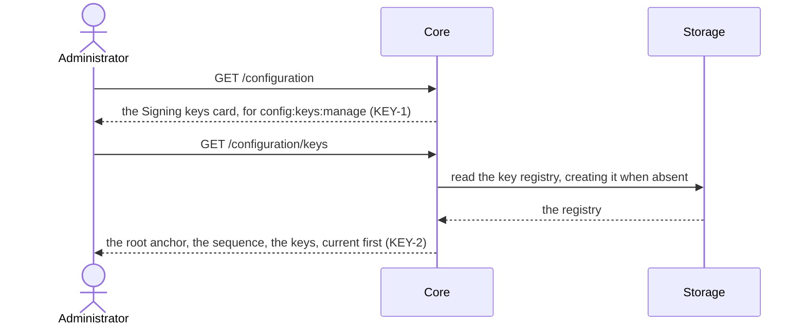
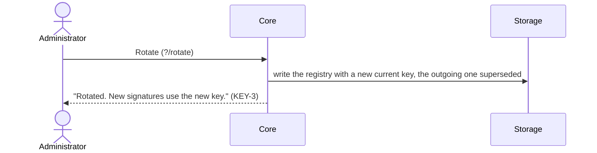

# Signing keys in core

## Design

### Role

How an administrator holding `config:keys:manage` sees and changes the instance's signing keys:
the key registry screen at `/configuration/keys`, which shows the root trust anchor, the registry's
sequence and the subordinate keys, and rotates and revokes subordinate keys.

```
/configuration (index card, gated) ─▶ /configuration/keys
   load ──▶ registry + root anchor + rotation due   (503 when unreadable)
   Rotate ─────────────────▶ ?/rotate
   Revoke (per key) ─ confirm ─▶ ?/revoke keyId
```

Out of scope, and not yet specified: the signed envelope and its canonical form, the algorithms,
key ids, the registry document and its verification, root rotation (`genoa rotate-root`,
`cli.md` CLI-9), the bootstrap that creates the keys (`secrets.md`, *Bootstrap ordering*), where
seeds are kept, and the security policy's rotation interval. Today only the code and
`packages/core/src/lib/script/signing/README.md` describe them.

### Use cases


| # | Use case | Actors | Statements |
| :-- | :-- | :-- | :-- |
| YJ1 | See the signing keys | Administrator | |
| YJ2 | Rotate the current key | Administrator | |
| YJ3 | Revoke a key | Administrator | |

### Scenarios

**YJ1a. An administrator opens the key screen.** KEY-1, KEY-2.



**YJ1b. A principal without the permission sees no card.** KEY-1. The configuration index shows no
`Signing keys` card, and the screen and its actions refuse.

**YJ2a. An administrator rotates the current key.** KEY-3.



**YJ3a. An administrator declines to revoke.** KEY-4. `No` in the confirmation submits nothing.

**YJ3b. An administrator revokes a key.** KEY-4.

```mermaid
sequenceDiagram
  actor A as Administrator
  participant C as Core
  participant S as Storage
  A->>C: Revoke a key
  C-->>A: what revoking costs; for the current key, that a new one is minted first (KEY-4)
  A->>C: Yes (?/revoke keyId)
  opt the key is current
    C->>S: rotate first (KEY-3)
  end
  C->>S: write the registry with the key revoked
  C-->>A: "Key revoked", the key listed as revoked, one key current (KEY-4)
```

### Decisions

| # | Decision | Where |
| :-- | :-- | :-- |
| YU1 | 2026-11-01: this document starts with the key registry screen only, so that the browser tests that check it carry statement IDs (RFC-0045). The rest of signing is specified later, in its own RFCs. | KEY-1 to KEY-4 |

**YD1. One permission for seeing and for acting (KEY-1).** There is no read permission for the
keys.
*Why:* the registry is published, since every consumer fetches it to verify anything, so a read
permission would withhold nothing.
*Cost:* a principal who should only watch rotation needs the permission that also rotates.

**YD2. The screen does not rotate the root (KEY-2).** Root rotation is `genoa rotate-root`.
*Why:* replacing the root strands every deployed consumer until it is rebuilt with the new anchor,
so it belongs with whoever can redeploy them, not behind a browser session.
*Cost:* an operator who needs to replace the root needs the CLI and the production config.

**YD3. Revoking states what it costs (KEY-4).** The confirmation says that every signature the
key ever made stops verifying.
*Why:* the word "revoke" does not say that revocation reaches backwards, and an administrator who
learns it afterwards has already lost those signatures.
*Cost:* none beyond a longer confirmation.

### Findings

| # | Finding | State |
| :-- | :-- | :-- |
| YF1 | **A secret write may restart the dev server mid-request.** In 2026-08 the development secrets adapter wrote `.env`, Vite restarted on the change and killed the request: rotating reported a failure, and revoking succeeded while reporting one. It was fixed with `envDir: false` in `packages/core/vite.config.ts` (`b0760979`), which `f9a432c6` removed when the development store moved to `.genoacms/secrets.env`. The guard test `tests/README.md` names does not exist. Whether a secret write restarts the dev server today is not verified; the e2e suite serves the build and cannot see it. | open: not verified |
| YF2 | **A verifier checks a signature with the algorithm the envelope names, not the one its key was registered with.** The key registry records each key's `alg`, but neither the core verifier (`verify` in `packages/core/src/lib/script/signing/envelope.ts`, called by `signedDocument.server.ts` for subordinate keys and the root) nor the SDK's (`verifyEnvelope` in `packages/sdk/src/verify/envelope.ts`, called by `client.ts`) compares the envelope's `alg` with it. Signing `alg` with the payload does not close this: under an algorithm whose signatures can be produced without the private key, the forger signs the rewritten header too. Not exploitable today, because the only registered algorithms are ML-DSA-65 and SLH-DSA-SHA2-128s, neither can be forged without the private key, and a key read under the other scheme fails to verify. Registering a weaker algorithm would open it. No statement specifies the envelope, so none is contradicted. Found 2026-11-20 by reading both verifiers. | open |
| YF3 | **An older security policy verifies until the root key is replaced.** The policy document (`.genoacms/security/policy.json`) carries no sequence number, unlike the key registry, and `readStoredPolicy` in `packages/core/src/lib/script/securityPolicy/policy.server.ts` checks only the root signature, the document type and the bounds (`readRootSignedDocument` in `signing/signedDocument.server.ts`). Anyone who can write the storage can put back a policy the root signed earlier, with a longer rotation interval or token lifetime, higher guard ceilings or a wider fetch origin allowlist, and the instance uses it; the next publication compiles its ceilings and allowlist into a signed artifact. The root key is replaced rarely, so in practice every policy an instance has ever stored stays valid. No statement specifies the policy, so none is contradicted. Found 2026-11-21 by reading `policy.server.ts` and `signedDocument.server.ts`. | open |
| YF4 | **Damaging the security policy puts the instance on the configured defaults, which may be looser than the stored values.** A stored policy that is not JSON, fails its root signature or fails `parseSecurityPolicy` is left in place and `readStoredPolicy` returns `defaultPolicy()`, the `security` stanza of `genoa.config` with its own defaults, logging a warning and reporting `degraded` to the administration screen. Anyone who can write the storage can therefore undo every value an administrator tightened at runtime by corrupting one object, without any key; the module's own reason for not replacing the document (a relaxed setting the administrator did not choose) applies to the fallback as well. No statement specifies the policy, so none is contradicted. Found 2026-11-21 by reading `policy.server.ts`. | open |

### History

*History.* The key registry screen dates from 2026-08. Until 2026-11-01 only the code,
`signing/README.md` and `packages/core/tests/keys.spec.ts`, a Playwright suite that ran nowhere
(`build.md` F32), described it. RFC-0045 wrote KEY-1 to KEY-4 from the code and moved that suite to
`packages/core/e2e/`.

### Verification

- **`unit`.** The order and the states of the keys (KEY-2) in
  `packages/core/src/lib/script/signing/keyAdministration.test.ts`; rotation and revocation in
  `registry.test.ts` and `user.server.test.ts`.
- **`e2e`.** `packages/core/e2e/configuration.test.ts` serves core built with `genoa.config/e2e.ts`, in an
  instance of the run's own, created at its start and removed at its end, and drives the screen as
  an administrator. Revocation is permanent, so the test that revokes rotates first and revokes the
  key it just superseded, which signed nothing the rest of the run reads.

## Specification

### The key registry screen

#### KEY-1 · The screen

`/configuration/keys` is titled `Signing keys`. Loading it and both of its actions need
`config:keys:manage`. The configuration index, `/configuration`, shows a card `Signing keys`
linking to it only to a principal holding that permission. Loading creates the registry when the
instance has none. A registry that cannot be read answers 503 with its reason, not an empty list.

- Test: `packages/core/e2e/configuration.test.ts`
- Level: e2e

#### KEY-2 · What it shows

A card `Root trust anchor` shows the root key's algorithm, key id and public key in full, as
base64, and offers no control: nothing on the screen rotates the root. A card `Registry` shows the
registry's `sequence` and when the current key falls due for rotation, or that the security policy
could not be read. Under `Subordinate keys`, a card per key of the registry is headed by its key id
and shows its state, `current`, `superseded` or `revoked`, its algorithm and the moments it has
(`created at`, `superseded at`, `revoked at`). Exactly one key is `current`. The current key comes
first, the others newest first by creation.

- Test: `packages/core/e2e/configuration.test.ts`
- Level: e2e

#### KEY-3 · Rotating

`Rotate` submits the form action `rotate` without asking: it mints a new current key, and the
outgoing key stays listed as `superseded`. It shows `Rotated. New signatures use the new key.`, or
`Key not rotated` with the reason. A refusal fails with 409 `{ reason }`.

- Test: `packages/core/e2e/configuration.test.ts`
- Level: e2e

#### KEY-4 · Revoking

Each key that is not `revoked` offers `Revoke`, which asks:
`Revoke <keyId>. Everything it ever signed stops verifying, including signatures made before now.`,
followed for the current key by `It is the current key, so a new one is minted first.`, and then
`Do this for a leaked key. For routine hygiene, rotate instead.` `No` submits nothing and leaves the
registry as it was. `Yes` submits the form action `revoke` with the field `keyId`: the key stays
listed as `revoked`, without `Revoke`, and the screen shows `Key revoked`, or `Key not revoked`
with the reason. Revoking the current key first mints a new current key, so exactly one key is
`current` afterwards. A missing or empty `keyId` fails with 400 `{ reason: 'key/id-required' }`, and
a refusal with 409 `{ reason }`.

- Test: `packages/core/e2e/configuration.test.ts`
- Level: e2e
