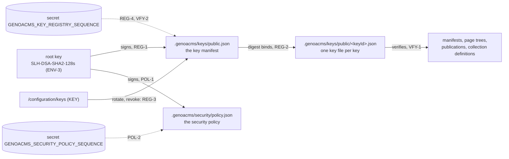
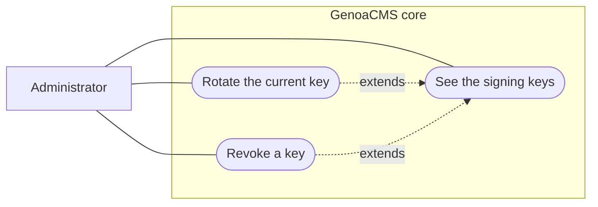
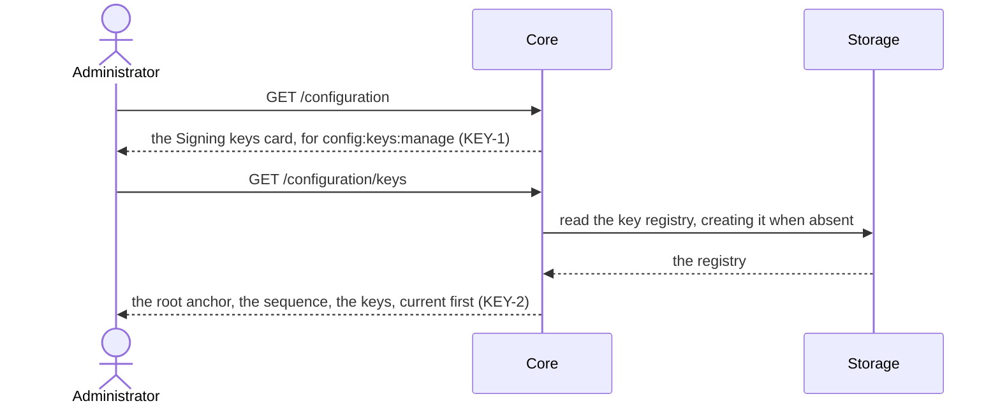
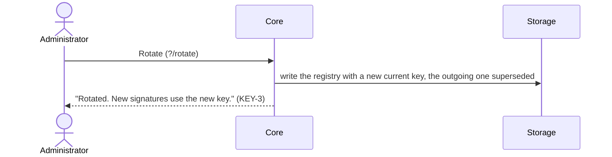

# Signing in core

## Design

### Role

How an instance makes its documents verifiable, and how anyone who holds the root public key checks
them: the signed envelope and what its signature covers (ENV), the key manifest and the key files
that name the subordinate keys (REG), how a consumer resolves a key and refuses an older manifest
(VFY), the security policy the root signs beside the manifest (POL), and the key registry screen at
`/configuration/keys`, where an administrator holding `config:keys:manage` rotates and revokes the
subordinate keys (KEY).



The key registry screen:

```
/configuration (index card, gated) ─▶ /configuration/keys
   load ──▶ registry + root anchor + rotation due   (503 when unreadable)
   Rotate ─────────────────▶ ?/rotate
   Revoke (per key) ─ confirm ─▶ ?/revoke keyId
```

Out of scope, and not yet specified: root rotation as a whole (`genoa rotate-root`, `cli.md`
CLI-9), of which REG-5 and POL-4 hold only what it writes; the bootstrap that creates the keys
(`secrets.md`, *Bootstrap ordering*); where seeds are kept; the session key derived from the root
(`signing/derivedKeys.ts`); and how each kind of document is read once its signature verifies, which
lives with the document (`authorization.md` MAN, `components.md` PUB and TRE).

### Use cases



| # | Use case | Actors | Statements |
| :-- | :-- | :-- | :-- |
| YJ1 | See the signing keys | Administrator | |
| YJ2 | Rotate the current key | Administrator | |
| YJ3 | Revoke a key | Administrator | |

### Scenarios

**YJ1a. An administrator opens the key screen.** KEY-1, KEY-2.



**YJ1b. A principal without the permission sees no card.** KEY-1. The configuration index shows no
`Signing keys` card, and the screen and its actions refuse.

**YJ2a. An administrator rotates the current key.** KEY-3.



**YJ3a. An administrator declines to revoke.** KEY-4. `No` in the confirmation submits nothing.

**YJ3b. An administrator revokes a key.** KEY-4.

```mermaid
sequenceDiagram
  actor A as Administrator
  participant C as Core
  participant S as Storage
  A->>C: Revoke a key
  C-->>A: what revoking costs; for the current key, that a new one is minted first (KEY-4)
  A->>C: Yes (?/revoke keyId)
  opt the key is current
    C->>S: rotate first (KEY-3)
  end
  C->>S: write the registry with the key revoked
  C-->>A: "Key revoked", the key listed as revoked, one key current (KEY-4)
```

### Decisions

| # | Decision | Where |
| :-- | :-- | :-- |
| YU1 | 2026-11-01: this document starts with the key registry screen only, so that the browser tests that check it carry statement IDs (RFC-0045). The rest of signing is specified later, in its own RFCs. | KEY-1 to KEY-4 |
| YU2 | 2026-11-25: the key manifest lists the keys and each public key moves to a file of its own, fetched only by a verifier that needs it (YF5). The manifest binds each file by the full SHA-256 of its key. The new manifest is a new document type, `genoacms.keyRegistry.v2`, and nothing reads the old one: core refuses it (REG-6). Migrating stored documents is not part of GenoaCMS: the only deployments are the author's, migrated by a script of the author's own. A revoked key's file is deleted. A consumer MAY pass the secret mark of the manifest's sequence to the SDK, so the mark's name and format become part of the contract (YF6). The envelope's algorithm must be the one its key was registered with (YF2). RFC-0048. | YD4 to YD10; ENV-6, REG-1 to REG-6, VFY-1 to VFY-3 |
| YU3 | 2026-11-25: the security policy carries a sequence with a secret mark of its own, like the manifest (YF3). A policy that cannot be trusted fails closed: sign-in keeps working with the strictest token lifetimes and grant cache, and everything else the policy governs refuses until an administrator rewrites the policy on the security screen (YF4, YF8). RFC-0049. | YD11, YD12; POL-1 to POL-4 |

**YD1. One permission for seeing and for acting (KEY-1).** There is no read permission for the
keys.
*Why:* the registry is published, since every consumer fetches it to verify anything, so a read
permission would withhold nothing.
*Cost:* a principal who should only watch rotation needs the permission that also rotates.

**YD2. The screen does not rotate the root (KEY-2).** Root rotation is `genoa rotate-root`.
*Why:* replacing the root strands every deployed consumer until it is rebuilt with the new anchor,
so it belongs with whoever can redeploy them, not behind a browser session.
*Cost:* an operator who needs to replace the root needs the CLI and the production config.

**YD3. Revoking states what it costs (KEY-4).** The confirmation says that every signature the
key ever made stops verifying.
*Why:* the word "revoke" does not say that revocation reaches backwards, and an administrator who
learns it afterwards has already lost those signatures.
*Cost:* none beyond a longer confirmation.

**YD4. The manifest lists the keys, and each key has a file (REG-1, REG-2).** The manifest carries
each key's id, algorithm, digest and moments, and no key; the key is in
`.genoacms/keys/public/<keyId>.json`.
*Why:* an ML-DSA-65 public key is 1952 bytes, 2604 in base64, and every entry the registry ever
held stays in it, so every consumer downloaded every key the instance ever made in order to verify a
page signed by one of them (YF5). A key file never changes once written, so a consumer caches it
without expiry, and only the manifest, which changes on every rotation, has to be fetched fresh.
*Cost:* a verifier makes one more request per key it has not seen, after the manifest and before
the first signature it checks with that key.

**YD5. The manifest binds a key file by the full digest of its key (REG-1, REG-2).** Not by the
key id.
*Why:* the key file is not signed, so anyone who can write the storage can replace it, and the key
id is 64 bits of SHA-256 (ENV-4). Finding a second key with the same id is a second-preimage search
of about 2^64 hash evaluations classically and about 2^32 with Grover's algorithm, the same quantum
adversary the post-quantum algorithms are chosen against. The full 256-bit digest leaves about
2^256 classically and 2^128 with Grover. A new key id would have invalidated every signature already
made, since the key id is signed into each (ENV-2), so the key id stays a name and the digest
becomes the binding.
*Cost:* 64 hexadecimal characters per entry, and a verifier hashes each key file before using it.

**YD6. The key file is not signed (REG-2).**
*Why:* the root-signed manifest already binds it through the digest, and a signature of its own
would add 3309 bytes of ML-DSA-65 or 7856 of SLH-DSA-SHA2-128s to a file of about 2.7 KB, and a
second key to trust for it.
*Cost:* a key file proves nothing on its own; it is read only with the manifest that names it.

**YD7. A hard break to `genoacms.keyRegistry.v2` (REG-1, REG-6).** No version of core or of the
SDK reads both manifests.
*Why:* a verifier that accepts two formats has two paths to keep right, and the attacker chooses
which one it takes. Keeping the old format beside the new one would also keep its cost (YF5) for
every consumer that did not update.
*Cost:* the CMS, its consumers and the stored manifest change together. Between the migration of
the stored manifest and the redeployment of a consumer, that consumer verifies nothing.

**YD8. A signature verifies only under the algorithm its key was registered with (ENV-6).**
*Why:* YF2. The envelope's `alg` is chosen by whoever wrote the envelope, and signing it with the
payload does not help, because under an algorithm whose signatures can be produced without the
private key the forger signs the rewritten header too.
*Cost:* none: a key used under another algorithm is a different key, with another id.

**YD9. Rollback beyond one session is the consumer's to stop (REG-4, VFY-2).** The SDK refuses a
manifest whose sequence is below a mark the consumer supplies.
*Why:* a signature says who signed a document, not when, so a verifier that keeps no state accepts
any manifest the root ever signed, and an older manifest undoes the revocations made after it (YF6).
Closing that needs either time, a signed statement that expires, or a party online that the verifier
trusts. GenoaCMS has no scheduler to re-sign an expiring statement, and the author ruled out adding
one now. The secrets service is already trusted with the mark, and a consumer that renders on a
server, or has one, can read the mark there and hand it to the code that verifies.
*Cost:* a consumer that passes no mark is protected only within one verifier: on a fresh load it
accepts a manifest any older than the mark, revocations undone. The mark's secret name and format
become a contract (REG-4), and a consumer that reads the mark needs read access to that one secret.

**YD10. Migrating is not part of GenoaCMS (REG-6, POL-3).** Core reads only the current types and
rewrites no stored document of an earlier one.
*Why:* the only deployments are the author's, so a migration command would be code kept for one
use, and a CMS that rewrote a trust document it could not read would also rewrite one an attacker
damaged.
*Cost:* a deployment of an earlier version has no supported path forward. A core deployed before its
stored documents are migrated refuses the manifest, so it signs and verifies nothing, and reads the
policy as damaged.

**YD11. The security policy has a sequence and a mark (POL-2).** As the manifest has (REG-4), in
a secret of its own.
*Why:* YF3. Without a sequence, every policy the root ever signed verifies, so anyone who can write
the storage can put back the loosest one an instance ever had.
*Cost:* a second secret, written on every change of the policy.

**YD12. A policy that cannot be trusted fails closed (POL-3).** It is not replaced by the
configured defaults.
*Why:* YF4. The configured defaults may be looser than the values an administrator set, and
whoever damaged the document would get them. Sign-in has to keep working, or nobody could reach the
screen that repairs the policy, and the strictest bounds of the values it reads cost only
convenience. The rest the policy governs has no strictest value that is safe to act on: a
publication compiles the guard ceilings and the fetch allowlist into a signed artifact that outlives
the damage.
*Cost:* while the policy is damaged, an access token lasts a minute, a session a day, grants are
resolved on every request, nothing is published, and the current key does not rotate when due.
Anyone who can write the storage can put an instance into this state, as they could already stop it
by deleting its documents.

### Findings

| # | Finding | State |
| :-- | :-- | :-- |
| YF1 | **A secret write may restart the dev server mid-request.** In 2026-08 the development secrets adapter wrote `.env`, Vite restarted on the change and killed the request: rotating reported a failure, and revoking succeeded while reporting one. It was fixed with `envDir: false` in `packages/core/vite.config.ts` (`b0760979`), which `f9a432c6` removed when the development store moved to `.genoacms/secrets.env`. The guard test `tests/README.md` names does not exist. Whether a secret write restarts the dev server today is not verified; the e2e suite serves the build and cannot see it. | open: not verified |
| YF2 | **A verifier checks a signature with the algorithm the envelope names, not the one its key was registered with.** The key registry records each key's `alg`, but neither the core verifier (`verify` in `packages/core/src/lib/script/signing/envelope.ts`, called by `signedDocument.server.ts` for subordinate keys and the root) nor the SDK's (`verifyEnvelope` in `packages/sdk/src/verify/envelope.ts`, called by `client.ts`) compares the envelope's `alg` with it. Signing `alg` with the payload does not close this: under an algorithm whose signatures can be produced without the private key, the forger signs the rewritten header too. Not exploitable today, because the only registered algorithms are ML-DSA-65 and SLH-DSA-SHA2-128s, neither can be forged without the private key, and a key read under the other scheme fails to verify. Registering a weaker algorithm would open it. No statement specified the check until YU2 (ENV-6). Found 2026-11-20 by reading both verifiers. | open, RFC-0048 |
| YF3 | **An older security policy verifies until the root key is replaced.** The policy document (`.genoacms/security/policy.json`) carries no sequence number, unlike the key registry, and `readStoredPolicy` in `packages/core/src/lib/script/securityPolicy/policy.server.ts` checks only the root signature, the document type and the bounds (`readRootSignedDocument` in `signing/signedDocument.server.ts`). Anyone who can write the storage can put back a policy the root signed earlier, with a longer rotation interval or token lifetime, higher guard ceilings or a wider fetch origin allowlist, and the instance uses it; the next publication compiles its ceilings and allowlist into a signed artifact. The root key is replaced rarely, so in practice every policy an instance has ever stored stays valid. No statement specified the policy until YU3 (POL-2). Found 2026-11-21 by reading `policy.server.ts` and `signedDocument.server.ts`. | open, RFC-0049 |
| YF4 | **Damaging the security policy puts the instance on the configured defaults, which may be looser than the stored values.** A stored policy that is not JSON, fails its root signature or fails `parseSecurityPolicy` is left in place and `readStoredPolicy` returns `defaultPolicy()`, the `security` stanza of `genoa.config` with its own defaults, logging a warning and reporting `degraded` to the administration screen. Anyone who can write the storage can therefore undo every value an administrator tightened at runtime by corrupting one object, without any key; the module's own reason for not replacing the document (a relaxed setting the administrator did not choose) applies to the fallback as well. No statement specified the policy until YU3 (POL-3). Found 2026-11-21 by reading `policy.server.ts`. | open, RFC-0049 |
| YF5 | **Every consumer downloads every key the instance ever made, 161 KB, to verify a page signed by one.** On 2026-11-25 the live registry held 55 keys (1 current, 30 superseded, 24 revoked) at sequence 80, and measured 160,892 bytes; the root signature is 10,476 of them and the public keys, 2604 base64 characters each, almost all the rest. Rotation never removes an entry and revocation keeps one, so the document only grows, and a revoked key, which verifies nothing, costs as much as the current one. The page the demos render is signed by one key. No statement constrained the registry's form. Found 2026-11-25 profiling the demos' page load. | open, RFC-0048 |
| YF6 | **A consumer accepts an older key registry on every fresh load, undoing every revocation made since.** The SDK keeps the highest sequence it has seen in the `Verifier` instance only (`#highWaterMark` in `packages/sdk/src/verify/client.ts`), so a browser that loads a page starts from 0 and accepts any registry the root ever signed. Anyone who can write the storage, or answer for it, and kept an older registry can serve it, and every key revoked since verifies again. Core is not affected: it checks the registry against the mark in the secrets service (`registrySequence.server.ts`). No statement specified the SDK until YU2 (VFY-2). Found 2026-11-25 while designing YU2. | open, RFC-0048 narrows it to consumers that pass no mark (YD9) |
| YF7 | **Running core with its development config rotates and revokes the production instance's keys, and leaves the production instance a current key whose seed it does not have.** `packages/core/genoa.config/development.ts` and `test.ts` name the bucket `genoacms`, which `production.ts` serves, with `@genoacms/adapter-secrets-env` as the secrets store instead of Secret Manager. A key minted from the dev server is published to the production registry while its seed is written to the developer's `.genoacms/secrets.env`, so production cannot sign with it (`signing/current-key-unavailable`) until it rotates again, and the registry sequence's mark is kept twice, in the local file and in Secret Manager, each catching up on its own. The 55 keys of YF5 were made from 2026-08-16 to 2026-08-29, rotated and then revoked 2 to 3 seconds later, the pattern of the key screen's browser test. `test.ts` reaches no service under the unit tests (`docs/README.md`, *Test levels*). No statement is contradicted. Found 2026-11-25 tracing YF5. | open |
| YF8 | **A failed read of the security policy runs the instance on the configured defaults and reports nothing.** `readStoredPolicy` treats every failure of `getInternalObjectStringVersioned` as an absent document and calls `createDefaultPolicy`, which writes with `ifAbsent`; when the document exists, the write's precondition fails, the error is swallowed, and `defaultPolicy()` is returned with no `degraded` reason and no warning. A storage outage, a permission error or a timeout therefore has the effect of YF4 without its notice. Found 2026-11-25 reading `policy.server.ts` for YU3. | open, RFC-0049 |

### History

*History.* The key registry screen dates from 2026-08. Until 2026-11-01 only the code,
`signing/README.md` and `packages/core/tests/keys.spec.ts`, a Playwright suite that ran nowhere
(`build.md` F32), described it. RFC-0045 wrote KEY-1 to KEY-4 from the code and moved that suite to
`packages/core/e2e/`.

*History.* Until 2026-11-25 this document covered the key registry screen only, and the envelope,
the algorithms, the key ids and the registry were described by the code and `signing/README.md`.
ENV-1 to ENV-5 were then written from the code at `8acedc65`, unchanged, and REG, VFY and POL
specify YU2 and YU3. The registry they replace, `genoacms.keyRegistry.v1`, held each key's public
key in the entry and was the only document of the chain besides the policy.

### Verification

- **`unit`.** The order and the states of the keys (KEY-2) in
  `packages/core/src/lib/script/signing/keyAdministration.test.ts`; rotation and revocation in
  `registry.test.ts` and `user.server.test.ts`.
- **`e2e`.** `packages/core/e2e/configuration.test.ts` serves core built with `genoa.config/e2e.ts`, in an
  instance of the run's own, created at its start and removed at its end, and drives the screen as
  an administrator. Revocation is permanent, so the test that revokes rotates first and revokes the
  key it just superseded, which signed nothing the rest of the run reads.
- ENV-1 to ENV-5 are checked by the tests of `envelope.test.ts`, `canonical.test.ts`,
  `algorithms.test.ts` and `keyId.test.ts` in core and of `packages/sdk/src/verify/`, none of which
  carries their IDs yet.

## Specification

### The signed envelope

#### ENV-1 · The envelope

A signed document is stored as one JSON object, its envelope:

```ts
interface SignedEnvelope {
  alg: 'SLH-DSA-SHA2-128s' | 'ML-DSA-65'
  keyId: string
  type: string
  payload: JsonValue
  signature: string
}
```

`keyId` is not empty. `type` is the versioned type of the document, defined with the document, such
as `genoacms.roles.v1` (`authorization.md`) or `genoacms.pageTree.v1` (`components.md`). `signature` is standard base64 (RFC 4648 §4) with
padding, and is read strictly: a value that does not re-encode to the same string is not base64. An
envelope is refused, before its signature is checked, when it is not an object
(`envelope-not-an-object`), names another algorithm (`envelope-unknown-algorithm: <alg>`), has no
key id (`envelope-missing-key-id`), names a type the verifier does not know
(`envelope-unknown-type: <type>`), has no string `signature` (`envelope-missing-signature`) or has
no `payload` (`envelope-missing-payload`).

- Test: unverified (no test carries the ID yet)
- Level: unit

#### ENV-2 · What the signature covers

The signature is made over the 32-byte SHA-256 digest of the UTF-8 bytes of the RFC 8785 (JCS)
canonical form of `{ alg, keyId, type, payload }`, with the envelope's own values. Signing refuses a
payload JCS cannot represent, and one that would canonicalize to something other than what was
given, with `unsignable-payload: <path> …`: `undefined` anywhere, a number that is not finite, a
function, symbol or bigint, an object that is neither a plain object nor an array, and a circular
reference. An unset optional member is omitted, never `undefined` or `null`.

- Test: unverified (no test carries the ID yet)
- Level: unit

#### ENV-3 · The algorithms

The root key is SLH-DSA-SHA2-128s (FIPS 205) and signs only the key manifest and the security
policy. Every subordinate key is ML-DSA-65 (FIPS 204) and signs every other document. Both sign
hedged, with fresh randomness, so signing one digest twice gives two signatures. A key pair is
derived from a seed, which is all that is kept secret:

| | public key | signature | seed |
| :-- | --: | --: | --: |
| SLH-DSA-SHA2-128s | 32 bytes | 7856 bytes | 48 bytes |
| ML-DSA-65 | 1952 bytes | 3309 bytes | 32 bytes |

- Test: unverified (no test carries the ID yet)
- Level: unit

#### ENV-4 · Key ids

A key id is the first 16 characters of the lowercase hexadecimal SHA-256 of the raw public key: 64
bits. It names a key and is never assigned.

- Test: unverified (no test carries the ID yet)
- Level: unit

#### ENV-5 · Verifying an envelope

A verifier is given the envelope, the type it asked for and a public key. After ENV-1's checks it
refuses an envelope whose type is another (`envelope-wrong-type: expected <type>, found <type>`),
whose signature is not base64 (`envelope-signature-not-base64`), whose payload JCS cannot represent
(`envelope-payload-uncanonicalizable: <message>`), and whose signature does not verify under the
envelope's algorithm and the given key over the digest of ENV-2 (`envelope-signature-invalid`).
Only then is the payload read. A malformed key or signature is a signature that does not verify,
never an exception.

- Test: unverified (no test carries the ID yet)
- Level: unit

#### ENV-6 · The registered algorithm

**New.** A verifier also refuses an envelope whose `alg` is not the algorithm its key was
registered with, after the type and before the signature:
`envelope-algorithm-mismatch: <keyId> is registered for <registered>, the envelope names <alg>`. A
subordinate key is registered with the `alg` of its manifest entry (REG-1); the root with
SLH-DSA-SHA2-128s.

- Test: none yet
- Level: unit
- State: new (RFC-0048)

### The key manifest and the key files

#### REG-1 · The key manifest

**New.** `.genoacms/keys/public.json` holds the key manifest: an envelope signed by the root with
the type `genoacms.keyRegistry.v2`, whose payload is

```ts
interface KeyManifest {
  sequence: number
  current: string
  keys: RegisteredKey[]
}

interface RegisteredKey {
  keyId: string
  alg: 'ML-DSA-65'
  digest: string
  createdAt: number
  supersededAt?: number
  revokedAt?: number
}
```

`digest` is the lowercase hexadecimal SHA-256 of the raw public key, 64 characters, and `keyId` is
its first 16 (ENV-4). The moments are milliseconds since the Unix epoch. A manifest is accepted
whole or refused whole, with a reason naming the first rule it breaks: an object with exactly these
members, each entry too; `sequence` an integer of at least 1; `keys` not empty; no key id listed
twice; each `alg` the subordinate algorithm, ML-DSA-65; each `digest` 64 lowercase hexadecimal
characters beginning with its `keyId`; each moment an integer of at least 0, or omitted, never
`null`; `current` listed, and neither superseded nor revoked. Every key the manifest has ever listed
stays listed; a key is current, superseded (`supersededAt`, it still verifies) or revoked
(`revokedAt`, it verifies nothing).

- Test: none yet
- Level: unit
- State: new (RFC-0048)

#### REG-2 · The key files

**New.** The public key of each listed key that is not revoked is in
`.genoacms/keys/public/<keyId>.json`, an unsigned JSON object with exactly these members:

```ts
interface KeyFile {
  keyId: string
  alg: 'ML-DSA-65'
  publicKey: string
}
```

`publicKey` is the raw public key in standard base64 with padding. A key file is accepted only for a
key the manifest lists and has not revoked, and only when its `keyId` and `alg` equal the entry's,
its `publicKey` is base64 of the length the algorithm gives (ENV-3), and the SHA-256 of that key is
the entry's `digest`; otherwise it is refused with
`key-file-mismatch: <keyId> <member> does not match the key manifest`. A key file is written once
and its bytes never change, so a consumer MAY cache it without expiry. The manifest changes with
every rotation and revocation.

- Test: none yet
- Level: unit
- State: new (RFC-0048)

#### REG-3 · Rotating and revoking

**New.** Rotating mints a key, then writes its key file only when no file is at its path, then the
manifest with the new key current and the outgoing one superseded, conditional on the version of
the manifest it read, then the mark (REG-4). An existing key file with the same bytes counts as
written; one with other bytes fails the rotation with `registry/key-file-conflict: <keyId>` and
writes no manifest. Revoking writes the manifest with the key revoked, conditional on the version
read, then the mark, then deletes the key's file and its seed; a key file already gone is not an
error. Revoking the current key rotates first (KEY-4). A failed conditional write leaves the
manifest as it was and fails with the storage's precondition error.

- Test: none yet
- Level: unit, e2e
- State: new (RFC-0048)

#### REG-4 · The sequence and its mark

**New.** Every change of the manifest raises `sequence` by exactly 1. The secret
`GENOACMS_KEY_REGISTRY_SEQUENCE` holds the highest sequence the instance has published or read, as
a decimal integer matching `^(0|[1-9][0-9]*)$`; absent, it is 0. The manifest is written before the
mark. Loading the manifest refuses one whose sequence is below the mark with
`registry-rollback: sequence <sequence> is below the highest seen (<mark>)`, and raises the mark to
a higher one. A mark of any other form fails every load with
`registry-sequence/unreadable: GENOACMS_KEY_REGISTRY_SEQUENCE is '<value>'`. The secret's name and
format are part of the contract with consumers (VFY-2).

- Test: none yet
- Level: unit
- State: new (RFC-0048)

#### REG-5 · What root rotation writes

**New.** Rotating the root writes, unconditionally, a manifest signed by the new root that lists one
fresh current key, with the sequence the mark holds plus 1, and that key's file before it, then the
mark. The keys of the previous manifest are no longer listed, so nothing verifies under them.

- Test: none yet
- Level: unit
- State: new (RFC-0048)

#### REG-6 · A manifest of the earlier type

**New.** Core does not read a manifest of the type `genoacms.keyRegistry.v1` and never rewrites
one: loading it fails with
`registry/needs-migration: .genoacms/keys/public.json is genoacms.keyRegistry.v1, which this version of core does not read`,
so the instance signs and verifies nothing until the manifest is migrated outside it (YD10).

- Test: none yet
- Level: unit
- State: new (RFC-0048)

### Verification by a consumer

#### VFY-1 · Resolving a key

**New.** To verify a document signed by a subordinate key, a verifier, core's and the SDK's alike,
finds the envelope's `keyId` in the manifest and refuses a key the manifest does not list or has
revoked with `key-unresolvable: <keyId> is unknown or revoked`, and one whose `alg` differs with
ENV-6, both before it fetches a key file. It then reads the key's file, refusing an absent one with
`key-file-absent: <keyId>` and one that does not match with REG-2, and only then checks the
signature (ENV-5). A verifier reads each key's file at most once, and remembers its verdict, but
not a failure to read it.

- Test: none yet
- Level: unit
- State: new (RFC-0048)

#### VFY-2 · The consumer's mark

**New.** `new Verifier({ rootPublicKey, source, minimumRegistrySequence })` takes an optional
`minimumRegistrySequence`, an integer of at least 0, which the consumer reads from the secret
`GENOACMS_KEY_REGISTRY_SEQUENCE` (REG-4); any other value fails the constructor with
`TypeError: minimumRegistrySequence must be a non-negative integer`. The verifier refuses a manifest
whose sequence is below the highest of that value and every sequence it has accepted, with
`registry-rollback: sequence <sequence> is below <highest>`. Without the option, only manifests
loaded by the same verifier are compared. A manifest that a cache serves from before the mark was
written is refused, so a consumer that passes the mark reads the manifest uncached.

- Test: none yet
- Level: unit
- State: new (RFC-0048)

#### VFY-3 · The SDK reads the manifest by REG-1

**New.** The SDK accepts a manifest only of the type `genoacms.keyRegistry.v2`, signed by the root
it was given, and by every rule of REG-1, refusing it whole otherwise.

- Test: none yet
- Level: unit
- State: new (RFC-0048)

### The security policy

#### POL-1 · The policy document

**New.** `.genoacms/security/policy.json` holds the security policy: an envelope signed by the root
with the type `genoacms.securityPolicy.v2`, whose payload has exactly these members, each an
integer within its bounds except `fetchOrigins`:

| Member | Bounds | Governs |
| :-- | :-- | :-- |
| `sequence` | at least 1 | POL-2 |
| `subordinateKeyRotationDays` | 1 to 365 | when the current key rotates as it is used |
| `accessTokenMinutes` | 1 to 1440 | the lifetime of an access token |
| `grantCacheSeconds` | 0 to 300 | how long resolved grants are cached (`authorization.md` RES-4) |
| `refreshTokenDays` | 1 to 365 | the lifetime of a session |
| `maxFuel` | 1000 to 1,000,000,000 | the guard ceilings compiled into a dynamic component |
| `maxDepth` | 8 to 10,000 | |
| `maxAllocation` | 1000 to 1,000,000,000 | |
| `fetchOrigins` | at most 64 origins, each scheme, host and optional port | the origins a dynamic component may fetch from |

When nothing is stored at the path and the mark (POL-2) is absent or 0, the instance writes the
policy of the `security` stanza of `genoa.config`, with sequence 1, only if still nothing is there.
When nothing is stored and the mark is above 0, the policy is damaged (POL-3) with
`policy-absent: nothing is stored, but the mark is <mark>`. Any other failure to read it propagates.

- Test: none yet
- Level: unit
- State: new (RFC-0049)

#### POL-2 · The policy's sequence and mark

**New.** Every write of the policy raises `sequence` to 1 more than the highest of the stored
policy's sequence, when that verifies, and the mark, and is conditional on the version of the
document it read. The secret `GENOACMS_SECURITY_POLICY_SEQUENCE` is the mark, in REG-4's format,
written after the policy. Reading a policy whose sequence is below the mark makes it damaged
(POL-3) with `policy-rollback: sequence <sequence> is below the highest seen (<mark>)`; a higher one
raises the mark.

- Test: none yet
- Level: unit
- State: new (RFC-0049)

#### POL-3 · A damaged policy

**New.** A stored policy is damaged when it is not JSON, does not verify with the root, is of
another type, `genoacms.securityPolicy.v1` included, breaks POL-1, is below the mark, is absent
while the mark is above 0 (POL-1), or when the mark cannot be read; the reason says which. A damaged policy is left in place and never replaced
except by an administrator. While it is damaged:

- an access token issued lasts 1 minute and a session started lasts 1 day, and a process that
  first resolves a subject while the policy is damaged caches grants for 0 seconds
  (`authorization.md` RES-4);
- publishing a component fails with
  `security-policy/damaged: <reason>. An administrator must rewrite it on /configuration/security.`;
- the current key does not rotate as it is used, and `/configuration/keys` says the policy could
  not be read (KEY-2);
- `/configuration/security` shows `The stored policy could not be read: <reason>` and
  `Until it is rewritten, sign-in runs on the strictest token lifetimes and nothing can be published. The values below are the defaults from genoa.config. Saving here replaces the stored document.`,
  offers those defaults to edit, and saving writes a policy by POL-2, which ends the damage.

- Test: none yet
- Level: unit, e2e
- State: new (RFC-0049)

#### POL-4 · What root rotation writes to the policy

**New.** Rotating the root writes, unconditionally, the policy of the `security` stanza signed by the
new root, with the mark plus 1 as its sequence, then the mark.

- Test: none yet
- Level: unit
- State: new (RFC-0049)

### The key registry screen

#### KEY-1 · The screen

`/configuration/keys` is titled `Signing keys`. Loading it and both of its actions need
`config:keys:manage`. The configuration index, `/configuration`, shows a card `Signing keys`
linking to it only to a principal holding that permission. Loading creates the registry when the
instance has none. A registry that cannot be read answers 503 with its reason, not an empty list.

- Test: `packages/core/e2e/configuration.test.ts`
- Level: e2e

#### KEY-2 · What it shows

A card `Root trust anchor` shows the root key's algorithm, key id and public key in full, as
base64, and offers no control: nothing on the screen rotates the root. A card `Registry` shows the
registry's `sequence` and when the current key falls due for rotation, or that the security policy
could not be read. Under `Subordinate keys`, a card per key of the registry is headed by its key id
and shows its state, `current`, `superseded` or `revoked`, its algorithm and the moments it has
(`created at`, `superseded at`, `revoked at`). Exactly one key is `current`. The current key comes
first, the others newest first by creation.

- Test: `packages/core/e2e/configuration.test.ts`
- Level: e2e

#### KEY-3 · Rotating

`Rotate` submits the form action `rotate` without asking: it mints a new current key, and the
outgoing key stays listed as `superseded`. It shows `Rotated. New signatures use the new key.`, or
`Key not rotated` with the reason. A refusal fails with 409 `{ reason }`.

- Test: `packages/core/e2e/configuration.test.ts`
- Level: e2e

#### KEY-4 · Revoking

Each key that is not `revoked` offers `Revoke`, which asks:
`Revoke <keyId>. Everything it ever signed stops verifying, including signatures made before now.`,
followed for the current key by `It is the current key, so a new one is minted first.`, and then
`Do this for a leaked key. For routine hygiene, rotate instead.` `No` submits nothing and leaves the
registry as it was. `Yes` submits the form action `revoke` with the field `keyId`: the key stays
listed as `revoked`, without `Revoke`, and the screen shows `Key revoked`, or `Key not revoked`
with the reason. Revoking the current key first mints a new current key, so exactly one key is
`current` afterwards. A missing or empty `keyId` fails with 400 `{ reason: 'key/id-required' }`, and
a refusal with 409 `{ reason }`.

- Test: `packages/core/e2e/configuration.test.ts`
- Level: e2e
