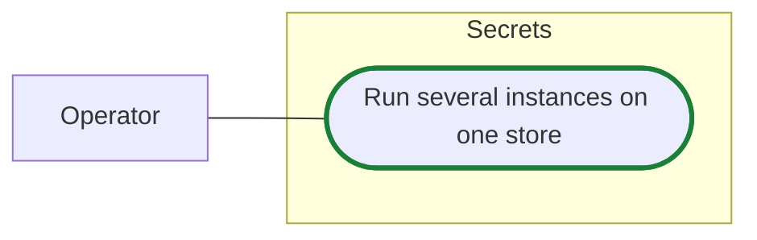
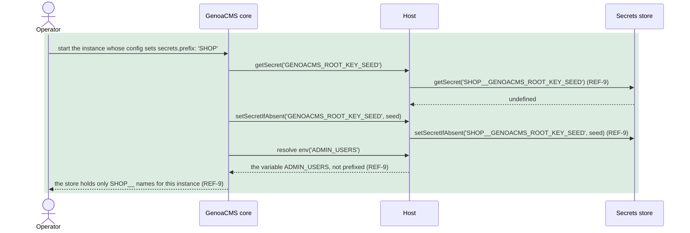

# RFC-0050: Several instances share one secrets store, each under its own prefix

## Summary

Two instances whose secrets providers reach one store, such as one GCP project, one AWS account,
or one environment for `adapter-secrets-env`, read and overwrite each other's secrets. Core's own
secrets have fixed names (`GENOACMS_ROOT_KEY_SEED`, `GENOACMS_SUBORDINATE_KEY_SEED_<keyId>`,
`GENOACMS_KEY_REGISTRY_SEQUENCE`, `GENOACMS_SECURITY_POLICY_SEQUENCE`, `signing.md`), so the
second instance to start takes over the first's root key. Issue #28.

The author decided on 2026-11-26 (`secrets.md` SU12):

1. The config's `secrets.prefix` names the instance in the store (CFG-3, LDR-22).
2. The prefix applies to every key the host gives the store: core's own names and the config's
   `secret()` keys. `env()` variables are never prefixed (REF-9).
3. The stored name is `<prefix>__<key>`. A prefix starts with a letter, has no `__` and does not
   end in `_`, so different prefixes never produce the same name (REF-9, LDR-22).
4. Nothing is migrated. An instance that sets a prefix over existing secrets starts as a new
   instance in the store (SU12).

The host applies it, wrapping the store it constructs (SD8), so no adapter changes.

Amended on 2026-11-26, after the implementation: REF-9 is verified at e2e, so the use case SJ1 and
its scenario SJ1a are added to `secrets.md`, and the e2e test carries SJ1a.

## Files

**Modify or create only:**

| File | Change |
| :-- | :-- |
| `packages/config/src/config.ts` | `secrets: { providers: XP, prefix?: string }`, with a doc comment naming REF-9 |
| `packages/config/src/load/rules.ts` | `invalidSecretsPrefix`, after `secretsProviderCount` in `RULES`, comment `// LDR-22` |
| `packages/config/src/host/prefixedStore.ts` | new: `SECRETS_PREFIX_PATTERN`, `storedSecretName(prefix, key)`, `prefixedStore(adapter, prefix)` |
| `packages/config/src/host/index.ts` | `secrets()` returns `prefixedStore(…)` when `config.secrets.prefix` is a string; `deps` gains `storedName`; exports `storedSecretName` |
| `packages/config/src/host/resolve.ts` | `ResolveDeps.storedName: (key: string) => string \| undefined`; `readSecret`'s `secrets/missing` message by REF-2 |
| `packages/config/test/types/config.test.ts` | `secrets.prefix` is a `string`; `prefix: 1` is a type error |
| `packages/config/package.json` | `fast-check` devDependency, the version core uses |
| `packages/config/src/host/prefixedStore.test.ts` | new, by §Tests |
| `packages/config/src/host/host.test.ts`, `packages/config/src/load/loader.test.ts` | by §Tests |
| `packages/core/genoa.config/e2e.ts` | `secrets.prefix: 'E2E'` |
| `packages/core/e2e/signing.ts` | `readSeed` reads `storedSecretName('E2E', subordinateSeedSecret(keyId))` from the raw store; no assertion changes |
| `packages/core/e2e/signIn.test.ts` | by §Tests |
| `packages/sdk/src/verify/client.ts` | the two doc comments naming `GENOACMS_KEY_REGISTRY_SEQUENCE` add "stored as `<prefix>__GENOACMS_KEY_REGISTRY_SEQUENCE` under an instance prefix" |
| `packages/docs/src/routes/guide/config/secrets/+page.md` | a section `## Several instances on one store`: the option, the stored names, that `env()` is not prefixed, and that setting it on an existing instance starts a new one |
| `.changeset/secrets-prefix.md` | `'@genoacms/config': minor`, the option in one paragraph |

```ts
// packages/config/src/host/prefixedStore.ts
const SECRETS_PREFIX_PATTERN: RegExp   // /^[A-Za-z][A-Za-z0-9]*(_[A-Za-z0-9]+)*$/
function storedSecretName (prefix: string, key: string): string   // `${prefix}__${key}`
function prefixedStore (adapter: SecretsAdapter, prefix: string): SecretsAdapter
```

## Specification

### `architecture/secrets.md`

#### REF-2 · Resolving a provider's options (changed, compatible)

When the host constructs a provider, it resolves each option the descriptor lists in
`secretOptions`, and copies every other option unchanged. An `inline()` option resolves to its value,
never decoded. An `env()` option resolves to the variable of the host's environment, or fails with
`secrets/env-missing: <path> reads <variable>, which is not set`. A `secret()` option resolves to the
store's `getSecret(key)`, or fails, when that is `undefined`, with `secrets/missing: <path> points
at '<key>', which the configured secret store does not hold. Set it before starting GenoaCMS.`<ins>,
which REF-9 extends under an instance prefix</ins>. A listed option present without a reference fails
with `config/bare-secret: <path> is a credential field and holds no reference`. `<path>` is
`<service>.providers.<name>.options.<option>`. The options of one provider are resolved
concurrently.

- Test: `packages/config/src/host/host.test.ts`
- Level: unit

#### REF-9 · An instance prefix (added)

When the config sets `secrets.prefix` to `<prefix>`, the store that `host.secrets()` returns calls
its adapter with `<prefix>__<key>` wherever its caller passes `<key>`, in `getSecret`, `setSecret`,
`setSecretIfAbsent` and `deleteSecret`, and the value passes unchanged. Each call resolves to what
the adapter's call resolves to, and rejects with what it rejects with. A `secret()` reference
resolves through that store (REF-2), and its `secrets/missing` message then ends `It is stored as
'<prefix>__<key>'.` Without `secrets.prefix`, each key reaches the adapter as given. An `env()`
reference is never prefixed. For any two prefixes that differ, no pair of keys gives the same stored
name.

- Test: `packages/config/src/host/prefixedStore.test.ts`, `packages/config/src/host/host.test.ts`, `packages/core/e2e/signIn.test.ts`
- Level: unit, e2e

#### Use case SJ1 and scenario SJ1a (added)

`secrets.md` gains the use case SJ1, *Run several instances on one store* (Operator), and its
scenario SJ1a, *An instance under a prefix keeps its secrets apart*, which names REF-9. The
project's `scenario-levels` is `[e2e]`, so REF-9, verified at e2e, must be named by a scenario.
Found when bringing `secrets.md` to current; added by amendment.





### `architecture/configuration.md`

#### CFG-3 · The config's shape (changed, compatible)

The type's `secrets` line becomes:

```ts
  secrets: { providers: XP, prefix?: string }   // exactly one provider; prefix by REF-9
```

The rest of CFG-3 is unchanged.

#### LDR-22 · The secrets prefix (added)

`secrets.prefix` is absent, or a string of at most 64 characters matching
`^[A-Za-z][A-Za-z0-9]*(_[A-Za-z0-9]+)*$`: it starts with a letter, holds no `__`, and does not end
in `_`. Any other value gives the issue `config/invalid-secrets-prefix` at `secrets.prefix`,
reading `must match ^[A-Za-z][A-Za-z0-9]*(_[A-Za-z0-9]+)*$ and be at most 64 characters`. The
manifest carries it in `config.secrets.prefix` (LDR-17), and the host applies it (`secrets.md`
REF-9).

- Test: `packages/config/src/load/loader.test.ts`
- Level: unit

## Non-goals

- Migrating the secrets of an instance that sets or changes its prefix (SU12): no command copies
  them, and the host reads no unprefixed name as a fallback.
- Prefixing `env()` variables, the `GENOA_*` variables the CLI passes to Vite (`cli.md`), or the
  `GENOACMS_TEST_*` and `GENOACMS_E2E_*` variables of the test suites.
- IAM or other access control per prefix (issue #28's out of scope).
- Isolating storage or databases between instances: buckets and databases are already named per
  instance in the config.
- Forbidding `__` in secret keys (REF-8 is unchanged).
- A CLI command that lists or prints stored names.

## Tests

`packages/config/src/host/prefixedStore.test.ts` (unit), new:

- `REF-9: each method calls the adapter with the prefixed key and passes the value unchanged`:
  given a recording adapter and the prefix `SHOP`, when `getSecret('A')`, `setSecret('A', 'v')`,
  `setSecretIfAbsent('A', 'v')` and `deleteSecret('A')` are called, then the adapter recorded
  `('SHOP__A')`, `('SHOP__A', 'v')`, `('SHOP__A', 'v')` and `('SHOP__A')`.
- `REF-9: each result and each rejection is the adapter's`: given an adapter answering
  `undefined`, `false`, `true` and `false` in turn, then each call resolves to that answer; given one
  that rejects with an error `e`, then each call rejects with `e` itself.
- `REF-9: different prefixes never give one stored name` (property, `fast-check`): for prefixes
  `p ≠ q` generated to match `SECRETS_PREFIX_PATTERN` and keys `k`, `l` generated to match REF-8's
  pattern, including keys that start with `_` or contain `__`, then
  `storedSecretName(p, k) !== storedSecretName(q, l)`.
- `REF-9: a stored name is a portable secret key`: for generated prefixes and keys as above, then
  `isValidSecretKey(storedSecretName(p, k))`.

`packages/config/src/host/host.test.ts` (unit), on a manifest whose secrets store is a recording
in-memory adapter:

- `REF-9: with a prefix, host.secrets() asks the store for the prefixed key`: given
  `secrets.prefix: 'SHOP'` and the store holding `SHOP__X = 'a'` and `X = 'b'`, when
  `(await host.secrets()).getSecret('X')`, then `'a'`.
- `REF-9, REF-2: a secret() option resolves the prefixed key`: given the prefix `SHOP`, a storage
  provider whose credential option is `secret('DB')`, and the store holding `SHOP__DB = 'p'` and
  `DB = 'q'`, when the provider is constructed, then its `create` receives `'p'`.
- `REF-9, REF-2: a missing secret names its stored name`: given the prefix `SHOP` and an empty store,
  then the construction fails with `secrets/missing: storage.providers.<name>.options.credentials
  points at 'DB', which the configured secret store does not hold. Set it before starting GenoaCMS.
  It is stored as 'SHOP__DB'.`
- `REF-9: env() is never prefixed`: given the prefix `SHOP`, an option `env('VAR')`, `VAR = 'v'` in
  the host's environment and `SHOP__VAR` unset, then the option resolves to `'v'`.
- `REF-9: without a prefix, keys reach the store as given`: given no `secrets.prefix`, when
  `getSecret('X')`, then the store recorded `'X'`, and a missing `secret('DB')` fails with REF-2's
  message, without `It is stored as`.

`packages/config/src/load/loader.test.ts` (unit):

- `LDR-22: a prefix of the portable form loads and reaches the manifest`: for `'SHOP'`, `'shop_2'`,
  `'A1_B2'` and a 64-character prefix, then no issue, and `manifest.config.secrets.prefix` is the
  value.
- `LDR-22: an absent prefix loads`: then no issue, and the manifest has no `secrets.prefix`.
- `LDR-22: any other prefix is an issue`: for `''`, `'_A'`, `'A_'`, `'A__B'`, `'1A'`, `'A-B'`, `'Á'`,
  a 65-character prefix, `42` and `null`, then exactly one issue `config/invalid-secrets-prefix` at
  `secrets.prefix` with LDR-22's text.

`packages/core/e2e/signIn.test.ts` (e2e), in its running instance, whose e2e config sets the prefix
`E2E`:

- `SJ1a, REF-9: the instance's own secrets are stored under its prefix, and env() credentials are not`:
  given a user signed in through credentials read with `env()`, then the secrets file holds
  `E2E__GENOACMS_ROOT_KEY_SEED`, `E2E__GENOACMS_KEY_REGISTRY_SEQUENCE` and an
  `E2E__GENOACMS_SUBORDINATE_KEY_SEED_<keyId>` for the key manifest's current key, and no key that
  does not start with `E2E__`.

Existing tests whose doubles change, with no assertion changed: `packages/core/e2e/signing.ts`'s
`readSeed`, used by `collections.test.ts`, `configuration.test.ts` and `securityPolicy.test.ts`.

## Steps

1. Baseline: `pnpm --filter @genoacms/config test`, `pnpm --filter @genoacms/core test`,
   `node scripts/test-level.mjs e2e`, `node docs/tools/check-docs.mjs docs`; record the counts.
2. Tests: written from the Specification and this RFC, those that fail today marked `it.fails`, by
   a session that has not seen the implementation. Commit:
   `test(config): the secrets prefix (RFC-0050)`.
3. Code: the type, the rule, `prefixedStore.ts`, the host, the e2e config and `readSeed`, the SDK's
   comments. Remove the markers and change no assertion. Commit with `commit-subject`.
4. The guide page and the changeset. Commit: `docs(site): several instances on one secrets store`.
5. Run §Verification. Update `secrets.md` (REF-2 and REF-9 current, SU12 and SD8 without **New**,
   `verified`), `configuration.md` (CFG-3, LDR-22 current, `verified`), the Coverage rows of
   `docs/README.md`, and `adapter-gcp/secrets.md`'s *Who overwrites* paragraph, which names the
   secrets by their unprefixed names. Set this RFC to `auditing` with `commits`. Run
   `node docs/tools/map.mjs docs`. Commit: `docs: RFC-0050's statements to current`.
6. Audit REF-9 and LDR-22 (WORKFLOW §6.3). Findings amend this RFC through steps 2 to 5; then
   `implemented` with `audit`.

## Verification

```bash
pnpm --filter @genoacms/config test
# all pass, none marked it.fails; the count is the baseline plus the new tests
pnpm --filter @genoacms/config exec tsc -p test/types
# the prefix types check; prefix: 1 is reported
pnpm --filter @genoacms/core test
# all pass, unchanged count
node scripts/test-level.mjs e2e
# all pass, the REF-9 test among them
node docs/tools/check-docs.mjs docs
# 0 error(s)
```

A falsification audit of REF-9 and LDR-22, by an agent that did not write the code, recorded as a
Verification entry of `secrets.md` and named in `audit`.

## Critique

**Pros**
- Closes issue #28 for every store at once, third-party adapters included. The adapters, their
  contracts and their contract tests do not change.
- One spelling per key everywhere in code and config. Only the stored name carries the prefix,
  so core's names and the signing documents stay as they are.
- The separator rule makes the prefix recoverable from a stored name, so two prefixed instances
  cannot collide, whatever keys they use; a property test checks it.
- An unset prefix is today's behavior, so existing deployments keep their secrets.

**Cons & trade-offs**
- Setting a prefix on a running instance is a new trust anchor: a new root key, and every page,
  component and policy signed before stops verifying until republished. Consumers must take the new
  root public key. That is the cost of SU12's no migration, and the guide must say it before the
  option.
- Anything that reaches the store without the host writes the prefixed name by hand: an operator
  creating a `secret()` in a cloud console, a consumer reading the key manifest's mark
  (`signing.md` VFY-2), the e2e helper. A missed prefix reads as a missing secret.
- `env()` is not prefixed, so two instances in one process environment, or on one platform's shared
  variables, still collide on `env()` names; they must be chosen per instance in each config.
- Development (`adapter-secrets-env`) and production may use different prefixes, or one and not
  the other; nothing checks they agree.
- The 64-character bound is a choice: it keeps the longest core name
  (`GENOACMS_SUBORDINATE_KEY_SEED_` and a key ID) far below GCP's 255-character secret IDs.

**Blindspots & missed edge cases**
- An instance without a prefix shares names with a prefixed one when it uses a `secret()` key that
  contains `__`: an unprefixed `SHOP__DB` is the prefixed instance `SHOP`'s `DB`. REF-8 still
  allows such keys.
- Changing a prefix leaves the old secrets in the store, root seed included, with nothing reading
  them; deleting them is the operator's.
- AWS Secrets Manager names allow `/`, which some operators use as a hierarchy; the portable rule
  keeps the prefix to `_`, so `shop/…` names are not expressible.
- The host's secret cache (REF-5) is keyed by the key as written; it is per host and a host has one
  prefix, so it stays correct, but a future cache shared across hosts would need the stored name.
- `genoa deploy` resolves target options through the same store, so a deployment credential under
  `secret()` is read under the prefix too. That is consistent, and easy to miss when creating it.
