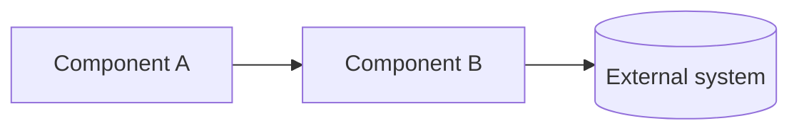

# <Subject>

## Design

### Overview

What the subject is, the components, and how they relate to other documents.

### Documents

| Document | Codes | Covers |
| :-- | :-- | :-- |
| [`<component>.md`](<component>.md) | <CODE> | … |

<!-- Optional: Use cases and Scenarios that span the components, as in templates/architecture.md. -->

### Decisions

| # | Decision | Where |
| :-- | :-- | :-- |

### History

*History.* …

### Register

<!-- Every ID defined in the directory, use cases included; scenarios, as sub-items, are not listed. -->

| ID | Summary | State | Document |
| :-- | :-- | :-- | :-- |

## Specification

None.
