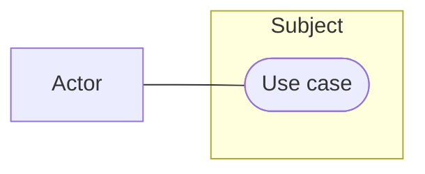
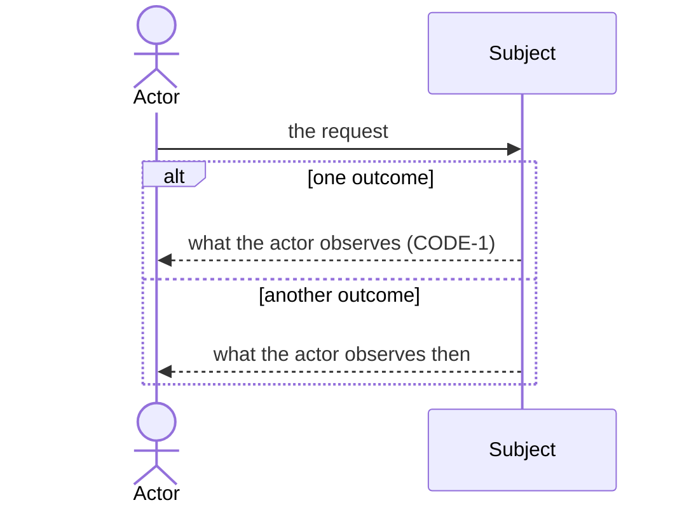

# <Subject>

<!-- In a directory, drop `prefix` from the front matter: the index declares it. -->

## Design

### Role

What this component is for, who uses it, and where its boundaries are.

<!-- Optional: a Mermaid flowchart of the component's parts and dependencies (WORKFLOW §5.4). -->

<!-- Use cases and Scenarios: keep them when users or external systems use this component directly (WORKFLOW §5.4); templates/example-architecture.md shows them filled in. -->

### Use cases

| # | Use case | Actors | Statements |
| :-- | :-- | :-- | :-- |
| 
J1 | <Use case>, a goal of the actor | <Actor> | |

### Scenarios

**
J1a. One way the use case runs, as the actor tells it apart.**

### Decisions

| # | Decision | Where |
| :-- | :-- | :-- |
| 
U1 | A decision the author made. | <CODE>-1 |

**
D1. A design decision, in one sentence.** The statements it produces: <CODE>-1.
*Why:* the reason, and what it rules out.
*Cost:* what it makes harder.

### Findings

| # | Finding | State |
| :-- | :-- | :-- |
| 
F1 | A fact about reality, usually a defect or a constraint, with where it was found. | open |

### History

*History.* Previous states, kept short: what, why, when.

### Verification

What the tests cover, how to run checks that need real services, spikes and falsification audits
(`**
S1, …**`).

## Specification

### <Group>

#### <CODE>-1 · <Short title>

The normative behavior. Plain present tense means MUST; **SHOULD** and **MAY** in capitals mark
weaker requirements.

- Test: `<test file, from the repository root>`
- Level: <levels from docs/README.md, such as unit, e2e>

<!-- Each test that checks this statement carries `<CODE>-1` in its title. -->

