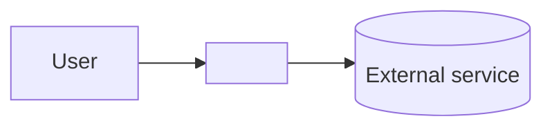

# <Project> documentation

The architecture documents and RFCs of <Project>, maintained under the Spec Workflow
([`WORKFLOW.md`](WORKFLOW.md)): people review specifications, agents write code, and tests connect the
two. Check the documents with `node docs/tools/check-docs.mjs docs`.

## System

<!-- The system: its boundary, components, external systems and main data flows; a subgraph per project in a repository of several. Each documented node links its document with click (WORKFLOW §5.4). -->

## Placement

<!-- Where each artifact runs, and what each instance alone owns there: a diagram with a subgraph per boundary and per instance, or one sentence when there is nothing to draw, such as "Linked into the caller's process; owns nothing." (WORKFLOW §5.4). -->

<!-- Optional: ## Flows, the use cases and scenarios whose components share no index, with `prefix` in the front matter (WORKFLOW §5.4). -->

## Documents

| Document | Prefix | Codes | Subject | Conforms |
| :-- | :-- | :-- | :-- | :-- |
| [`rfcs/`](rfcs/README.md) | — | — | implementation specifications, in implementation order | — |

## Testing and release

<!-- What each test level runs against, and what stops a release: a sentence or a small diagram, linking the document with the runs when they do not fit here (WORKFLOW §5.4). -->

## Coverage

What the Specifications cover, measured against the reproducibility principle (WORKFLOW §1). "None"
means that rebuilding the component would need its code.

| Area | Components | Covered by | State |
| :-- | :-- | :-- | :-- |

## Glossary

The words the statements give a precise meaning, each defined once (WORKFLOW §5.5).

| Term | Meaning |
| :-- | :-- |
