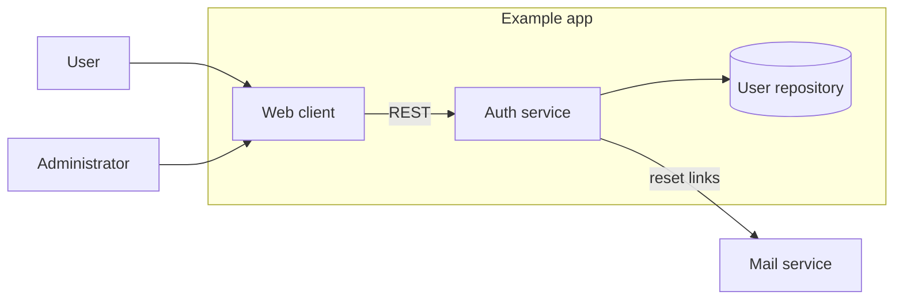
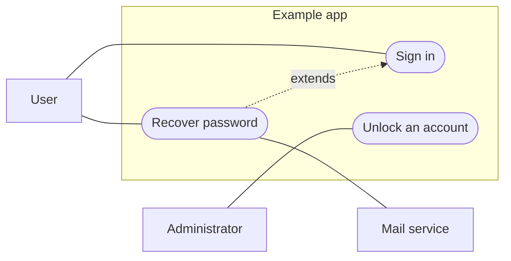
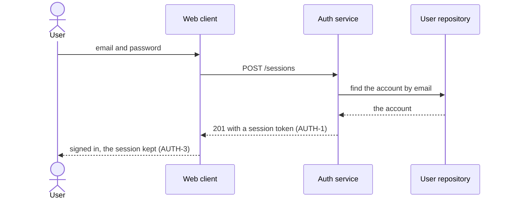
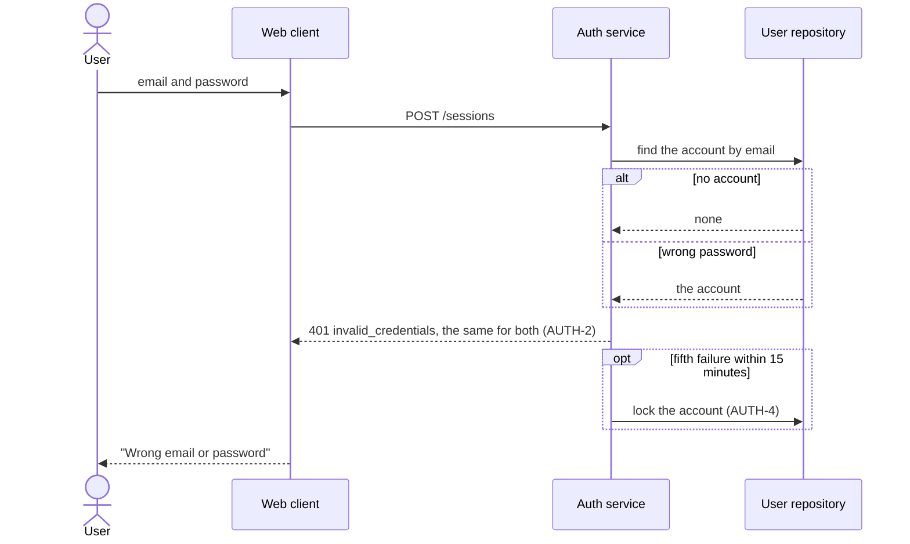
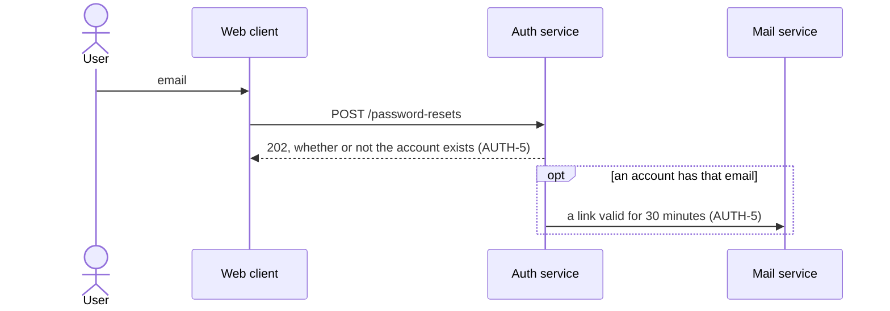

# Sign-in

<!-- A worked example of diagrams, use cases and scenarios (WORKFLOW §5.4), not a skeleton. In a project, the system diagram goes under `## System` in docs/README.md, and a component's Role shows only its own parts; the example keeps both in one file. -->

## Design

### Role

The auth service signs users in, locks an account after repeated failures, and mails password reset
links. The web client calls it over REST. It reads accounts from the user repository, and sends mail
through the mail service.

### Use cases

| # | Use case | Actors | Statements |
| :-- | :-- | :-- | :-- |
| AJ1 | Sign in | User | |
| AJ2 | Recover password | User, Mail service | |
| AJ3 | Unlock an account | Administrator | |

### Scenarios

**AJ1a. Sign in succeeds.**

**AJ1b. The credentials are wrong.**

**AJ2a. A reset link is mailed.**

**AJ3a. An administrator unlocks an account.** AUTH-6. One request and its response: no diagram.

### Decisions

**AD1. Wrong credentials get one answer.** AUTH-2.
*Why:* a different answer for an unknown email would tell an attacker which emails have accounts.
*Cost:* a user who mistyped the email is not told so.

### Findings

None.

### History

None.

### Verification

None.

## Specification

### Sessions

#### AUTH-1 · Valid credentials open a session

`POST /sessions` with the email and password of an unlocked account answers `201` with
`{ "token": <string> }`. The token is valid for 12 hours.

- Test: `tests/auth.unit.test.mjs`, `tests/auth.e2e.test.mjs`
- Level: unit, e2e

#### AUTH-2 · Wrong credentials are indistinguishable

For an unknown email, for a wrong password, and for a locked account, `POST /sessions` answers `401`
with `{ "error": "invalid_credentials" }`.

- Test: `tests/auth.e2e.test.mjs`
- Level: e2e

#### AUTH-3 · The web client keeps the session

The web client keeps the token in an `HttpOnly`, `Secure` cookie, and sends it with every request
until the token expires.

- Test: `tests/auth.e2e.test.mjs`
- Level: e2e

#### AUTH-4 · Five failures lock the account

The fifth `401` for one account within 15 minutes locks the account.

- Test: `tests/auth.unit.test.mjs`
- Level: unit

### Recovery

#### AUTH-5 · A reset link is mailed

`POST /password-resets` with an email answers `202`. When an account has that email, the mail
service receives a reset link for it, valid for 30 minutes.

- Test: unverified (needs the mail service)
- Level: e2e

#### AUTH-6 · An administrator unlocks an account

`POST /accounts/{id}/unlock` by an administrator answers `204`, and clears the account's failures.

- Test: none yet
- Level: e2e
- State: new (no RFC yet)
