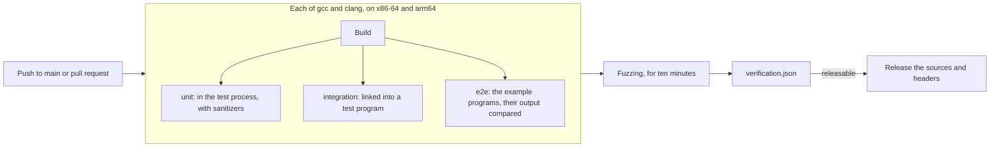

# Ringlog documentation

<!-- A worked example of the index of a project that nothing deploys: Ringlog, a small C library (WORKFLOW §5.4). Not a skeleton. -->

Ringlog is a C library that keeps a log in a fixed block of memory, overwriting its oldest entries.

## System

## Placement

Ringlog is linked into the caller's process, as `libringlog.a` or `libringlog.so`. It owns nothing:
the caller gives it the memory it works in, and it opens no file and starts no thread.

## Documents

| Document | Prefix | Codes | Subject | Conforms |
| :-- | :-- | :-- | :-- | :-- |
| [`architecture/ring.md`](architecture/ring.md) | R | RING | the ring buffer | yes |
| [`rfcs/`](rfcs/README.md) | — | — | implementation specifications, in implementation order | — |

## Testing and release

